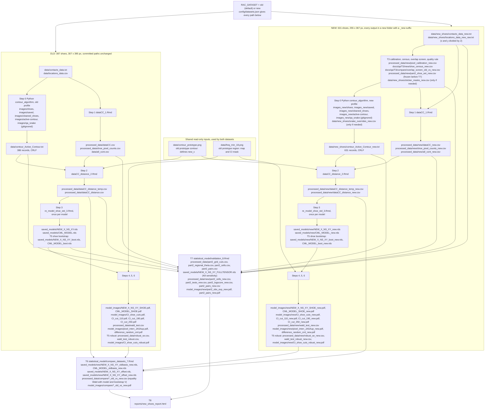

# Plan: Run the full RAC pipeline on the new 631-shoe dataset and validate it
**Date:** 2026-11-05

> **For agentic workers:** this plan is executed task by task (T1..T8) by the workflow, one implementer plus one independent reviewer per task (superpowers:subagent-driven-development; inside a task use superpowers:test-driven-development and superpowers:verification-before-completion). A task is done only when its tests and its **old-regression gate** pass, its results are pasted (real output only) into `docs/tests/<task>-results.md`, `docs/progress/LOG.md` and `docs/decisions.md` are updated, the images it produced were opened and described, and the work is committed. Steps use `- [ ]` checkboxes.

**Goal:** Part 1: run the complete pipeline (snake contour, steps 1-6, old-vs-new comparison) on the 631 new shoes with the same standardization as the 387 old shoes, without changing any old output by a single byte. Part 2: use the new shoes as out-of-sample data to test the old-fitted continuous model (and the 2022 regional model) with Micha's per-shoe area probabilities. The out-of-sample premise does **not** hold as stated: many new shoes look like reprints of old shoes (F25: 67 judged the same shoe and 22 uncertain in T0), so Part 2's primary analysis uses only the new shoes that pass the T3 overlap screen and quality rule (`processed_data/new/part2_shoe_set_new.csv`, frozen before any Part 2 number).

**Revision (2026-11-05, after the T0 reviews):** all review findings were checked with new probes (`docs/qa/T0/probes/t0_review.py`, `t0_review.R`; results in `docs/tests/T0-review-fixes-results.md`) and fixed here: facts F5, F6, F14 corrected, F25-F33 and known issues K8-K10 added, the Part 2 method of section 9 revised (primary analysis named, log score as the primary model comparison, the real 2022 model as comparator, dispersion read as extra-multinomial variation, a within-shoe dependence test, effect sizes), robust variances added to T5/T6, an overlap screen and a quality rule added to T3, engineering fixes in sections 4-5 and T1-T4, T8. Decisions A-024 to A-040, D-012 and D-013.

**Revision 2 (2026-11-06, after the second T0 reviews):** every finding was checked first with new read-only probes (`docs/qa/T0/probes/t0_review2_overlap.py`, `t0_review2_param.R`, `t0_review2_offset.R`, the fixed `t0_review_pairs.py`; results in `docs/tests/T0-review2-fixes-results.md`). Fixed here: the NEW 92 evidence (mislabelled image rank) and F25/F26 rewritten after an order-free, n-calibrated overlap screen and a visual review of 91 NEW shoes (67 judged the same shoe as an OLD shoe, 22 uncertain); facts F34-F39 and known issue K11 added; section 9 propagates the OLD estimation error into every Part 2 test and interval (two-sample shoe bootstrap primary); the T6 offset sign corrected; bootstrap-covariance Wald tests referred to the Hotelling F distribution; the within-shoe test by annuli; engineering fixes in sections 4-5 and T2, T3, T5. Decisions A-041 to A-053; D-008 and D-012 updated.

**Revision 3 (2026-11-06, T1 results):** facts F40-F44 added from the T1 reruns (`docs/tests/T1-baseline-results.md`); K11 completed with its root cause; the T1 steps ticked; T2 step 3 annotated (on WSL the contour gate is Tier B, Tier A only under the Windows venv; the printed Wald W after a WSL refit). Decisions A-054 to A-061.

**Revision 4 (2026-11-06, T1 review fixes):** the scratch deletion guard of section 4.5 now deletes only a direct `mktemp`-shaped child of the validated root (A-062); the T2 order is T2c, T2a, T2d, T2b, T2e, so that the verbatim code's 106 flake8 findings and its fixed output path go first (A-064); the T2 step-3 gate gains a Tier A check of step 3 under the Windows R (`tests/legacy/run_windows_r_step3.sh`, A-065); `test_no_hardcoding` does not scan `tests/`; F40's determinism statement cites independent full reruns instead of checks against the folders Tier B was written from (A-066). Decisions A-062 to A-066; results in `docs/tests/T1-review-fixes-results.md`.

**Revision 5 (2026-11-06, second T1 review fixes):** a live OLD-regression check may compare only outputs that its run regenerated: every runner deletes the outputs of the steps it runs from its copy before the first step, lists them, and fails if one is missing or not newer afterwards; the live checks read that list first (`tests/lib/run_outputs.sh`, `tests/lib/run_manifest.R` and `.py`; section 4.5 and T2 step 3; A-067). Scratch run folders carry a marker and the validated root is read-only (A-068). The `compare_models.R` CLI exits 1 for any field that is not `identical()` (A-069). The Windows R step-3 gate compares with the Tier A blob, not the work-tree model (A-070). venv-wind runs on the self-updating Microsoft Store Python, so F21 and F40 are reconciled and every venv-wind Tier A check logs its interpreter (A-071). `test_no_hardcoding` scans `tests/` except an allowlist of OLD-only files, and the OLD record reader of the helpers lives in `tests/lib/old_records.py` (A-072). Decisions A-067 to A-072.

**Revision 6 (2026-11-06, T2 results):** T2 is done (commits `9adc036` to `cf740fa`; results `docs/tests/T2-profiles-results.md`). Facts F45-F49 added; T2 ticked; the step-2 vectorization of T5 step 2 was done in T2 after its byte-identity proof (A-076), so `RAC_DISTANCE_IMPL` defaults to `vectorized` (section 4.1); `rac_write_csv` writes through a binary connection (A-080); OLD outputs are never overwritten in place (A-075). Decisions A-073 to A-080.

**Architecture:** one dataset profile file (`config/datasets.json`) selected by `RAC_DATASET=old|new` (default `old`) drives both the Python contour code (ported from the thesis repo into `contour_algorithm/`) and the R steps (`statistical_model/`). OLD paths are exactly the committed ones; every NEW artifact lives in a `new` folder and carries a `_new` suffix. Old regression is checked against two baselines: Tier A (files committed at `79247d8`) and Tier B (the unmodified code re-run on this machine in T1).

**Tech stack:** R 4.3.3 (lme4 1.1.38, survival 3.8.3, splines, imager, fields, ggplot2 4.0.0, jsonlite 2.0.0, rmarkdown 2.29); Python 3.12.3 from the thesis venv `/mnt/c/Users/mehes/Documents/repo/master_thesis_forensic_shoeprint/venv/bin/python` (scikit-image 0.25.2, numpy 2.2.6, opencv 4.12.0.88, pandas 2.3.3, pillow 12.0.0, scipy 1.16.3, matplotlib 3.10.7); tests with `python -m unittest` and plain `Rscript` + `stopifnot`; bash runners checked by shellcheck.

**Spec:** `docs/2026-11-05-meeting-micha-new-shoes.md` (requirements), `README.md`, `PIPELINE_DETAILS.md`, `data/new_shoes/README.md`. **Evidence for every number below:** `docs/qa/T0/probes/*.out` (scripts next to them), summarized in `docs/tests/T0-architecture-results.md`. **Decisions:** `docs/decisions.md` (IDs `D-` = people, `A-` = agent calls).

---

## 1. Goal and scope

| Part | What | Done when |
|---|---|---|
| 1 | Snake contours for all 631 new shoes (visually checked one by one), steps 1-6 on the new data (both models), every output under the NEW names of section 5 | NEW outputs committed; QA described; old regression green |
| 1+ | Old vs new comparison: data, contours, `new_x`, coefficients, sigma^2, maps, CIs, Wald tests | `model_images/compare/*_old_vs_new.pdf` + tables; statistics expert review |
| 2 | Micha's validation: OLD-fitted model, random effect 0, on each NEW shoe's own standardized pixels, on the primary shoe set (T3: no confirmed or uncertain reprint of an OLD shoe, quality rule passed); goodness of fit: Naomi's 14 areas on `new_x` and a 10-20 cell grid, with the OLD estimation error propagated (two-sample shoe bootstrap primary, parameter-corrected pooled test; the fixed-surface chi-square only as a labelled descriptive) + effect sizes; model comparison with the 2022 regional model: pixel-level log score (primary) and chi-square on the grid; a within-shoe dependence test; sensitivities (all 631 shoes, OLD CML, full-tensor basis) | Tables and figures of section 9; method review by the statistics expert |
| Report | HTML report for Micha (T8) | `reports/new_shoes_report.html` committed |

Out of scope (open, see `docs/decisions.md`): replacing the old GLMM by a refit with the per-shoe offset (D-008; T6 fits it, with the offset log((px - cases)/100), only as a sensitivity for the sigma^2 comparison, A-037 as corrected by A-044), the sign of the sigma^2 correction (D-009), sole-type classification (meeting open question 6).

## 2. Facts established in T0 (all from real probe output)

| # | Fact | Evidence |
|---|---|---|
| F1 | OLD: 387 shoes, **13,287 RACs** (the CSV has 13,288 lines including the header; the meeting note's "13,288" counts the header), 386 shoes with RACs (127 has none), 38 duplicate RAC pixels, so 13,249 case pixels; committed `dataCC.csv` = 51,849 rows = 13,249 + 386 x 100 | `t0_probe.out` B, `t0_facts.out` K, `t0_probe_R.out` |
| F2 | NEW: 631 shoes, 20,013 RACs, **every shoe has at least one RAC** (min 1, median 24, mean 31.72, max 281); file sorted by shoe, `rac_num` consecutive from 1; `type` values 1-7; 23 duplicate RAC pixels, so **19,990 case pixels** expected | B, K |
| F3 | All three fixed-stride files (`contacts_data.txt` 387 x (307*395+2), `contour_Active_Contour.txt` 386 records, `contacts_data_new.txt` 631 x (255*367+2)) have `\r\n` at every stride and only `0`/`1` | A |
| F4 | `raw / 2` equals the 2023 file's x and y exactly (max abs diff 0) | B |
| F5 | The 2023 `COL/ROW` equal the **generalized legacy mapping** (R `aspix_x/aspix_y` with W=255, H=367, `rel_col_shoe`=150, `rel_row_shoe`=300) for all 20,013 RACs; all in bounds. This shows only that the 2023 processing used the same formula; it is **not** independent evidence that the scale is right (A-032) | K |
| F6 | RACs on contact: OLD legacy mapping in the exact R division form `floor((x + 0.25) / (0.5 / 150))` **0.8478** (0.847821); the multiply form `(x + 0.25) * 300` gives 0.847896 and maps 2 RACs differently (shoe 46 at x = 0.09425, y = 0.2: R (col, row) = (125, 138), multiply (125, 137); shoe 239 at x = -0.07, y = -0.47346: R (175, 340), multiply (174, 340)); for NEW both forms agree on all 20,013 RACs. OLD grid optimum 0.8816 at scale 300 px/unit, x mirrored, y not flipped, offset -0.5 px from legacy. NEW generalized legacy 0.8078; NEW optimum 0.8352 at (sx, sy) = (298, 300) with the same -0.5 px offset; (300, 300) gives 0.8343. Same scale, same mirroring, same half-pixel convention in both datasets | D, K, `t0_review.out` R1 |
| F7 | The R `dataCC` frame mirrors x: corr(x in `locations_data.csv`, x of the RAC's pixel) = -0.999941. Naomi's 14 areas are defined in the unmirrored frame | K |
| F8 | The committed OLD contour **is** the thesis run of 2025-11-13: 386/386 records equal `images/saved/active-contour_all.npy`; the txt was written on Windows (CRLF) at 11:54 | J, `t0_probe_sh.out` |
| F9 | In that run shoe 9 was **not** flipped (`list_matrices[8]` == raw shoe 9; the flip at `create_files_shoes.py:26-30` is dead code), while R flips shoe 9's contact (`dataCC_1.Rmd:83-85`). Known issue K1. Shoe 9 has 2 RACs, both off-contact in either orientation | J, K, F |
| F10 | `data/freq_min_18.png` == thesis `images/saved/freq_min_18.npy` (snake-filled prototype of the superposition >= 18, 32,975 px); `data/contour_prototype.png` == its 4-connected inner boundary (xor 0, 748 px) | J, G |
| F11 | R mask `all_cont.csv` (28,609 px) lies inside `freq_min_18.png`; the stamp sweep removed 1,110 px, the two blobs beside the toe | H, `docs/qa/T0/old_rmask_stamps.png` |
| F12 | NEW superposition: union 36,894 px; >= 8: 6 components (7 px outside the main one); >= 13: 2 (1 px); >= 18 and >= 29: 1 component | H |
| F13 | The legacy stamp sweep with its bound `j < rel_row_shoe` (300) **crashes on NEW dims** ("subscript out of bounds", t = 8 and 13); with bound `col_shoe` = 255 it removes 4 px (t = 8) or 1 px (t = 13) | `t0_probe_R.out` |
| F14 | `abs(dy) < 0.01` in step 2 (data y after a real `write.csv`/`read.csv` round trip, contour y in memory) includes all 2-row pairs, no 4-row pair, and of the 392 three-row pairs **160 when the data row is above the contour row and 161 when it is below** (321 of 784 ordered pairs). On the NEW 367-row lattice: 152 and 151 of 364. The round trip changes 263 of the 395 y values (245 of 367) and is idempotent. A vectorized version must reproduce the float comparison in both directions, not an integer row window (A-039) | `t0_probe_R.out` |
| F15 | `get_snake_image()` (`np.zeros((W, H))` + `cv2.transpose`) is orientation-correct for both 307x395 and 255x367: a double swap, not a bug | M |
| F16 | Geometry (0-indexed px): OLD >= 18 rows 44-347, cols 102-219, centroid (194.4, 157.9); NEW >= 18 rows 27-335, cols 74-196, centroid (180.5, 132.2). Init ellipses: OLD rows 38-362, cols 65-245; NEW (2023 values) rows 23-347, cols 33-223: similar margins | L |
| F17 | Left/right score (flipped vs original correlation with the mean shoe): OLD shoe 9 = 1.164 (a left shoe); NEW: no shoe above 1 (max 0.989) | E |
| F18 | Committed GLMM (writer R 4.4.3): nobs 51,849, 386 groups, **25 fixed effects** (24 spatial), conv 0, sigma^2 = 0.9597791; manual Wald W = 428.6933, df 24, p = 9.43e-76. Committed CML (writer R 4.3.3): 24 coefficients | `t0_probe_R.out` |
| F19 | Committed EOLs: `dataCC.csv`, `shoe_pixel_counts.csv`, `all_cont.csv` CRLF; `dataCC_distance.csv`, `dataCC_distance_temp.csv` LF. The 2026-03-16 "regeneration" of `dataCC.csv` and `all_cont.csv` changed only the EOL | `t0_probe_sh.out` |
| F20 | All committed PDFs: Producer R 4.4.3, embedded CreationDate, so they cannot be byte-compared on this machine | `t0_probe_sh.out` |
| F21 | Missing here: `car`, `hglm`, `testthat`, `sandwich`, `pdftools`, `magick` (R); `pdftoppm`, `gs`, `magick` (system). Present: `png`, `jsonlite`, `digest`, `boot` (R); flake8 7.3.0, shellcheck 0.10.0. The Windows `venv-wind` has the same package versions; its `pyvenv.cfg` records Python 3.13.9, the version at its creation on 2025-11-12, but its base interpreter is the self-updating Microsoft Store Python 3.13, which ran 3.13.14 in T1 (F40, A-071) | `t0_probe_R.out`, `t0_probe_sh.out` |
| F22 | Thesis contour code at HEAD `109f30a`; the working tree differs from it only by CRLF | `t0_probe_sh.out` |
| F23 | OLD: `MEAN_OFFSET` = -4.614310784; knots `new_x` (-0.0663992, 0.0219597, 0.1047822), y (-0.325, -0.178333, 0.095, 0.208333, 0.321667); range `new_x` [-0.191667, 0.241667], y [-0.501667, 0.511667] | `t0_probe_R.out` |
| F24 | Contact px per shoe p5/p50/p95: OLD 6,245/10,266/16,146; NEW 4,876/8,924/14,286; smallest NEW: shoe 428 (1,343 px), 163 (1,376), 8 (2,016) | C, L |
| F25 | **Many NEW shoes are reprints of OLD shoes** (the meeting's "no overlap" is contradicted). The first T0 screen (`sym` = min(share of the NEW RACs, share of the OLD RACs with a partner within 1 px) at the best rigid shift, Hough vote within +-8 px, threshold 0.30 and margin 0.15; plus one shift per half, threshold 0.400) gave 34 candidates (1,309 RACs). The second review showed that this rule is not calibrated by the number of RACs n (the NEW-NEW null maximum of the best `sym` falls from 0.286 for n in [5, 10) to 0.120 for n >= 80) and misses heavy reprints, whose NEW print has 3-4 times the RACs of the OLD one. Order-free statistics (`t0_review2_overlap.py`: the T0 shifts of both argument orders, exactly symmetric; T0's values reproduced for all 631 NEW shoes; the T0 value of 2,800 of the 243,566 NEW-OLD pairs depended on the argument order) with pair-level thresholds = the NEW-NEW maximum within strata of (n bin, n bin), strict >, >= 3 matched, for five statistics (rigid and two-half shares, rigid and two-half matched counts, max share): 121 NEW shoes flagged by at least one statistic, 59 by all five. The same thresholds flag 3-6 OLD-OLD pairs per statistic (2 of them the K10 duplicates), and chance matches against OLD shoes run slightly above NEW-NEW ones (among dissimilar images, r < 0.80, the best matched count per NEW shoe against 386 OLD partners exceeds that against 386 NEW partners by 1-3 RACs at p90 for n >= 10 and by 1 at the median for n >= 40), so single flags include chance hits. Visual review of 91 NEW shoes (the 34, the reviewer's 8 heavy candidates, every shoe flagged by >= 2 statistics, and 7 single-statistic shoes whose partner is a top-3 image; `docs/qa/T0/compare/overlap_pairs/`, `overlap_pairs2/`; verdicts and notes in `docs/qa/T0/compare/overlap_verdicts_t0_old_vs_new.csv`): **67 same shoe (3,158 RACs, 15.8% of all NEW RACs), 22 uncertain (755 RACs), 2 different**; 31 single-statistic shoes (1,486 RACs) are not reviewed yet (T3). Structural evidence that does not depend on the visual review: among the 121 NEW shoes flagged by the screen, 57 pairs of consecutive NEW ids occur and 16 of them map onto consecutive OLD ids (0.30 expected if the partners were unrelated, 2/386 per pair); among the 59 shoes flagged by all five statistics, 9 of 25 (0.13 expected). Consecutive NEW shoes do not match each other (matched counts at chance level in the 21 such pairs checked), so they are two soles of one wearer, not duplicates inside NEW. NEW 92 was mislabelled in T0 (its two-half partner OLD 103 has image r 0.851, rank 5; r 0.497, rank 226 belonged to the rigid partner OLD 63): same design, RAC match at chance level, re-judged uncertain. The T0 control NEW 354 is probably a reprint of OLD 219 (its consecutive partner 355 matches OLD 220), so it is not a valid different-shoe control; NEW 57 vs OLD 196 still is one (57 matches OLD 177). 47 NEW shoes (120 RACs) have < 5 RACs and cannot be screened by RACs. Many OLD prints of these pairs carry a sticker outside the sole (a bar or rectangle beside the toe on OLD 7, 12, 24, 29, 55, 56, 66, 94, 110, 113, 116, 121, 160, 239, 264, 267, 299, 371; a square below the heel on 194); none was seen on their NEW prints | `t0_review.out` R5, R7, R8; `t0_review_pairs.out`; `t0_review2_overlap.out` |
| F26 | Within-dataset screens (same method): NEW-NEW best sym per shoe p99 0.222, max 0.286 (no duplicate inside NEW); OLD-OLD max 0.400 (OLD 277-236; two-half 0.486) and 0.356 (278-237; 0.384), a consecutive pair matching a consecutive pair. Looked at (`docs/qa/T0/old/pair_old_236_277.png`, `pair_old_237_278.png`): the same chevron boot design and outline, about 24-26 RACs matched over forefoot and heel: very likely one pair of shoes printed twice inside OLD (K10). 15 NEW shoes have an image partner at r >= 0.95; 13 of these partners have consecutive ids and unrelated RACs (sym <= 0.068): two shoes of one wearer, not duplicates. The order-free statistics give the same maxima (NEW-NEW 0.286 and two-half 0.400; OLD-OLD 0.400 and 0.486). The NEW-NEW pairs with the most matched RACs are consecutive heavy shoes of one design (72-73: 26 matched with 281 and 267 RACs, image r 0.937; 60-61: 17); looked at (`docs/qa/T0/new/pair_new_72_73_new.png`, `pair_new_60_61_new.png`): different soles with scattered coincidences, the per-half shifts finding other coincidences than the rigid one, as chance does at that density; a legitimate part of the null. The n-calibrated thresholds flag two more OLD-OLD pairs with two statistics (`docs/qa/T0/old/pair_old_38_299.png`, `pair_old_103_315.png`): 38-299 (10 matched, same round-dot design, scattered: uncertain, a possible further duplicate inside OLD) and 103-315 (different designs, 2-3 matched with 4 RACs: a small-n false positive) | `t0_review.out` R6, R8; `t0_review2_overlap.out` B, D, E |
| F27 | Per-shoe RAC on-contact rate (R mapping) p5/p10/p25/p50: OLD 0.584/0.643/0.778/0.880, NEW 0.500/0.571/0.718/0.829. Below 0.5: OLD 6 shoes (77 RACs), NEW 23 (514); below 0.7: OLD 55 (9.5% of RACs), NEW 135 (16.3%); NEW below the OLD p5: 66 shoes (1,403 RACs). With >= 10 RACs and < 0.6 under every flip and every shift up to 4 px: OLD 2 (35, 153), NEW 5 (112, 177, 286, 420, 498; 280 RACs). Shift gain > 0.2: OLD 35 of 302 shoes, NEW 62 of 517 (largest: NEW 599, 0.222 -> 0.911). No shoe gains > 0.15 from a flip (no left shoes, as F17). Looked at (`docs/qa/T0/new/low_contact_shoes_new.png`): 112 heel not printed but about 30 RACs there; 177 and 498 RAC clusters in the unprinted arch; 286 very faint; 420 partial spiral-textured print; 599 a different image type (thick rim band and dot texture, RACs 1-4 px off the dots). Top 10% of shoes hold 36.4% (OLD) and 31.8% (NEW) of the RACs | `t0_review.out` R3, R4, R7 |
| F28 | K8 (formula `ns(new_x, 3 knots):ns(y, 5 knots)`, no main effects): the rebuilt design matrix equals `getME(X)` (max diff 0); both `ns` bases are 0 at their left boundary knot, so eta = intercept = -2.271582 at every point of the edge new_x = -0.1916667 and of the heel edge y = -0.5016667, while the opposite edges vary (new_x = max: -2.27 to -1.08; y = max: -2.27 to -3.61). Fitted eta over `dataCC` p1/p50/p99 = -2.238/-1.491/-1.166; rows within 0.03 of the new_x edge: 200 (37 cases), eta median -1.969; of the heel edge: 569 (89 cases), median -2.146. The full tensor (main effects + interaction) has 35 fixed effects | `t0_review_R.out` S1 |
| F29 | Variance under dependence: `survival` refuses a robust variance for the exact CML ("robust variance plus the exact method is not supported") and has no score residuals for it; an exact refit here (R 4.3.3, from the committed `dataCC_distance.csv`) takes 189 s and its coefficients, `vcov` and `loglik` are all `identical()` to the committed CML. Efron ties + `cluster(shoe)`: 1.9 s, coefficients up to 0.589 from the exact fit, robust/model SE ratio min 0.999, median 1.132, max 1.373; Wald (all 24 = 0) 394.20 model-based vs 234.41 cluster-robust; committed exact CML model-based W = 420.67 | `t0_review_R.out` S4, `t0_review_cml.out` |
| F30 | The calibration criterion is flat in the x scale and sharp in the y scale (best offset per scale): NEW x 296-302 within 0.0024 of the optimum (298), y 298 and 302 cost 0.0137 and 0.0055; OLD x 296-304 within 0.0041, y 298 costs 0.0233. The mean distance from each RAC to the nearest contact pixel has the same shape (NEW x 296: +0.0006 px, y 298: +0.0156 px), so it is not sharper | `t0_review.out` R2 |
| F31 | Toy checks of section 9: a regional theta fitted (Poisson GLM, shoe + area + offset) on the partition that the test uses gives O_k = E_k in every cell (max diff 1.7e-11, X^2 = 7e-24); with the real NEW n_i, K = 15, independent multinomials with shoe-specific pi_i: mean X^2 13.43, exact E[X^2] = 13.55 < K - 1 = 14 (phi_0 = 0.968); the same data scored with a common pi: phi = 3.44 (heterogeneity alone); clumped RACs with a common pi: phi = 1.84 (dependence alone). These phi values illustrate the mechanisms under arbitrary settings (Dirichlet alpha 30; clumps of 1 + Poisson(0.5)); they are not magnitudes to expect (A-051) | `t0_review_R.out` S2, S3 |
| F32 | var(log(100/px)): OLD committed cleaned counts 0.0978; raw contact OLD 0.0954, NEW 0.1210. The exact log control sampling fraction log(100/(px - cases)) (a refit uses its negative as offset, F35) differs from log(100/px) by up to 0.0335 (OLD shoe 385, `dataCC` code 384: 9,321 px, 307 cases) | `t0_review_R.out` S5 |
| F33 | `Sys.getenv("RAC_DATASET", "old")` (R) and `os.environ.get("RAC_DATASET", "old")` (Python) return `""`, not the default, when the variable is set but empty | `t0_review_R.out` S6, results doc |
| F34 | **Part 2 expected counts carry the OLD estimation error.** E~_k depends on beta_old, estimated from about as many RACs as NEW has. Delta method on the committed GLMM (reviewer probe A, re-run identical; 15-cell grid, controls weighted by (px - cases)/100 as the pixel proxy, model-based vcov): per-cell Var(E~_k due to beta_old) / multinomial Var(O_k) median 1.12, max 1.28 at N = 13,249; so a correct model is rejected by the nominal 5% fixed-E pooled test with probability 0.80 at N_new = 18,000 (E[X^2] = 34.9, not about 14), 0.88 with V x 1.132^2, 0.046 without the parameter term. Independent toy (`t0_review2_param.R` P1: the real n_i of both datasets, K = 15, shoe-specific contact shares, a cell model fitted on OLD by its conditional multinomial MLE, 400 replicates, B = 199): rejection at nominal 5% of the fixed-E test 0.787, the NEW-only shoe bootstrap 0.795, a multinomial Wald without the parameter term 0.812, a Wald with the parameter term 0.045, a two-sample (OLD refit + NEW resample) shoe bootstrap 0.050; with between-shoe heterogeneity (Dirichlet 100) 0.968, 0.787, 0.968, 0.470 and 0.035 | `t0_review2_param.out` P1; results doc (probe A) |
| F35 | **Offset of a GLMM refit.** All RAC pixels of shoe i are cases and 100 controls are drawn from its px_i - cases_i other contact pixels (fraction f_i = 100 / (px_i - cases_i)), so logit P(case given sampled) = logit p + log(1 / f_i) and a refit needs `offset(log((px - cases) / 100))`; the plan had the opposite sign. On the committed OLD data (`t0_review2_offset.R`): the corrected refit has intercept -6.883741 against the predicted no-offset intercept + mean(log(100 / (px - cases))) = -6.882487, spatial coefficients within 0.0184 of the no-offset fit, and sigma^2 0.9793, **above** the no-offset 0.9598 (the shoe effect correlates -0.18 with log(1 / f): larger prints have a lower per-pixel intensity), so "sigma^2 below 0.96" is not a valid test; the plan's sign fails to converge (PIRLS step-halving error, also from the implied starting values). Simulation (reviewer probe B, re-run identical; 300 shoes, true sigma^2 0.64, intercept -6.20): no offset sigma^2 0.72; plan's sign 1.05 and intercept +2.81; corrected 0.61 and -6.20 | `t0_review2_offset.out`; results doc (probe B) |
| F36 | **Wald tests with a bootstrap covariance** (B draws, p = 24): E[W] = p (B - 1) / (B - p - 2) = 27.45 at B = 200 (inverse-Wishart); rejection at nominal 5% with chi^2_24: 0.142 (B = 200), 0.062 (B = 1,000); with the Hotelling reference W (B - p) / (p (B - 1)) ~ F(p, B - p): 0.045 and 0.049. Equality test with V1 + V2 from separate draws and chi^2_24: 0.097 (0.090 in the reviewer's run with V1 = V2); with one covariance of paired difference draws and F(p, B - p): 0.0507 | `t0_review2_param.out` P3; results doc (probe C, re-run identical) |
| F37 | **GLMM refit on this machine (T1 lead).** The committed call refitted with R 4.3.3 and lme4 1.1.38 (245.8 s; 5 GLMM fits in this pass took 231-281 s): logLik -25819.2839 (equal to 4 decimals), largest absolute fixef difference 0.000767 (relative 0.0019), sigma^2 0.9597959 vs 0.9597791, manual Wald W = 427.7804 vs 428.6933, SEs differ by up to 12.1%. The largest vcov difference (24.8% of the largest element) equals the committed model's own difference between `vcov(use.hessian = TRUE)` (finite-difference Hessian, the default) and `vcov(use.hessian = FALSE)` (RX), so T1 must compare vcov computed the same way before concluding (K11) | `t0_review2_offset.out` |
| F38 | **Within-shoe RAC pairs at small distances** (reviewer probe F, re-run identical; unordered pairs against uniform placement on each shoe's own contact pixels, observed/expected): OLD r <= 1 px 1.045, annuli (2, 4] 1.756, (4, 8] 1.564, (8, 16] 1.277, (16, 32] 1.138; NEW r <= 1 0.629, r <= 2 0.932, (2, 4] 1.611, (4, 8] 1.448, (8, 16] 1.177, (16, 32] 1.037: short-range inhibition below about 2 px (RAC extent, marking resolution) and an excess at 2-8 px. The top 10% of shoes by RAC count hold 68.7% (OLD) and 62.4% (NEW) of the within-shoe pairs | results doc (probe F, annuli from its cumulative counts, pair shares) |
| F39 | **Dispersion under a common misfit** (`t0_review2_param.R` P2: real NEW n_i, model known, 200 replicates, B = 200): independence phi 0.966 (bootstrap residuals centred on the model) and 0.965 (the model minus each shoe's share of the pooled misfit) vs phi_0 0.968; a common misfit with mean X^2 207: 1.008 vs 0.987; between-shoe heterogeneity (Dirichlet 100): 1.543 vs 1.538; var(n)/mean(n) is 29.8 (NEW) and 41.3 (OLD). The misfit leaks into phi, but little, and the second centring halves the leak | `t0_review2_param.out` P2 |
| F40 | **The committed OLD contour is a Windows result.** The verbatim thesis code reproduces all 386 records under the thesis Windows venv (venv-wind: numpy 2.2.6, scipy 1.16.3, scikit-image 0.25.2 on the Microsoft Store Python 3.13; in T1 and its reviews that was Python 3.13.14, Store package 3.13.3824.0; `pyvenv.cfg` records 3.13.9 from the venv's creation on 2025-11-12, one day before the committed contour was written, and which patch level wrote it is not recorded; the base updates itself, so every venv-wind Tier A check logs its interpreter, A-071). The reproducibility reviewer's end-to-end step 0 under venv-wind (raw contacts to contour, `<scratch>/rv2_t1/winchain_5CNsNh`, LOG 2026-11-06 03:08) wrote the committed contour byte for byte. The full legacy run on WSL (Python 3.12.3, the same package versions, the venv copied to the Linux filesystem) reproduces 356 records; 30 differ (19,027 px; per record a mean distance to the committed contour of at most 1.50 px, a maximum of at most 8.94 px). Each platform is deterministic: on WSL three full runs that do not depend on each other (the T1 Tier B run, the reproducibility reviewer's run, the T1 review-fix run) wrote the same contour (sha256 `d43fda7e...`) and the same 1,556 intermediates; on Windows the 386-shoe snake run reproduces the committed records (A-066). The differences are mostly one-pixel offsets of the outline; for a few shoes the snake converges differently in a concavity (the arch of shoes 21 and 11) or at the toe (11, 176), by up to 8-9 px (`docs/qa/T1/old/contour_platform_diff_old.png`). Everything before the snake (shoe matrices, superposition, prototype, cleaned shoes, extreme-value contours) is identical in bytes or pixels. Mechanism: the float snakes of the two platforms differ by about 1e-8 px, and `np.int32` truncation in `cv2.polylines` plus the 2,500 iterations amplify that for some shoes | T1 results 4 |
| F41 | PNG bytes differ across platforms while the pixels are identical: Windows Pillow 12.0.0 ("1.3.1.zlib-ng") re-encodes the committed `freq_min_18.png` pixels to its exact 767 bytes, Linux Pillow 12.0.0 ("1.3", zlib-ng) to 807 bytes | T1 results 4.2 |
| F42 | **The committed GLMM is reproduced bit for bit by the Windows R 4.4.3 with lme4 1.1-37 and Matrix 1.7-2** (fixef, both vcovs, theta, logLik, the stored 26 x 26 Hessian, `u`; refit 548 s). On WSL (R 4.3.3, lme4 1.1.38, Matrix 1.6.5) two independent refits are `identical()` to each other, differ from the committed model by at most 7.7e-4 in fixef (sigma^2 0.95979590 vs 0.95977909), and store no Hessian: lme4 1.1-38 skips derivatives when nobs > `check.conv.nobsmax` = 10,000 (its NEWS), so `vcov()` uses RX and W = 427.7804 (committed: 428.6933 with its Hessian vcov, 427.7674 with RX; the RX vcovs of the two platforms agree to 8.5e-6). A WSL refit with `calc.derivs = TRUE` has the same fixef and W = 431.19: the finite-difference Hessian vcov is numerically fragile here. The CML refit is `identical()` to the committed CML in every field | T1 results 5 |
| F43 | R steps on WSL from the committed tree: step-1 CSVs equal Tier A after LF -> CRLF (R on Linux writes LF), step-2 CSVs byte-identical, every knit exits 0. Times (s): step 1 141.8, step 2 1133.8, GLMM 281-305, CML 228-230, step 4 14-17 per model, step 5 30-32, step 6 21-23. Plotted matrices, committed vs WSL refit: GLMM map max relative difference 8.9e-5, CML map 8.3e-6; GLMM CI band widths at rows 110, 190, 250 within 0.986-1.007 of the committed ones | T1 results 5 |
| F44 | Manual Wald = car: the verbatim step-5 `linearHypothesis` chunk (Windows R 4.4.3, car 3.1-3) gives Chisq 428.6933350010699 on the committed GLMM, `wald_all_spatial()` 428.69333500107194 (relative difference 4.8e-15). Legacy Python run on WSL: 509 s wall (snakes 5 min 39 s, cleaning and plotly HTML 1 min 11 s), 3.6 GB of plotly HTML | T1 results 4, 5 |
| F45 | **The ported step 0 reproduces both baselines.** The profile-driven `contour_algorithm` with the OLD profile writes, on WSL, the Tier B contour (CRLF sha256 `e18d50df...`) and all 1,556 Tier B intermediates (378.6 s on an idle machine: create 2.6 s, contour 20.3 s, snake 353.2 s; the legacy run took 509 s with plotly); under venv-wind (Python 3.13.14), from the raw contacts, the committed contour (`ca8a07f2...`, Tier A), and its `active-contour_all.npy` equals the thesis run of 2025-11-13 byte for byte. The OLD gallery of T1 is reproduced byte for byte on both platforms | T2 results 3, 7.3 |
| F46 | `write.csv` to a file name writes in text mode: on Windows R each `\n` becomes `\r\n` (the profile's `\r\n` would become `\r\r\n`); a binary connection writes the requested line ending on both platforms and the same bytes as a file name on Linux. Through `rac_write_csv` the refactored step 1 writes the committed CRLF CSVs byte for byte on WSL and under the Windows R 4.4.3 | T2 results 4.1, 5, 7.4 |
| F47 | **Vectorized step 2 is byte-identical on OLD**: both CSVs have the Tier A sha256 in 51.4 s (the legacy loops took 1,134-1,387 s in T1); the legacy chunks of the Rmd and `R/distances.R` give `identical()` values on 406 OLD rows, and the F14 window counts hold for both lattices | T2 results 6 |
| F48 | The refactored step 3 (reading the profile) reproduces the committed GLMM under the Windows R 4.4.3 / lme4 1.1-37 in 27 of 27 fields; step 5 on the committed models gives W = 428.693335001072 (vcov: the stored Hessian), W_rx = 427.767419273715, df 24, p 9.43e-76; with car (Windows R) `W_car` = 428.69333500107 | T2 results 5, 7.2 |
| F49 | cv2's thick polyline is not symmetric under transposition: the snake image of `get_snake_image` contains the direct (H, W) drawing plus a fringe of at most 1 px (1,625 vs 1,445 px for a test segment); the double swap itself is correct for both frames (F15) | T2 results 3.3 |

**Known issues of the OLD analysis (kept as they are for the regression, reported, not fixed):** K1 shoe 9 contour unflipped vs flipped contact (F9). K2 GLMM fitted without the per-shoe offset (meeting 8.1). K3 `exp(-sigma^2/2)` (meeting 8.2, ask Naomi). K4 `MEAN_OFFSET` is a mean of logs (meeting 8.3). K5 legacy `aspix` sits about half a pixel from the on-contact optimum (F6). K6 `PIPELINE_DETAILS.md` errors: 25 fixed effects, not 36; `dataCC.csv` has 51,849 rows, not ~8,000; `freq_min_18.png` is the snake-filled >= 18 superposition, not ">= 8 shoes". K7 `processed_data/dataCC_distance_part4.csv` has another schema and no current code writes it (stale; never regenerate, never delete). K8 the model formula `ns(new_x, 3 knots):ns(y, 5 knots)` has no main effects and both bases vanish at their left boundary knot, so the fitted log-odds is pinned to the intercept (-2.271582) along the whole edge new_x = -0.1917 and the whole heel edge y = -0.5017, while the opposite edges are free: a left-right and toe-heel asymmetric restriction that can drive Part 2 misfit and T6 map differences near those edges (F28; checked in T5 and T7, sensitivity refit with the full tensor in T7). K9 every CI and Wald test uses model-based variances that assume RACs independent given the shoe effect (meeting 8.5); a cluster-robust check on the CML gives SE ratios up to 1.37 and W 394 -> 234 (F29; robust variances in T5/T6). K10 OLD 236/237 and 277/278 are very likely one pair of shoes printed twice (F26: the images agree), so 2 of the 386 OLD shoes are counted twice (T3 records it; the OLD analysis is kept as is and the duplication is reported); OLD 38-299 is a weaker, uncertain candidate (F26). K11 the committed GLMM's `vcov` is the finite-difference-Hessian estimate, which differs from the RX-based one by up to 24.8% of the largest element; a local refit's SEs differ by up to 12.1% and its manual Wald is 427.78 instead of 428.69 (F37): the step-5 CIs and the Wald test depend on this numerical choice (T1 checks it; the T5 bootstrap variance does not depend on it). **T1 (F42, A-055):** the committed Hessian comes from lme4 1.1-37 on Windows; lme4 1.1-38 on WSL stores none (nobs > 10,000), so a WSL refit uses the RX vcov by default (W 427.78). The RX vcov is stable across platforms, the Hessian one is not (W 428.69 and 431.19 for the same data); T5/T6 state the vcov method and use the same one for both datasets (proposed in A-055).

## 3. Big picture

## 4. Dataset-profile architecture

### 4.1 Selection and the profile file
- `RAC_DATASET` (environment variable) = `old` (default when unset or empty) or `new`; any other value is an error in both languages. Read by `contour_algorithm/profiles.py` and `statistical_model/R/profile.R`. Both readers map `""` to `old` **explicitly, before validating**, because `Sys.getenv("RAC_DATASET", "old")` and `os.environ.get("RAC_DATASET", "old")` return `""` for a set-but-empty variable (F33, A-033). The same rule holds for **every** `RAC_*` variable (A-049): both languages read them through one helper (`rac_env(name, default)` in `R/profile.R`, `profiles.env(name, default)` in Python) that returns the default when the variable is unset **or** empty; `RAC_SCRATCH` has no default, so unset or empty is an error (A-034).
- `RAC_PROFILE_FILE` (tests only) = path of an alternative profile file with the same schema (default `config/datasets.json`); the dataset keys are still `old` and `new`. It lets the sentinel tests run the real code on tiny fixtures (A-035). Production entry points refuse it: `tools/run_pipeline.sh`, `tests/regress_old.sh`, the `tests/e2e/*.sh` scripts and `python -m contour_algorithm.main` exit with an error when it is set and non-empty, so a fixture profile can never drive a real run (A-049); only the unit tests set it, and they unset it on exit.
- Both read the **same** file `config/datasets.json` (decision A-003): one source of truth for dimensions, skip lists, thresholds and paths. R reads it with `jsonlite::fromJSON(simplifyVector = TRUE)` and coerces every number with `as.numeric()`, so the old values are doubles exactly like the legacy literals.
- Shoe ids are 1-based everywhere in the JSON and in CSV outputs. Image file names keep the legacy 0-based index (`im0.png` is shoe 1) for both datasets (A-018); QA tiles are labelled with the 1-based shoe id.
- `RAC_MODEL_FEATURE` = `NEW_X_NS_XY` (default, same as `config.R` today) or `CML_MODEL` selects the model for steps 3 and 4, so nobody edits `config.R` to switch models; empty means the default (A-049).
- `RAC_DISTANCE_IMPL` = `legacy` or `vectorized` (step 2; default `legacy` until T5 proves byte identity on OLD, then `vectorized`, A-016); empty means the default (A-049). *(T2: proved in T2 and switched, default `vectorized`, A-076.)*

### 4.2 Frames
- **Data frame:** the dataset's own pixel grid (`col_shoe` x `row_shoe`). Pixel (c, r), 1-based, has coordinates x = (c - col_shoe/2) / 300, y = -(r - row_shoe/2) / 300, i.e. 1 px = 1/300 coordinate unit on both axes (legacy `rel_Y_cord / rel_col_shoe`). x is mirrored with respect to the location files (F7).
- **Prototype (map) frame:** the old 307 x 395 grid of `data/contour_prototype.png` and `data/freq_min_18.png`. Used by step 2 for `distance_shape` and by steps 4-6 for maps, CI cuts (rows 110, 190, 250), crops (`sub = 40`, `xlim = c(100, 220)`) for **both** datasets (A-006). In the legacy Rmds the same `col_shoe/row_shoe` serve both frames; the refactor separates them (`P$col_shoe` vs `P$prototype$col_shoe`). For OLD the values coincide, so the outputs cannot change.

### 4.3 Profile values

| Field (JSON path) | OLD | NEW | Who sets NEW |
|---|---|---|---|
| `dataset`, `suffix` | `old`, `""` | `new`, `"_new"` | T2 |
| `col_shoe`, `row_shoe` | 307, 395 | 255, 367 | T2 (F3) |
| `num_shoe` | 387 | 631 | T2 |
| `shoes_without_racs` (1-based; contour has no record for them) | [127] | [] | T2, asserted against the locations at load (F2) |
| `excluded_shoes` (1-based; removed from every per-shoe step by a recorded decision, e.g. no acceptable contour) | [] | [] (T4 may add, A-031) | T4 by decision |
| `coords.divisor` | 1 | 2 | T2 (F4) |
| `coords.rel_col_shoe`, `rel_row_shoe`, `rel_x_cord`, `rel_Y_cord` (pixel scale 300 px/unit) | 150, 300, 0.25, 0.5 | 150, 300, 0.25, 0.5 (provisional) | T3 decision rule (section 8, T3) |
| `inputs.contacts` | `data/contacts_data.txt` | `data/new_shoes/contacts_data_new.txt` | T2 |
| `inputs.locations`, `inputs.locations_format` | `data/locations_data.csv`, `csv` | `data/new_shoes/locations_data_new_raw.txt`, `space_no_header` | T3 |
| `inputs.cross_check` | none | `data/new_shoes/locations_new_snake_2023.csv` | T3 |
| `inputs.sticker_masks` | none | `data/new_shoes/sticker_masks_new.csv` (only if T3 finds stickers inside the mask) | T3 |
| `prototype.col_shoe`, `row_shoe`, `contour`, `mask` | 307, 395, `data/contour_prototype.png`, `data/freq_min_18.png` | same as OLD | T2 (A-001, A-006) |
| `r.contact_flip_shoes` | [9] | [] | T3 confirms visually (F17) |
| `r.stamp_threshold` (`allcont >= t`) | 8 | 13 (provisional: 8 x 631/387 = 13.04) | T3 |
| `r.stamp_sweep_bound` (legacy `j < rel_row_shoe`) | 300 | 255 (`col_shoe`; 300 crashes, F13) | T2 |
| `r.n_controls`, `r.seed` | 100, 313 | 100, 313 | T2 (A-020) |
| `r.eol` per CSV | `dataCC`, `pixel_counts`, `all_cont`: `\r\n`; `dataCC_distance`, `dataCC_distance_temp`: `\n` | all `\n` | T2 (A-005, F19) |
| `r.paths.*`, `r.knit_dir` | section 5, `statistical_model/` | section 5, `logs/knit/new/` | T2 |
| `python.images_dir` | `images/` | `images_new/` | T2 |
| `python.contact_flip_shoes` | [] (legacy dead code, F9) | [] | T3 |
| `python.superpose_threshold` | 18 | 29 (provisional: 18 x 631/387 = 29.3) | T4 |
| `python.snake.center_rc`, `radii_rc` | [200, 155], [162, 90] | [185, 128], [162, 95] (2023 values, provisional) | T4 |
| `python.snake.n_points`, `gaussian_sigma`, `alpha`, `beta_first`, `beta_second`, `gamma` | 400, 3, 0.015, 10, 0.10, 0.001 | same unless T4 shows a global change is needed | T4 |
| `python.write_html` | false (no effect on any output, saves 3.6 GB) | false | T2 (A-017) |
| `python.contour_out` | `data/contour_Active_Contour.txt` | `data/new_shoes/contour_Active_Contour_new.txt` | T2 |

**Analysis shoes and indexing (A-031).** Analysis shoes = 1..`num_shoe` minus `shoes_without_racs` minus `excluded_shoes`, in ascending id. Contour record k is the k-th analysis shoe. Step 1 drops excluded shoes when it reads the locations, so the `as.factor` codes of `dataCC$shoe` are 1..n in the same order (OLD: codes 1-126 = shoes 1-126, codes 127-386 = shoes 128-387, exactly as committed); step 1 writes the code-to-id table (`processed_data/shoe_codes.csv`, `processed_data/new/shoe_codes_new.csv`). Excluded shoes stay in the dataset-level masks (Python superposition, R stamp mask) like shoe 127, unless the exclusion decision says that the image itself is invalid; then the decision also removes it from the masks and the masks are rebuilt (step 0 and step 1 re-run).

### 4.4 Access API (implemented in T2)
- R, `statistical_model/R/profile.R`: `rac_env(name, default) -> character` (unset or `""` gives `default`); `rac_profile(dataset = rac_env("RAC_DATASET", "old"), root = ROOT_PATH, file = rac_env("RAC_PROFILE_FILE", "config/datasets.json")) -> list`; `rac_analysis_shoes(P) -> integer`; `rac_path(P, key) -> character` (for OLD the exact string the legacy `paste(ROOT_PATH, "...", sep = "")` built); `rac_model_path(P, feature) -> character`; `rac_image_path(P, stem) -> character` (`model_images/<stem>.pdf` or `model_images/new/<stem>_new.pdf`); `rac_write_csv(x, P, key)` = `write.csv(x, rac_path(P, key), row.names = FALSE, eol = P$r$eol[[key]])`.
- `config.R` sources `R/profile.R`, sets `P <- rac_profile()`, reads `MEAN_OFFSET` from `rac_path(P, "pixel_counts")`. OLD keeps the legacy fallback `log(N_CONTROLS / 10615)`; NEW gets `NA_real_` plus a warning, never the old average (A-021).
- Python, `contour_algorithm/profiles.py`: `env(name: str, default: str | None) -> str | None` (unset or `""` gives `default`); `load_profile(dataset: str | None = None, file: Path | None = None) -> Profile` (`None` or `""` means `env("RAC_DATASET", "old")`, `file=None` means `env("RAC_PROFILE_FILE", "config/datasets.json")`; frozen dataclass with the fields of 4.3 as attributes and `root: Path`); `Profile.image_path(kind: str, idx0: int, ext: str = "png") -> Path` (legacy names: `shoes/im{i}`, `shoe_on_prototype/im_{i}`, `cleaned_shoes/im_{i}`, `active-contour/im_{i}`, `qa_snake/im_{i}`, plus `_new` before the extension for NEW); `Profile.saved_path(stem: str, ext: str) -> Path` (`images/saved/<stem>.<ext>` or `images_new/saved/<stem>_new.<ext>`).
- Runners: `RAC_DATASET=old|new <venv>/bin/python -m contour_algorithm.main [--steps create,contour,snake,distance] [--html] [--qa]` from the repo root; `RAC_DATASET=old|new tools/run_pipeline.sh --steps 0-6` renders each Rmd with `rmarkdown::render(input, knit_root_dir = "<repo>/statistical_model", output_file = "<stem><suffix>.html", output_dir = P$r$knit_dir, intermediates_dir = <fresh temp dir>, envir = new.env())`, runs steps 3 and 4 once per model, logs to `logs/<dataset>/` (gitignored), sets `RGL_USE_NULL=TRUE` (headless). Old and new knits never run at the same time.

### 4.5 Regression harness (A-004)
- **Tier A** = files committed at `79247d8` (`tests/baseline/committed_79247d8.sha256`, EOL table, model dumps). **Tier B** = outputs of the unmodified code (thesis `109f30a` Python; R Rmds at `79247d8`) re-run on this machine in T1 (`tests/baseline/local/`).
- **Scratch directory (A-034, A-062, A-068).** Every script that copies or deletes takes its scratch root from `RAC_SCRATCH` (set by the caller to its own scratchpad; there is **no default**). `tests/lib/scratch.sh` is the one place that reads it: `set -euo pipefail`; `: "${RAC_SCRATCH:?set RAC_SCRATCH to a scratch directory}"`; the directory must exist and must not be `/`, `$HOME` or inside the repo; a run folder is created with `run_dir=$(rac_scratch_new <name>)` (`mktemp -d "$RAC_SCRATCH/<name>_XXXXXX"`: unique, so parallel agents sharing a scratchpad cannot collide); cleanup is `rac_scratch_remove "$run_dir"`, which deletes only a real directory (not a symlink) directly under the validated root whose name has the `mktemp` form `NAME_XXXXXX` and which holds the marker `.rac_scratch_run` naming that folder (written by `rac_scratch_new`), after stripping trailing slashes and refusing `//`, `.` and `..` components (A-062: the earlier prefix test accepted `"$RAC_SCRATCH/"` itself; A-068: the shape rule alone accepted hand-made folders such as `results_backup`). The validated root `rac_scratch_root` is read-only. Runners keep their files below the run folder (`$run/repo/`) and never `rsync --delete` into the run folder itself. `tests/legacy/run_legacy_*.sh`, `tests/legacy/run_windows_r_step3.sh`, `tests/regress_old.sh` and the e2e scripts source it.
- `tests/regress_old.sh --steps <list> [--keep]` copies the working tree to `$run/repo/` in a fresh `rac_scratch_new regress_old` folder (rsync, excluding `.git`, `images/`, `images_new/`, `logs/`), **deletes from the copy every output of the steps it runs** and lists them (`rac_outputs_begin` of `tests/lib/run_outputs.sh`, A-067; step 0: `data/contour_Active_Contour.txt`; step 1: `data/all_cont.csv`, `processed_data/dataCC.csv`, `processed_data/shoe_pixel_counts.csv`; step 2: `processed_data/dataCC_distance_temp.csv`, `processed_data/dataCC_distance.csv`; step 3: `saved_models/NEW_X_NS_XY.rds`, `saved_models/CML_MODEL.rds`; step 4: `model_images/NEW_X_NS_XY_SHOE.pdf`, `model_images/CML_MODEL_SHOE.pdf`; step 5: `model_images/CI_shoe_cuts.pdf`, `CI_cut_110.pdf`, `CI_cut_190.pdf`, `CI_cut_250.pdf`; step 6: `model_images/pixel_inten_JASAup.pdf`, `difference_random_cml.pdf`), runs the steps there with `RAC_DATASET=old`, writes `timings.tsv`, `outputs_regenerated.sha256` (`rac_outputs_end`: every listed output that exists and is newer than the list) and `exit_status` (1 if a step failed **or an output is missing**), and compares. A copy of the committed tree would otherwise pass: the five R CSVs, the CML and the Tier A contour equal the committed files (T1 review 2). Nothing in the real repo is overwritten. Exit 0 only if every comparison passes; the summary table goes into the task's results doc.
- Comparisons (each one first checks the run's manifest with `check_run_manifest()` of `tests/lib/run_manifest.R` or `.py`: `exit_status` 0, exit 0 for every step of `timings.tsv`, the compared file on `outputs_regenerated.sha256` with an unchanged sha256 and an mtime after the start, A-067; the live checks `tests/r/test_old_regression.R`, `tests/python/test_live_r_pdfs.py` and `tests/python/test_snake_old_regression.py` do this): contour txt and R CSVs **raw sha256 = Tier A** (that is why the old profile carries the committed EOLs); Python intermediates (npy, png) sha256 = Tier B; `.rds` models: `identical()` on `fixef`, `vcov`, `VarCorr`, `getME(, "theta")`, `logLik`, CML `coef`/`vcov` vs Tier B, and the Tier A status reported as in T1; PDFs: sha256 after removing the `/CreationDate (...)` and `/ModDate (...)` values = Tier B, plus a visual check against Tier A.
- `tests/run_all.sh` = the fast suite (< 5 min): all unit tests + `sha256sum -c tests/baseline/committed_79247d8.sha256` (and `old_baseline.sha256`) + flake8 on all Python except `contour_algorithm/` until T2c and shellcheck on all shell scripts (A-064) + a check that the tests left the work tree unchanged. Slow gates (`regress_old.sh`, e2e) run in the background (`run_in_background` or `nohup ... &`), polled until done.

## 5. File naming, every artifact (OLD vs NEW)

Rule: OLD keeps the committed name and path; NEW = a `new` folder (`processed_data/new/`, `saved_models/new/`, `model_images/new/`, `images_new/`, `data/new_shoes/`, `logs/knit/new/`, `docs/qa/<task>/new/`) **and** `_new` before the extension. Raw inputs keep their committed names. Artifacts built from both datasets go to a `compare/` folder with `_old_vs_new`. New artifacts derived only from OLD data have no suffix.

| Step / task | Artifact | OLD | NEW | Tracked in git |
|---|---|---|---|---|
| input | contact surfaces | `data/contacts_data.txt` | `data/new_shoes/contacts_data_new.txt` | yes (raw, byte-identical forever) |
| input | RAC locations | `data/locations_data.csv` | `data/new_shoes/locations_data_new_raw.txt` | yes (raw) |
| input | 2023 cross-check | none | `data/new_shoes/locations_new_snake_2023.csv` | yes (raw) |
| input (shared) | prototype contour / region | `data/contour_prototype.png`, `data/freq_min_18.png` | same files | yes |
| T3 | pixel calibration | `docs/qa/T3/calibration_grid.csv` | `processed_data/new/pixel_calibration_new.csv`, `docs/qa/T3/new/calibration_grid_new.csv` | yes |
| T3 | shoe census (all shoes, reviewed) | none | `docs/qa/T3/new/shoe_census_new.csv` | yes |
| T3 | raw contact sheets with RACs | none | `docs/qa/T3/new/raw_sheet_<kk>_new.png` | yes |
| T3 | sticker erase list (only if needed) | none | `data/new_shoes/sticker_masks_new.csv` | yes |
| T3 | overlap screen, every NEW shoe vs every OLD shoe (built from both) | `docs/qa/T3/compare/overlap_screen_old_vs_new.csv`, `docs/qa/T3/compare/overlap_pairs/pair_<new>_<old>_old_vs_new.png` | (same files) | yes |
| T3 | within-dataset duplicate screens | `docs/qa/T3/old/duplicate_screen.csv` | `docs/qa/T3/new/duplicate_screen_new.csv` | yes |
| T3 | Part 2 shoe set (overlap decision, quality flag, `include_primary`), frozen before T7 | `processed_data/part2_shoe_set.csv` (quality flags for the in-sample sensitivity) | `processed_data/new/part2_shoe_set_new.csv` | yes |
| step 0 | shoe images | `images/shoes/im{i}.png` | `images_new/shoes/im{i}_new.png` | no |
| step 0 | shoe matrices | `images/saved/list_matrices.npy` | `images_new/saved/list_matrices_new.npy` | no |
| step 0 | union image | `images/saved/all_shoes_superposed.png` | `images_new/saved/all_shoes_superposed_new.png` | no |
| step 0 | superposition >= t | `images/saved/old_freq_min_18.npy`, `images/saved/old_freq_min_18.png` | `images_new/saved/superposed_min_<t>_new.npy`, `images_new/saved/superposed_min_<t>_new.png` | no |
| step 0 | prototype cleaning mask (snake-filled) | `images/saved/freq_min_18.npy`, `images/saved/freq_min_18.png` (== `data/freq_min_18.png`) | `images_new/saved/freq_min_<t>_new.npy`, `images_new/saved/freq_min_<t>_new.png` | no |
| step 0 | shoe over prototype | `images/shoe_on_prototype/im_{i}.png` | `images_new/shoe_on_prototype/im_{i}_new.png` | no |
| step 0 | cleaned shoes | `images/cleaned_shoes/im_{i}.png` | `images_new/cleaned_shoes/im_{i}_new.png` | no |
| step 0 | extreme-value contours | `images/saved/list_contour.npy` | `images_new/saved/list_contour_new.npy` | no |
| step 0 | plotly HTML (opt-in `--html`) | `images/extreme_values/plot_cont_{i}.html`, `images/snake_rac_html/plot_cont_{i}.html` | `images_new/extreme_values/plot_cont_{i}_new.html`, `images_new/snake_rac_html/plot_cont_{i}_new.html` | no |
| step 0 | legacy overlay (second snake) | `images/active-contour/im_{i}.png` | `images_new/active-contour/im_{i}_new.png` | no |
| step 0 (T4) | QA overlay: init ellipse red dashed + first snake blue; init + second snake blue | `images/qa_snake/im_{i}.png` | `images_new/qa_snake/im_{i}_new.png` | no |
| T4 | QA contact sheets, metrics, flagged shoes | `docs/qa/T4/old/snake_metrics.csv` | `docs/qa/T4/new/snake_sheet_<kk>_new.png`, `docs/qa/T4/new/snake_metrics_new.csv`, `docs/qa/T4/new/flagged/im_{i}_new.png` | yes |
| T4 | per-shoe snake overrides (only if needed) | none | `data/new_shoes/snake_overrides_new.csv` | yes |
| step 0 | all snakes | `images/saved/active-contour_all.npy` | `images_new/saved/active-contour_all_new.npy` | no |
| step 0 | **contour file** | `data/contour_Active_Contour.txt` | `data/new_shoes/contour_Active_Contour_new.txt` | yes |
| step 0 | pixel locations (`distance_extremities`) | `images/saved/locations_new.csv` (legacy name) | `images_new/saved/locations_pixels_new.csv` | no |
| step 1 | case-control sample | `processed_data/dataCC.csv` | `processed_data/new/dataCC_new.csv` | yes |
| step 1 | contact px per shoe | `processed_data/shoe_pixel_counts.csv` | `processed_data/new/shoe_pixel_counts_new.csv` | yes |
| step 1 | stamp-cleaned mask | `data/all_cont.csv` | `processed_data/new/all_cont_new.csv` | yes |
| step 1 (T2) | `dataCC` shoe code -> shoe id | `processed_data/shoe_codes.csv` (new file) | `processed_data/new/shoe_codes_new.csv` | yes |
| step 2 | distances, checkpoint | `processed_data/dataCC_distance_temp.csv` | `processed_data/new/dataCC_distance_temp_new.csv` | yes |
| step 2 | distances + `new_x` | `processed_data/dataCC_distance.csv` | `processed_data/new/dataCC_distance_new.csv` | yes |
| none | stale checkpoint (K7) | `processed_data/dataCC_distance_part4.csv` | none | yes (never touched) |
| step 3 | GLMM | `saved_models/NEW_X_NS_XY.rds` | `saved_models/new/NEW_X_NS_XY_new.rds` | yes |
| step 3 | CML | `saved_models/CML_MODEL.rds` | `saved_models/new/CML_MODEL_new.rds` | yes |
| step 4 | heat maps | `model_images/NEW_X_NS_XY_SHOE.pdf`, `model_images/CML_MODEL_SHOE.pdf` | `model_images/new/NEW_X_NS_XY_SHOE_new.pdf`, `model_images/new/CML_MODEL_SHOE_new.pdf` | yes |
| step 5 | CI figures | `model_images/CI_shoe_cuts.pdf`, `model_images/CI_cut_110.pdf`, `model_images/CI_cut_190.pdf`, `model_images/CI_cut_250.pdf` | `model_images/new/CI_shoe_cuts_new.pdf`, `model_images/new/CI_cut_110_new.pdf`, `model_images/new/CI_cut_190_new.pdf`, `model_images/new/CI_cut_250_new.pdf` | yes |
| step 5 | Wald test (W, df, p, method) | `processed_data/wald_test.csv` (added in T2) | `processed_data/new/wald_test_new.csv` | yes |
| T5 | shoe-bootstrap coefficient draws (B x p, the resampled shoe ids of every draw, seeds, timings) | `saved_models/NEW_X_NS_XY_boot.rds`, `saved_models/CML_MODEL_boot.rds` | `saved_models/new/NEW_X_NS_XY_boot_new.rds`, `saved_models/new/CML_MODEL_boot_new.rds` | yes |
| T5 | Efron + `cluster(shoe)` CML (indicative sandwich) | `saved_models/CML_MODEL_efron_cluster.rds` | `saved_models/new/CML_MODEL_efron_cluster_new.rds` | yes |
| T5 | SE table (model, bootstrap, Efron-cluster) and robust Wald | `processed_data/robust_se.csv`, `processed_data/wald_test_robust.csv` | `processed_data/new/robust_se_new.csv`, `processed_data/new/wald_test_robust_new.csv` | yes |
| T5 | CI cuts with bootstrap variance | `model_images/CI_shoe_cuts_robust.pdf` | `model_images/new/CI_shoe_cuts_robust_new.pdf` | yes |
| step 6 | comparison figures | `model_images/pixel_inten_JASAup.pdf`, `model_images/difference_random_cml.pdf` | `model_images/new/pixel_inten_JASAup_new.pdf`, `model_images/new/difference_random_cml_new.pdf` | yes |
| knit | HTML of each Rmd | `statistical_model/<stem>.html` | `logs/knit/new/<stem>_new.html` | no |
| QA | map PNGs for viewing | `docs/qa/T5/old/<stem>.png` | `docs/qa/T5/new/<stem>_new.png` | yes |
| T6 | common-basis refits | none | `saved_models/new/NEW_X_NS_XY_oldbasis_new.rds`, `saved_models/new/CML_MODEL_oldbasis_new.rds` | yes |
| T6 | GLMM refits with the offset log((px - cases)/100), minus the log of the control sampling fraction (sigma^2 comparison; A-044) | `saved_models/NEW_X_NS_XY_offset.rds` | `saved_models/new/NEW_X_NS_XY_offset_new.rds` | yes |
| T6 | comparison tables / figures | `processed_data/compare/<what>_old_vs_new.csv`, `model_images/compare/<what>_old_vs_new.pdf`, `docs/qa/T6/<what>_old_vs_new.png` | (same files) | yes |
| T7 | grid cut points (from OLD only) | `processed_data/part2_grid_cuts.csv` | (read by NEW) | yes |
| T7 | regional theta (fit on OLD) | `processed_data/part2_regional_theta.csv` | (read by NEW) | yes |
| T7 | shoe x cell tables | `processed_data/part2_cells.csv` (in-sample) | `processed_data/new/part2_cells_new.csv` | yes |
| T7 | tests and log scores | `processed_data/part2_tests.csv` (in-sample, descriptive) | `processed_data/new/part2_tests_new.csv`, `processed_data/new/part2_logscore_new.csv` | yes |
| T7 | figures | `model_images/part2_obs_exp.pdf` | `model_images/new/part2_obs_exp_new.pdf` | yes |
| T7 | within-shoe pair-count test (table, figure) | `processed_data/part2_pairs.csv`, `model_images/part2_pairs.pdf` | `processed_data/new/part2_pairs_new.csv`, `model_images/new/part2_pairs_new.pdf` | yes |
| T7 | K8 sensitivity: OLD GLMM with the full tensor (35 fixed effects) | `saved_models/NEW_X_NS_XY_FULLTENSOR.rds` | none (OLD-fitted model only) | yes |
| T7 | full pixel tables | `processed_data/pixels_full.rds` | `processed_data/new/pixels_full_new.rds` | no (large, reproducible) |
| T8 | report | `reports/new_shoes_report.html` (covers both) | (same) | yes (`!reports/new_shoes_report.html` in `.gitignore`; the untracked March `reports/offset_changes_report.html` stays ignored, A-036) |
| logs | run logs | `logs/old/<step>.log` | `logs/new/<step>_new.log` | no |

## 6. Global constraints (every task)
- No collisions: every file created for the NEW dataset is in a `new` folder **and** has a `_new` suffix; OLD files keep their names and paths exactly.
- Exact old regression after every change: contour txt and CSVs byte-identical; `.rds` compared with `identical()` (or `all.equal(tolerance = 0)`) on fixef/coef/vcov/VarCorr, with the result reported; anything not reproduced is stated with evidence, never hidden.
- Tests for every part, no package installs (no pip install, no install.packages, no apt): `python -m unittest` under `tests/python/`, `Rscript` + `stopifnot` under `tests/r/`, `tests/run_all.sh` (shellcheck-clean, LF).
- `car` is not installed: the Wald test is computed manually (W = b' V^-1 b, df 24) and must give 428.69 on OLD; the `car::linearHypothesis` path runs only when `requireNamespace("car", quietly = TRUE)` is TRUE.
- Docs: `docs/progress/LOG.md` (dated entries with results and timings), `docs/decisions.md` (who decided and why), `docs/tests/<task>-results.md` (exact commands and real outputs).
- Raw data byte-identical, line endings never converted. Code files LF; Python flake8-clean (default 79 columns); shell shellcheck-clean.
- Foreground commands time out at 10 min: long jobs run in the background and are polled. The step-2 loop may be vectorized only with byte-identical proof on OLD.
- Thesis repo is read-only: run Python with `-B` (no bytecode), copy modules to a scratch dir before running legacy code, use `git --no-optional-locks` there. Never run filesystem-wide searches; wrap risky commands in `timeout 600`.
- Look at every produced image with the Read tool and describe what you saw; check every NEW shoe for stickers (police/evidence labels, stamps).
- Work only on `feature/new-shoes-pipeline`; never push; commit often; no Co-Authored-By or AI attribution lines in commit messages.

## 7. Review Focus

The seven failure modes that the task tests could miss and that would silently corrupt results, most likely first. Each one is pinned by a named test in its owning task.
1. **Float semantics of step 2.** `abs(dy) < 0.01` admits 160 (data row above) and 161 (below) of 392 three-row pairs on OLD and 152/151 of 364 on NEW (F14), and every value goes through a 15-digit CSV round trip; an "equivalent" integer window or a missing round trip changes `new_x` in the last digits. Pinned by T5 `tests/r/test_distances_vectorized.R` (byte-identical OLD CSVs; legacy vs vectorized on 2,000 NEW rows).
2. **Fixed-stride CRLF files.** Python on Linux writes `\n`; the R reader assumes `+2` per record and would shift every record by one byte without an error. Pinned by T2 `test_io_shoes.WriteShoes.test_crlf_roundtrip`, `test_io_shoes.WriteShoes.test_old_contour_bytes_from_thesis_npy`, and T4 `test_contour_new.ContourNew.test_layout`.
3. **Coordinate frames.** `dataCC` x is mirrored (F7), the prototype frame stays 307 x 395 for NEW, Naomi's areas need `-new_x`. Pinned by T2 `tests/r/test_profile.R` (NEW prototype dims 307/395), T5 `tests/r/test_new_outputs.R` (step 2 used the prototype frame for `distance_shape`), T7 `tests/r/test_validation_areas.R` (mirror test).
4. **Shoe indexing.** Contour record k is the k-th analysis shoe (section 4.3), which is factor code k in `dataCC` (OLD shoes 128-387 become 127-386); OLD skips shoe 127, NEW skips none unless T4 adds `excluded_shoes`. Pinned by T2 `test_io_shoes.RecordMap.test_record_shoe_mapping` and T5 `tests/r/test_new_outputs.R` (631 shoes, 631 contour records).
5. **Stickers and left shoes in NEW.** A sticker inside the prototype region survives the AND-cleaning and inflates the contact surface and the snake. Pinned by T3 `test_stickers.Stickers.test_synthetic_recall`, T3 `test_census.Census.test_complete`, T4 `test_qa_snake.Flags.test_all_flags_resolved`.
6. **Out-of-sample validity of Part 2.** Many NEW shoes are reprints of OLD shoes (F25) and some NEW prints are partial (F27); if they enter the primary analysis, Part 2 measures memory and data quality instead of out-of-sample fit. Pinned by T3 `test_overlap.Overlap.test_detects_reprint`, `.test_null_pairs`, `test_shoe_set.ShoeSet.test_frozen_rule`, and T7 `test_validation_stats.R` (the primary analysis reads `include_primary` from the frozen `part2_shoe_set_new.csv`). Heavy reprints with 3-4 times the RACs are pinned by T3 `test_overlap.Overlap.test_detects_heavy_reprint`.
7. **Fitted quantities treated as known.** Part 2 expected counts come from beta_old, whose estimation error is as large as the NEW multinomial noise (F34); Wald tests with a bootstrap covariance over-reject with a chi^2 reference (F36); an offset refit with the wrong sign silently changes sigma^2 and the intercept (F35). Pinned by T7 `test_validation_stats.R` (calibration with E re-estimated from a simulated OLD sample), T5 `test_robust.R` and T6 `test_compare.R` (rejection rates with an estimated V; offset sign and intercept).

## 8. Tasks

Roles available to the orchestrator: implementer, independent reviewer, statistics expert, analyst, visualization/QA, end-to-end tester. Each task lists who is needed.

### T1: Baseline and reproduction (OLD)
**Roles:** implementer (baseline engineer); reviewer re-runs `tests/run_all.sh` and spot-checks two comparisons by hand.
**Rule:** no pipeline code changes. Legacy code runs only in scratch copies.

**Files:**
- Create: `tests/lib/scratch.sh` (section 4.5, A-034), `tests/baseline/README.md`, `tests/baseline/committed_79247d8.sha256` (every file tracked at `79247d8` under `data/`, `processed_data/`, `saved_models/`, `model_images/`, except `README.md` files, which are documentation), `tests/baseline/committed_79247d8_eol.tsv` (path, lines, CR count), `tests/baseline/models_committed.rds` + `models_committed.txt` (`%.17g` dumps), `tests/baseline/local/` (Tier B: `python_contour.sha256`, `python_intermediates.sha256`, `r_outputs.sha256`, `pdf_normalized.sha256`, `models_local.rds`, `models_local.txt`, `environment.txt` with R `sessionInfo()`, `pip freeze` of the venv, `uname -a`), `tests/lib/dump_models.R`, `tests/lib/pdf_normalize.py`, `tests/legacy/run_legacy_python.sh`, `tests/legacy/run_legacy_r.sh`, `tests/python/test_baseline_raw_data.py`, `tests/r/test_baseline_committed.R`, `tests/run_all.sh`, `docs/tests/T1-baseline-results.md`.

**Interfaces (produces):** `dump_models(glmm_path, cml_path) -> list(fixef, vcov, theta, sigma2, loglik, nobs, ngrps, cml_coef, cml_vcov, cml_loglik)` (R); `normalized_sha256(path: str) -> str` (Python, removes the CreationDate/ModDate values before hashing); baseline files in `sha256sum` format.

- [x] **Step 1: tests that must pass on HEAD.** `test_baseline_raw_data.Raw.test_committed_checksums` (every line verifies); `.test_fixed_stride_layout` for (old contacts, 307, 395, 387), (old contour, 307, 395, 386), (new contacts, 255, 367, 631): size == n*(W*H+2), every separator == `b'\r\n'`, bytes in {48, 49}; `.test_location_counts`: OLD 13,287 RACs / 386 shoes / missing [127]; NEW 20,013 / 631 / []; NEW raw/2 == 2023 x and y with `np.array_equal`. `tests/r/test_baseline_committed.R`: GLMM `nobs == 51849`, `ngrps == 386`, `length(fixef) == 25`, `optinfo$conv$opt == 0`, `round(sigma2, 7) == 0.9597791`, manual `round(W, 2) == 428.69` with df 24; CML `length(coef) == 24`; `dataCC.csv` 51,849 rows, 13,249 cases, 386 shoes, `all(table(shoe[n_Acc == 0]) == 100)`; `dataCC_distance` (n_Acc, x, y, shoe) `identical` to `dataCC`; `round(MEAN_OFFSET, 9) == -4.614310784`.
- [x] **Step 2: Tier A.** Write the checksum, EOL and model-dump files from the committed tree.
- [x] **Step 3: legacy Python in scratch (background, about 20-40 min).** `run_legacy_python.sh` (sources `tests/lib/scratch.sh`; `RAC_SCRATCH` must be set) creates `run=$(mktemp -d "$RAC_SCRATCH/legacy_py_XXXXXX")`, copies the thesis `contour_algorithm/*.py` (HEAD `109f30a`) into `$run/contour_algorithm/`, **copies** (never symlinks) `contacts_data.txt` and `locations_data.csv` into `$run/data/`, links `Data -> data` (the code reads `../Data/` at `distance_extremities.py:36`), creates the `images/` subfolders, runs `PYTHONDONTWRITEBYTECODE=1 <venv>/bin/python main.py`. Compare `data/contour_Active_Contour.txt` (LF, written on Linux) with Tier A after removing CR: whole-file and per-record pixel differences; also `images/saved/freq_min_18.png` vs `data/freq_min_18.png`. If it differs: record which records/pixels; as a diagnostic only, try `venv-wind` through WSL interop if it starts without writing to the thesis repo.
- [x] **Step 4: legacy R in scratch.** `run_legacy_r.sh` rsyncs the repo to `run=$(mktemp -d "$RAC_SCRATCH/legacy_r_XXXXXX")` and renders steps 1, 2 (background), 3 (twice: `MODEL_FEATURE` changed by `sed` in the scratch `config.R` only), 4 (twice), 5 (scratch variant without `library(car)` and with the `linearHypothesis` chunk set to `eval = FALSE`, documented), 6. *(Done: the variant calls the manual `wald_all_spatial()` instead, A-057.)* Record each runtime; the GLMM and CML fit times set the T5 bootstrap budget (T0: an exact CML refit took 189 s, F29; a GLMM fit 231-281 s, F37).
- [x] **Step 5: compare.** Per artifact: raw sha256, LF-normalized sha256, numeric `identical()` after `read.csv`, model fields `identical()` and `max(abs(diff))`. Expected (to be confirmed, not assumed): step-1 CSVs identical after EOL normalization; step-2 CSVs byte-identical; CML identical (an exact refit from the committed `dataCC_distance.csv` in T0 gave `identical()` coefficients, `vcov` and `loglik`, F29; T1 confirms it from its own step-2 output); GLMM not bit-identical in T0's refit (Windows R 4.4.3 vs WSL R 4.3.3; F37: fixef relative difference 0.0019, manual Wald 427.78 vs 428.69); compare `vcov` computed both ways (`use.hessian = TRUE` and `FALSE`) for Tier A and Tier B and report which one the committed step-5 outputs used (K11); PDFs differ in bytes.
- [x] **Step 6: look.** Open every committed PDF and its Tier B twin with Read; describe differences in the results doc.
- [x] **Step 7: write Tier B**, the results table (artifact, raw, LF, numeric, max abs diff, note) and LOG/decisions entries.
- [x] **Step 8: gate.** `bash tests/run_all.sh` passes. The results doc names every artifact that is not reproduced exactly, with evidence.
- [x] **Step 9: commit** `test: capture old-dataset baseline (Tier A committed, Tier B local legacy rerun)`. *(Done in several commits, `fb9bca2` to the T1 docs commit; see LOG.)*

### T2: Profiles refactor (no behaviour change for OLD)
**Roles:** implementer R, implementer Python, reviewer (diff reading against the legacy code), end-to-end tester (runs the gates).
**Order (one commit each, each with its gate; revised in Revision 4, A-064):** T2c Python port with style-only changes (first: it fixes the 106 flake8 findings of the verbatim code and deletes the `contour_algorithm/` exclusion of the lint check in `tests/run_all.sh`); T2a profile file + accessors; T2d Python profile parametrization (right after T2a: it removes the fixed output path `../data/contour_Active_Contour.txt` at `active_contour_snake.py:175` and `../images/`, so the code can no longer overwrite the committed OLD contour when run in place); T2b Rmd parametrization + runners; T2e manual Wald (already created in T1, A-057; T2e wires it into step 5). Until T2d is committed, `contour_algorithm/` runs only through `tests/python/test_snake_old_regression.py` (temporary `FOLDER`) and `tests/legacy/run_legacy_python.sh` (scratch copy); if the committed contour is ever overwritten, `git checkout -- data/contour_Active_Contour.txt` restores it (the Tier A checksum of `tests/run_all.sh` detects it).

**Files:**
- Create: `config/datasets.json`; `statistical_model/R/profile.R`; `statistical_model/R/wald.R`; `contour_algorithm/{__init__.py, profiles.py, io_shoes.py, create_files_shoes.py, remove_noise.py, extreme_values_x_y.py, contour.py, active_contour_snake.py, distance_extremities.py, main.py, requirements.txt}` (ported from thesis `109f30a`, LF, flake8-clean; `requirements.txt` = the T1 `pip freeze`); `tools/run_pipeline.sh`; `tests/regress_old.sh` (reuses `tests/lib/scratch.sh`, `tests/lib/run_outputs.sh`, `tests/lib/run_manifest.R` and `.py`, `tests/lib/compare_models.R`, `tests/lib/compare_glmm_fits.R` and `tests/legacy/run_windows_r_step3.sh`, which exist since T1 and its review fixes); `tests/fixtures/sentinel/` (a profile file with sentinel values, written by `tests/fixtures/make_sentinel.py`: 6 synthetic shoes of 40 x 60 px with CRLF strides, their locations; A-035); `tests/python/{test_profiles.py, test_io_shoes.py, test_snake_geometry.py, test_no_hardcoding.py, test_sentinel_profile.py}`; `tests/r/{test_profile.R, test_wald.R, test_no_hardcoding.R, test_profile_sentinels.R}`; `docs/tests/T2-profiles-results.md`.
- Modify: `statistical_model/config.R:13-31`; `dataCC_1.Rmd:14-21, 40-64 (aspix defaults from P), 73, 83-85 (flip list), 98 (threshold), 110 and 131 (sweep bound), 147, 192, 199-205, 244-247 (rac_write_csv)`; `dataCC_distance_2.Rmd:23-33, 41-61 (1:386 -> seq_along(rac_analysis_shoes(P)); read exactly that many records and stop() unless the file size equals n_records * (col_shoe * row_shoe + 2), A-053), 114, 142, 152-153, 163-164, 176-178 (prototype frame), 212-213`; `re_model_shoe_std_3.Rmd:19-26, 43-47, 71`; `shoe_std_results_4.Rmd:21-28 (prototype frame), 44-59, 80, 123`; `statistical_tests_5.Rmd:20, 24-30, 35-43, 59, 111-131, 198, 208, 256-266`; `model_comparison_6.Rmd:21-28, 34-59, 136, 168`; `.gitignore` (`images/`, `images_new/`, `logs/`, `processed_data/**/pixels_full*.rds`); `.gitattributes` (`-text` for `data/*.txt`, `data/all_cont.csv`, `processed_data/**/*.csv`); `README.md` (how to select a dataset).

**Interfaces:** 4.4 above, plus `read_shoes(path: Path, width: int, height: int, n: int) -> np.ndarray` (bool, shape (n, H, W); raises `ValueError` if a separator is not `b'\r\n'` or a byte is not 0/1); `write_shoes(path: Path, arrays: Sequence[np.ndarray], skip_idx0: Iterable[int] = ()) -> None` (binary, `0`/`1` characters, `b'\r\n'` after every record); `init_snake(profile: Profile) -> np.ndarray` (shape (n_points, 2), (row, col)); `wald_all_spatial(model) -> list(W, df, p, method)` (manual; `method = "car"` result added as `W_car` when car is present).

- [x] **Step 1: failing tests.**
  - `test_profiles.Old.test_matches_legacy_constants`: W 307, H 395, n 387, `shoes_without_racs == (127,)`, `contour_out == root/"data/contour_Active_Contour.txt"`, `images_dir == root/"images"`, snake (200, 155), (162, 90), 400 points, sigma 3, alpha 0.015, beta 10 and 0.10, gamma 0.001, threshold 18, python flips `()`.
  - `test_profiles.New.test_outputs_namespaced`: every NEW output path has a `new` folder component (`new`, `new_shoes`, `images_new`) and a stem ending in `_new`; `test_no_collision`: OLD outputs and NEW outputs are disjoint, and no NEW output equals a path in `git ls-files`.
  - `test_profiles.Env.test_selection`: unset or empty gives `old`; `new` gives new; `foo` raises `ValueError`; `env()` maps unset and `""` to the default for `RAC_PROFILE_FILE`, `RAC_MODEL_FEATURE` and `RAC_DISTANCE_IMPL` too; with `RAC_PROFILE_FILE` set to the fixture, `tools/run_pipeline.sh --steps 1` and `python -m contour_algorithm.main` exit non-zero before writing anything (A-049).
  - `tests/r/test_profile.R`: `rac_profile("old")` values `identical()` to the legacy literals (doubles); `rac_path(P, "dataCC") == paste(ROOT_PATH, "processed_data/dataCC.csv", sep = "")`; NEW `prototype$col_shoe == 307`, `prototype$row_shoe == 395`; `rac_profile("foo")` errors; NEW `MEAN_OFFSET` is `NA` when its pixel-count file is absent; **selection**: with `Sys.unsetenv("RAC_DATASET")` and with `Sys.setenv(RAC_DATASET = "")` (set but empty), `rac_profile()$dataset == "old"`; `Sys.setenv(RAC_DATASET = "new")` gives `"new"`; `rac_env()` returns the default for unset and `""` values of every `RAC_*` variable (A-049).
  - `test_io_shoes.ReadShoes.test_matches_legacy_readlines` (OLD and NEW: identical arrays to the legacy text-mode `readlines()` parse); `WriteShoes.test_crlf_roundtrip` (separators, record count n - len(skip), read-back equality); `WriteShoes.test_old_contour_bytes_from_thesis_npy` (`write_shoes` of the thesis 2025-11-13 `active-contour_all.npy` with skip [126] has the committed sha256, read-only access to the thesis file); `RecordMap.test_record_shoe_mapping` (OLD record k -> shoe k for k <= 126, k + 1 after; NEW record k -> shoe k; a synthetic profile with `num_shoe = 6`, `shoes_without_racs = [2]`, `excluded_shoes = [5]` gives analysis shoes [1, 3, 4, 6], records 1-4 and `dataCC` codes 1-4 mapped to them, and `write_shoes` writes 4 records).
  - `test_snake_geometry.Orientation.test_get_snake_image` (both dims: polyline through (row 50, col 20) and (300, 200) sets exactly those cells, not (20, 50); shape (H, W)); `InitSnake.test_old_values` (rows 38-362, cols 65-245 after rounding).
  - `tests/r/test_wald.R`: `round(W, 2) == 428.69`, `df == 24`, `p < 1e-70` on the committed GLMM; if car is present `all.equal(W, W_car, tolerance = 1e-8)`, else print `SKIPPED car comparison: car not installed`.
  - `test_no_hardcoding` (Python) and `tests/r/test_no_hardcoding.R`: no `307`, `395`, `387`, `386`, `255`, `367`, `631`, `126`, `1:386`, `'../images/'`, `'../data/'` or literal output paths in code outside the profile files (comments excluded). `tests/` is scanned too, except an explicit allowlist of OLD-only files kept in the test itself, each with its reason (A-072; T1 review 2, nit 1, which replaced the earlier exclusion of all of `tests/`): `tests/lib/old_records.py` (the one OLD frame, record reader and record mapping of the Python helpers; once `io_shoes.read_shoes` exists it may delegate to it), the OLD baseline tests that state the legacy values (`tests/python/test_baseline_raw_data.py`, `test_old_records.py`, `test_snake_old_regression.py`, `tests/r/test_baseline_committed.R`), and the OLD-only diagnostics of `tests/legacy/` that draw or read OLD images (`compare_figure_matrices.R`, `diag_snake_platform.py`, `old_snake_gallery.py`, `old_snake_metrics.py`, `plot_contour_platform_diff.py`; there `255` is an 8-bit colour value, not the NEW width). A new file under `tests/` is scanned unless it is added to the allowlist with a reason, so NEW tooling cannot slip in a literal; and no literal for a dataset constant that the profile supplies: `allcont >= 8` (`dataCC_1.Rmd:98`), `max_pix == 18` (thesis `create_files_shoes.py:52`), the snake init `200 + 162`, `155 + 90`, `185 + 162`, `128 + 95` (thesis `active_contour_snake.py:55-59`), `set.seed(313)`, `N_CONTROLS <- 100`.
  - **Sentinel behaviour tests (A-035)**, because a grep cannot prove that a value is used: `test_sentinel_profile.Sentinel.test_values_reach_outputs` (Python, `RAC_PROFILE_FILE` = the fixture, dataset `new`: superposition threshold 2 -> mask == `sum >= 2`; snake center (30, 20) and radii (25, 15) with 50 points -> `init_snake()` has exactly that ellipse; `python.contact_flip_shoes = [2]` flips only shoe 2; the contour file has 6 - len(skip) records of stride 40 * 60 + 2) and `tests/r/test_profile_sentinels.R` (renders `dataCC_1.Rmd` on the fixture into a `mktemp` folder: stamp threshold 2 and sweep bound 40 -> `all_cont` equals the sweep of `sum >= 2` computed in the test; `n_controls = 5` -> `all(table(shoe[n_Acc == 0]) == 5)`; seed 7 -> two renders identical and different from seed 8). **Coordinates and frames (A-050):** the fixture's `coords` give 20 px per unit on both axes (`rel_col_shoe` 10, `rel_row_shoe` 20, `rel_x_cord` 0.25, `rel_Y_cord` 0.5) and its prototype (contour and mask PNGs of 44 x 66 px) differs in size from its 40 x 60 px data, so values that coincide for OLD cannot hide a leftover literal: the RAC pixels of step 1 equal `aspix` computed from `P$coords`; the control coordinates equal `(c - col_shoe/2) / 20` and `-(r - row_shoe/2) / 20`; every step-2 `distance_shape` value occurs among the fixture prototype's per-row half-widths in its own 44 x 66 frame; a mutated copy of step 2 that uses `P$col_shoe` for the prototype frame fails the test; a fixture contour file with one record too few makes step 2 stop with an error (A-053).
- [x] **Step 2: implement** T2c, T2a, T2d, T2b, T2e in this order (A-064). Python port: first a style-only commit (flake8 fixes, no logic change), then parametrization; the dead flip of image 8 becomes `python.contact_flip_shoes` (OLD `[]`), the `i == 126` skip (thesis `active_contour_snake.py:177`; the fixed output path is at `:175`; the meeting note's 172/175 are off) becomes `shoes_without_racs` + `excluded_shoes`, `img.show()` is never called in batch runs, `'../Data/'` becomes the profile path, the contour is written by `write_shoes` (CRLF). R: `P$...` replaces every constant and path; `num_shoe` loops use `rac_analysis_shoes(P)`; every `RAC_*` variable is read through `rac_env()` (Python: `profiles.env()`, A-049); the step-5 car chunk becomes `wald_all_spatial()` + optional car; `processed_data/wald_test.csv` is written.
- [x] **Step 3: gate (background).** *(Done: `regress_old.sh --steps 0-6` ALL PASS at `ed68998`; Windows R step 3 27/27 and venv-wind step 0 = Tier A at `82c1661`; results doc section 7.)* *(T2, A-081: `--steps 0-6` runs as `--steps 0` and `--steps 1-6`, each from the committed inputs; a chained run cannot pass on WSL because step 2 would read the Tier B contour while every step-2+ baseline comes from the committed contour.)* `bash tests/run_all.sh`; `tests/regress_old.sh --steps 0-6`: contour txt sha256 == Tier A (if T1 found the legacy run reproduces the committed content; otherwise == Tier B content written with CRLF, stated in the results); Python intermediates == Tier B; the five R CSVs raw sha256 == Tier A; models `identical()` to Tier B; normalized PDFs == Tier B; printed Wald W = 428.69. *(T1 note, A-055 and A-060: on WSL the contour gate is Tier B, CRLF sha256 `e18d50df...`, plus Tier A, `ca8a07f2...`, for the ported step 0 run under venv-wind; the printed W is 428.69 only when step 5 reads the committed GLMM, and 427.7804 after a WSL refit.)* *(T1 review fixes, A-065: in addition, a **Tier A gate for step 3**: `RAC_SCRATCH=<scratch> RAC_WINR_COMMIT=<the commit with the refactored step 3> bash tests/legacy/run_windows_r_step3.sh` knits the refactored `re_model_shoe_std_3.Rmd` with the Windows R 4.4.3 / lme4 1.1-37 / Matrix 1.7-2 (`knitr::knit`, that R has no pandoc) and must print `RESULT 27 of 27 fields the same` against the committed GLMM (`tests/lib/compare_glmm_fits.R`); add the profile files (`config/datasets.json`, anything `profile.R` reads) to the runner's `git archive` list. The Windows R `sessionInfo()` is in `tests/baseline/local/environment.txt`. Python intermediates == Tier B is checked with `(cd <run> && sha256sum --quiet -c <repo>/tests/baseline/local/python_intermediates.sha256)` plus a count of 1,556 `.npy`/`.png` files under `<run>/images/`.)* *(Second T1 review fixes, A-067 and A-070: every comparison of this gate accepts only outputs on the run's `outputs_regenerated.sha256` list. `regress_old.sh` deletes from its copy the outputs of each step it runs before the first step, step 0's contour included, so the venv-wind Tier A contour check can no longer pass on the committed file that the copy would otherwise hold; it fails when an output is missing or not newer than the start. The live checks run on the gate's run folder: `RAC_REGRESS_R_RUN=<run> Rscript tests/r/test_old_regression.R`, `RAC_REGRESS_R_RUN=<run> python -m unittest tests.python.test_live_r_pdfs`, and for step 0 `RAC_REGRESS_PY_RUN=<run> python -m unittest tests.python.test_snake_old_regression` (contour and all 1,556 intermediates, newer than the start). The Windows R step-3 gate compares the new fit with the Tier A blob `79247d8:saved_models/NEW_X_NS_XY.rds` (checked against `committed_79247d8.sha256`), and its driver sets `RAC_DATASET=old`; add there any other `RAC_*` variable the refactored step 3 reads (WSL variables reach Windows R only through `WSLENV`). Every venv-wind Tier A check logs the interpreter's `sys.version` and `sys.base_prefix` in the results doc, because its Store base updates itself, A-071.)*
- [x] **Step 4: docs and commits** (`refactor:` for T2a-T2d, `feat: manual Wald test when car is absent` for T2e). *(Done: `9adc036`, `6c3488f` (T2c), `12e29d8` (T2a), `69dc980` (T2d), `012753f` (T2b), `82c1661` (T2e), `053b081` (venv-wind step-0 gate), `c9d782b` (vectorized step 2, A-076), `cf740fa` (binary CSV writer, A-080), then the docs commit.)*

### T3: New data preparation, pixel calibration, overlap screen and quality rule
**Roles:** analyst (calibration, overlap screen), visualization/QA (census of all 631 shoes, every overlap candidate), statistics expert (checks the decision rules before they are applied), implementer, reviewer.

**Files:**
- Create: `contour_algorithm/locations.py` (readers), `contour_algorithm/calibrate_pixels.py`, `contour_algorithm/stickers.py`, `contour_algorithm/qa_sheets.py`, `contour_algorithm/census.py`, `contour_algorithm/overlap.py`, `contour_algorithm/shoe_quality.py`; `statistical_model/R/io.R` (`read_locations(P)`); outputs of section 5 (T3 rows); `tests/python/{test_locations_new.py, test_pixel_mapping.py, test_calibration.py, test_stickers.py, test_census.py, test_overlap.py, test_shoe_quality.py, test_shoe_set.py}`; `tests/r/test_pixel_mapping.R`; `docs/tests/T3-new-data-results.md`. Start from the T0 probe `docs/qa/T0/probes/t0_review.py` (sections R1-R3, R5-R8).
- Modify: `config/datasets.json` (NEW coords, `r.stamp_threshold`, flip lists, `inputs.*`); `statistical_model/dataCC_1.Rmd:147-148` (read via `read_locations(P)`).

**Interfaces:** `read_locations(profile) -> pd.DataFrame` (columns `shoe` int 1-based, `x`, `y` already divided, plus `rac_num`, `type` when present); `legacy_pixel(x, y, width, height, rel_col=150, rel_row=300, rel_x=0.25, rel_y=0.5) -> tuple[np.ndarray, np.ndarray]` (1-based col, row; identical to R `aspix_x/aspix_y`); `on_contact_rate(contacts, shoe, col0, row0) -> float`; `calibration_grid(contacts, locs, scales_x, scales_y, offsets, mirror_x, flip_y) -> pd.DataFrame` (one row per setting, sorted by rate); `sticker_candidates(raw: np.ndarray, mask: np.ndarray) -> list[dict]` (component id, area, bbox, solidity, rectangularity, inside_mask fraction); `contact_sheet(tiles: list[np.ndarray], labels: list[str], ncols: int, out: Path) -> None`; `pair_stats(a, b, box=8.0, tol=1.0) -> PairStats` (points in px = coordinates x 300; fields `sym`, `k`, `ka`, `kb`, `shift`, `sym2h`, `k2h`, `ka2h`, `kb2h`, `shifts2h`, `msh`; **order-free** (A-042): the candidate shifts are T0's first top-vote displacement and its inlier mean taken in both argument orders, the inlier means as exactly rounded sums, and for the two halves (y > 0, y <= 0) every combination of a front and a back shift, so `pair_stats(b, a)` equals `pair_stats(a, b)` with the sides swapped, bit for bit; `sym` and `sym2h` are the maxima over the shifts of min(share matched in a, share matched in b), `k` and `k2h` the maxima of min(matched in a, matched in b), `msh` the larger share at the shift of `k`; prototype: `docs/qa/T0/probes/t0_review2_overlap.py`); `null_thresholds(stats_new_new, n_new, bins) -> dict[str, np.ndarray]` (pair-level NEW-NEW maximum of each statistic per unordered pair of n bins); `overlap_screen(locs_a, locs_b, feats_a, feats_b, thresholds) -> pd.DataFrame` (per shoe of a: every partner in b above a threshold, the number of statistics that flag it, each statistic's value, image r and rank); `shoe_quality(contacts, locs, mapping) -> pd.DataFrame(shoe, n, rate, best_shift_rate, best_dc, best_dr, best_flip_rate)`. R: `read_locations(P) -> data.frame(shoe, x, y)`.

**Pre-registered mapping rule (statistics expert signs it off before running; A-013 as corrected by A-032):** keep the generalized legacy mapping (profile W, H; `rel_col_shoe` 150, `rel_row_shoe` 300; 1 px = 1/300) if all three hold: (i) on OLD the grid optimum has scale 300, x mirrored, y not flipped; (ii) on NEW, with x mirrored and y not flipped, the point optimum lies within [294, 306] on both axes, and the shoe-bootstrap 95% percentile interval (B = 200, seed 20261107, resampling shoes) of the smooth difference Delta = rate(s*) - rate(300), with s* the full-sample optimum (scales and offsets fixed from the full sample, the offsets of scale 300 being its own full-sample best offsets; both rates recomputed on each resample), has its upper bound below the practical margin 0.005 (A-048: a percentile interval of a grid argmax of a step-function criterion is unreliable, while Delta is a difference of two means at fixed settings); (iii) the NEW optimum's offset from the generalized legacy mapping equals the OLD optimum's offset from the legacy mapping within 1 px. Otherwise add explicit `coords.px_per_unit_x/_y` and `coords.center_col/_row` for NEW, a new code path in both languages, and record why. Criterion: the on-contact rate (primary); the mean distance from each RAC to the nearest contact pixel is reported as a cross-check (T0: not sharper, F30). The x scale is weakly identified (F30), so the rule asks for practical equivalence with 300 rather than for a sharp optimum; the 2023 `COL/ROW` (F5) are not evidence for the scale. T0 numbers satisfy (i), (iii) and the point part of (ii) (F6: the NEW optimum (298, 300) beats (300, 300) by 0.0009), so the expected outcome is "keep".

- [ ] **Step 1: failing tests.** `test_locations_new.New.test_matches_2023` (20,013 rows, shoes 1..631, sorted, x and y equal the 2023 file exactly); `test_pixel_mapping.Mapping.test_new_equals_2023_colrow` (all 20,013); `.test_matches_r_aspix` (runs `Rscript` on **all** 20,013 NEW and **all** 13,287 OLD RACs, `np.array_equal`; plus explicit assertions for the two RACs where the multiply form differs, F6: OLD shoe 46 (x = 0.09425, y = 0.2) -> (col, row) = (125, 138) and OLD shoe 239 (x = -0.07, y = -0.47346) -> (175, 340)); `tests/r/test_pixel_mapping.R` (R side of the same equality); `test_calibration.Old.test_recovers_legacy_scale` (top row: scale 300, mirror True, flip False); `.New.test_scale_band` (top scale in [294, 306]); `.New.test_rate_difference_interval` (the B = 200 shoe-bootstrap draws of Delta and their 95% interval are written to `pixel_calibration_new.csv`, and the rule of this section reads them; on a synthetic dataset whose RACs were placed with scale 300 the upper bound is below 0.005); `.test_deterministic` (two runs identical); `test_stickers.Stickers.test_synthetic_recall` (100 synthetic solid rectangles 15-40 px wide injected inside the mask of 50 random NEW shoes (seed 1): recall >= 0.95; false positives on the unmodified shoes reported); `test_census.Census.test_complete` (631 rows, every `reviewed == "yes"`, every `sticker_decision` in {`none`, `erased`, `outside_mask`}, every overlap candidate (any statistic) and every shoe of the T0 verdict list has `overlap_decision` in {`same_shoe`, `uncertain`, `different_shoe`} and a note, every shoe has the quality fields); `test_overlap.Overlap.test_detects_reprint` (synthetic reprint of 20 OLD shoes, seed 5: RACs jittered by N(0, 0.3 px), shifted by (2.5, -1.5) px, 30% dropped, 20% random RACs added on contact -> `sym` >= 0.5, flagged by the candidate rule, and the shift recovered within 0.5 px; the same with the front half shifted 3 px more -> `sym2h` >= 0.5 and > `sym`); `.test_detects_heavy_reprint` (20 OLD shoes with 20-40 RACs, seed 6: 70% of their RACs kept and jittered as above, plus 3 times their number of new random RACs on contact, so the NEW print has about 3.7 times the OLD RACs -> the candidate rule flags at least 19 of 20 with the right partner, while the T0 rule `sym` >= 0.30 flags at most 5: documents why the rule is n-calibrated); `.test_null_pairs` (200 random NEW-OLD pairs with image r < 0.5, seed 3: at most 1 pair flagged by any statistic); `.test_symmetric` (200 random NEW-OLD and NEW-NEW pairs plus the T0 order-dependent pairs 241-380, 245-91 and 531-67: `pair_stats(b, a)` equals `pair_stats(a, b)` with the sides swapped, exactly); `.test_thresholds` (thresholds from NEW-NEW pairs only, per unordered pair of the bins [1, 5), [5, 10), [10, 20), [20, 40), [40, 80), [80, inf), equal to a brute-force recomputation on a 40-shoe subset); `.test_port_matches_t0` (a port check, not the candidate rule: the T0 one-order statistic reproduces `docs/qa/T0/compare/overlap_screen_t0_old_vs_new.csv` for all 631 NEW shoes with Python's 3-decimal rounding, and the order-free `sym` with the T0 rule flags the same 26 NEW shoes with the same partners, F25); `.test_t0_list_reviewed` (every NEW shoe of `docs/qa/T0/compare/overlap_verdicts_t0_old_vs_new.csv` gets a T3 `overlap_decision`, flagged by the T3 rule or not: NEW 92 is not flagged by the n-calibrated rule and keeps a visual decision); `test_shoe_quality.Quality.test_rates` (rates equal the R-mapping on-contact share; a synthetic shoe whose RACs were shifted by (3, -2) px gets best shift (-3, 2) and rate 1); `test_shoe_set.ShoeSet.test_frozen_rule` (`include_primary == (overlap_decision not in {same_shoe, uncertain}) & (quality_flag == "pass")` for all 631 shoes, and the commit that adds `part2_shoe_set_new.csv` precedes every commit that touches `processed_data/new/part2_*` other than itself).
- [ ] **Step 2: implement**, run the calibration on both datasets, apply the rule, update the profile.
- [ ] **Step 3: census (visual).** Contact sheets of all 631 raw NEW shoes (32 per sheet) with RACs drawn by the chosen mapping and the candidate stickers outlined; open **every** sheet with Read; open every flagged shoe at full size; fill `shoe_census_new.csv` (shoe, px, n_rac, on_contact_rate, best_shift_rate, best_dc, best_dr, best_flip_rate, flip_score, n_sticker_candidates, sticker_decision, overlap_old_partner, overlap_other_partners, overlap_n_stats, overlap_sym, overlap_k, overlap_sym_2h, overlap_k_2h, overlap_decision, quality_flag, reviewed, note; the overlap and quality columns come from steps 3b and 3c). Stickers inside the prototype region go to `data/new_shoes/sticker_masks_new.csv` (shoe, row0, row1, col0, col1, reason), applied at load time by Python and R. Possible left shoes (flip score near or above 1, or visual) are checked: RAC on-contact rate flipped vs not decides the RAC frame.
- [ ] **Step 3b: overlap screen (pre-registered; A-024 as revised by A-042).** Every NEW shoe against every OLD shoe, and NEW-NEW and OLD-OLD as nulls and duplicate checks, with `pair_stats` (order-free) and the image correlation r (Gaussian blur 2 px, subsample 2, aligned frame OLD (r + 14, c + 26) = NEW (r, c)). **Thresholds:** for each of the five statistics (`sym`, `sym2h`, `k`, `k2h`, `msh`), the maximum over all NEW-NEW pairs in the same stratum of (n bin, n bin), bins [1, 5), [5, 10), [10, 20), [20, 40), [40, 80), [80, inf). A NEW-OLD pair is **flagged** by a statistic if its value is strictly above its stratum's threshold and at least 3 RACs are matched (`k`, or `k2h` for the two-half statistics); a NEW shoe with >= 5 RACs is a **candidate** if any of its pairs is flagged, and every flagged partner is recorded with the number of statistics that flag it. There is no margin over the second-best partner: a NEW reprint of an OLD shoe that is itself duplicated inside OLD (K10) matches two OLD shoes. NEW shoes with < 5 RACs whose most similar OLD image has r >= 0.95 are candidates for the visual check only. **False-positive estimates, reported:** the same thresholds applied to OLD-OLD pairs outside K10 (T0: 1-4 pairs per statistic, F26) and the chance levels against OLD vs NEW partners (F25). **Visual review:** every candidate, whatever its number of statistics, at full size (side by side; green = matched at the rigid shift, orange = matched in addition with one shift per half, as in `docs/qa/T0/compare/overlap_pairs2/`), every shoe of the T0 verdict list, and 20 random non-candidates with a best `sym` of at least 0.20 (seed 9, to estimate misses); decide `same_shoe`, `uncertain` or `different_shoe` with a note (design, outline, print position, RAC clusters and their shifts, the consecutive-pair structure). The T0 verdicts (`docs/qa/T0/compare/overlap_verdicts_t0_old_vs_new.csv`: 67 same shoe, 22 uncertain, 2 different; 31 single-statistic shoes not reviewed) are re-checked, not copied. Report the consecutive-pair structure (pairs of consecutive NEW ids whose partners have consecutive OLD ids; T0: 16 of 57 among the flagged NEW shoes, 0.30 expected if unrelated). Record the list for Micha and Yoram (D-012). The same review for OLD-OLD candidates (K10; 38-299) goes to `docs/qa/T3/old/duplicate_screen.csv` (reported, the OLD analysis is not changed).
- [ ] **Step 3c: per-shoe quality rule (pre-registered, A-029).** `shoe_quality` for both datasets; threshold q = the 5th percentile of `best_shift_rate` over OLD shoes with >= 10 RACs (OLD only). `quality_flag = "fail"` if (n >= 10 and `best_shift_rate` < q) or the census marks the print as partial with RACs on an unprinted part of the sole (any n, e.g. NEW 112's heel); else `"pass"`. Sensitivities named now: no exclusion; the raw-rate rule (rate < OLD p5 of the raw rate, 0.584, F27).
- [ ] **Step 3d: freeze the Part 2 shoe set.** Write `processed_data/new/part2_shoe_set_new.csv` (shoe, n_rac, overlap_decision, old_partner, quality_flag, include_primary, reason) and `processed_data/part2_shoe_set.csv` (OLD quality flags, for the in-sample sensitivity); commit them alone (`feat: freeze the Part 2 shoe set (overlap screen and quality rule)`) before any Part 2 number exists.
- [ ] **Step 4: R stamp threshold.** Compare `allcont >= 8` and `>= 13` (sweep bound 255) with an overlay image like `docs/qa/T0/old_rmask_stamps.png`; criteria: no sole pixel lost on the overlay, sticker components removed; default 13. Record in decisions.
- [ ] **Step 5: gate.** `bash tests/run_all.sh`; `tests/regress_old.sh --steps 1` (step-1 CSVs byte-identical to Tier A).
- [ ] **Step 6: docs and commit** `feat: new-shoes readers, pixel calibration and sticker census` (the shoe set of step 3d has its own earlier commit).

### T4: Snake adaptation and QA (NEW)
**Roles:** implementer (snake), visualization/QA (looks at every new shoe), reviewer (independent look at a random 10% and all flagged shoes).

**Files:**
- Create: `contour_algorithm/qa_snake.py`; `tests/python/{test_qa_snake.py, test_contour_new.py}`; outputs of section 5 (T4 rows), `data/new_shoes/contour_Active_Contour_new.txt`; `docs/tests/T4-snake-results.md`.
- Modify: `contour_algorithm/active_contour_snake.py` (return the init and both snakes to the QA writer; optional `--jobs N` with ordered results), `config/datasets.json` (NEW `superpose_threshold`, `snake.*`).

**Interfaces:** `snake_qa_figure(original: np.ndarray, init: np.ndarray, first: np.ndarray, second: np.ndarray, out: Path) -> None` (two panels: original + init red dashed + first snake blue; original + init red dashed + second snake blue; the shoe id in the title); `snake_metrics(cleaned: np.ndarray, contour: np.ndarray, proto_mask: np.ndarray) -> dict` with keys `coverage` (share of cleaned contact pixels inside the row-span fill of the contour), `rac_coverage`, `outside_mask_frac`, `area_px`, `n_contour_px`, `touches_border`, `bbox`.

- [ ] **Step 1: OLD reference.** `snake_metrics` for all 386 OLD shoes from the committed contour (expected from F: coverage p5 0.947, median 1.000, min 0.700 for shoe 9 by K1; 614-742 contour px) written to `docs/qa/T4/old/snake_metrics.csv`.
- [ ] **Step 2: failing tests.** `test_contour_new.ContourNew.test_layout` (631 - len(`excluded_shoes`) records, CRLF at every stride, bytes 0/1, each record between 400 and 1,000 contour px, record k = the k-th analysis shoe of section 4.3); `.test_rac_coverage` (share of each shoe's RAC pixels inside its contour fill >= the OLD p5 of the same metric minus 0.02, for every shoe not listed as an accepted exception in the results doc); `test_qa_snake.Files.test_complete` (631 QA PNGs, `ceil(631 / 20)` = 32 sheets); `test_qa_snake.Flags.test_all_flags_resolved` (every flagged shoe in `snake_metrics_new.csv` has `resolution` in {`ok_after_review`, `override`, `excluded`} and a note); `test_qa_snake.Parallel.test_jobs_identical` (if `--jobs` exists: 20 shoes, jobs 1 vs 4, identical arrays).
- [ ] **Step 3: prototype mask threshold.** Build the NEW snake-filled mask for t = 18 and t = 29. Pre-registered choice: the mask must contain >= 99.5% of NEW RAC pixels and >= 99% of the contact pixels of the median shoe and must exclude every sticker component marked `outside_mask` in T3; if both thresholds pass, take 29 (same relative frequency as 18/387). Look at both masks over the superposition.
- [ ] **Step 4: run the snakes** on all 631 with the 2023 init (F16), write QA images and metrics. Flag a shoe when coverage or rac_coverage is below the OLD p1, `outside_mask_frac` is above the OLD p99, `touches_border` is true, or `n_contour_px` is outside [553, 816] (OLD range +-10%).
- [ ] **Step 5: look.** Open **all 32 sheets** and **every flagged shoe** at full size; describe what you saw (init placement, first snake, second snake, stickers, cut-off heels or toes) in the results doc. Confirm explicitly that no sticker survives in any cleaned shoe or contour.
- [ ] **Step 6: iterate globally first** (init center and radii from the NEW superposition; a starting proposal from F16 is center (186, 129), radii (165, 94)); re-run all 631 after each change and compare metrics. Per-shoe overrides only with a written reason and the before/after images (`snake_overrides_new.csv`: shoe, center_r, center_c, radius_r, radius_c, reason). A shoe without an acceptable contour is excluded only by a recorded decision: it is added to `excluded_shoes` (section 4.3: no contour record, no `dataCC` rows, codes renumbered, `shoe_codes_new.csv` written; whether it stays in the masks is part of the decision) and removed from every NEW step, with a sensitivity note.
- [ ] **Step 7: cross-check** with the 2023 file (`INSIDE_SNAKE`, `HORIZ_DIST_SNAKE`, `DIST_SNAKE` are in pixels): agreement tables, after converting units.
- [ ] **Step 8: gate.** `bash tests/run_all.sh`; `tests/regress_old.sh --steps 0` (OLD contour byte-identical; intermediates == Tier B; only outputs on the run's regenerated list count, A-067). If the official NEW contour is built under venv-wind (A-060), the results doc records that run's `sys.version` and `sys.base_prefix` and those of the OLD venv-wind Tier A check (A-071).
- [ ] **Step 9: docs and commits** (`feat: snake QA images and metrics`, `data: adapted-snake contours for the 631 new shoes`).

### T5: R steps 1-6 on NEW, and robust variances on both datasets
**Roles:** implementer (R), statistics expert (reads the fitted models and outputs, owns the robust-variance method), visualization (map PNGs), reviewer.

**Files:**
- Create: `statistical_model/R/distances.R`; `statistical_model/R/robust.R`; `tools/shoe_bootstrap.R` (background CLI); `statistical_model/robust_variance_5b.Rmd` (reads the models and the bootstrap draws, writes the T5 robust outputs; step 5 itself is not touched); `tests/r/{test_distances_vectorized.R, test_new_outputs.R, test_robust.R}`; NEW outputs of section 5 (steps 1-6) and the T5 robust rows for both datasets; `docs/qa/T5/old/*.png`, `docs/qa/T5/new/*_new.png`; `docs/tests/T5-new-pipeline-results.md`.
- Modify: `statistical_model/dataCC_distance_2.Rmd:89-157, 182-211` (call `compute_distances()` when `RAC_DISTANCE_IMPL = vectorized`), `config/datasets.json` (NEW eol and paths confirmed).

**Interfaces:** `min_dist_vec(new_data, contour_df) -> numeric`; `horiz_dist_vec(new_data, contour_df) -> numeric` (Inf where no contour point has `abs(dy) < 0.01`; the caller applies the legacy fallback to `min_dist`); `distance_shape_vec(x, y, distance_per_y) -> numeric` (legacy `>= y - 0.01 & <= y + 0.01` window, first `which.min`, nearest-y fallback); `compute_distances(dataCC, contour_df, distance_per_y, P) -> data.frame` (keeps the legacy write/read of the temp CSV between passes so every rounding is the same). Robust variances (A-028): `shoe_bootstrap(data, feature, B, seed, workers) -> list(coef, ids, seed, seconds, failed)` (`ids` = the B x m matrix of resampled shoe codes, so that T7 can refit the 2022 theta on the same OLD resamples, A-043; resample shoes with replacement; a shoe drawn twice becomes two strata or two random-effect groups; `RNGkind("L'Ecuyer-CMRG")` and one `parallel::nextRNGStream` per draw, so the draws do not depend on the number of workers; failed fits are recorded, never silently dropped); `boot_vcov(draws) -> matrix`; `wald_V(b, V, B = NULL) -> list(W, df, p, reference)` (chi^2_p for a model-based V, B = NULL; for a bootstrap V from B draws the Hotelling reference W (B - p) / (p (B - 1)) ~ F(p, B - p), A-045); `ci_cuts(model, V, rows) -> data.frame` (the step-5 cut CIs with any V); `efron_cluster_cml(data) -> coxph` (Efron ties + `cluster(shoe)`, indicative only).

- [ ] **Step 1: failing tests.** `test_distances_vectorized.R`: OLD, vectorized run in scratch gives `dataCC_distance_temp.csv` and `dataCC_distance.csv` with the Tier A sha256; a unit check of the float window in both directions (data row above and below the contour row, F14: 160 and 161 of 392 three-row pairs on the OLD lattice, 152 and 151 of 364 on NEW); NEW, 2,000 random rows (seed 1) through the legacy loop and through the vectorized code are `identical()` on `min_dist`, `horiz_dist`, `distance_shape`, `new_x`. `test_new_outputs.R`: `dataCC_new.csv` has 631 shoes, `all(table(shoe[n_Acc == 0]) == 100)`, `sum(n_Acc) == 19990` (if T3 kept the generalized legacy mapping; otherwise the number T3 recorded), so 83,090 rows; no NA or Inf in `min_dist`, `horiz_dist`, `new_x`; every `distance_shape` value occurs among the prototype's per-row half-widths computed in the 307 x 395 frame, after the same 15-digit round trip (proves the prototype frame was used); the number of contour records read equals the file size / (255 * 367 + 2) and equals `length(rac_analysis_shoes(P))` (631 unless T4 excludes shoes, A-053); GLMM `optinfo$conv$opt == 0`, 25 fixed effects; CML 24 coefficients; `wald_test_new.csv` has df 24.
- [x] **Step 2: vectorize** and prove identity on OLD; commit (`perf: vectorized step-2 distances, byte-identical on old`). *(Done in T2, `c9d782b`, A-076; the NEW 2,000-row legacy-vs-vectorized check of step 1 above still needs the NEW contour.)*
- [ ] **Step 3: run NEW steps 1-6** with both models (background; record runtimes).
- [ ] **Step 3b: robust variances, both datasets (background; A-028, A-045, A-052).** First time one GLMM fit and one exact CML fit per dataset on this machine and write the measured budget into the results doc (T0, OLD: GLMM 231-281 s, F37; exact CML 189 s, F29; NEW has 631 strata and up to 281 RACs per shoe, so its times are unknown until measured). Then `tools/shoe_bootstrap.R` (seed 20261106; as many workers as memory allows, at least 8): the **OLD GLMM with B = 1,000** if the measured time fits in about 10 wall-hours (about 1,000 x 250 s = 69 CPU-hours: 9 h on 8 workers, 5 h on 14), else 500, never below 200 (T7's two-sample bootstrap draws from it, A-043); B = 200 for the OLD CML and both NEW models, more if the budget allows; every draw stores its resampled shoe ids. Then `robust_variance_5b.Rmd`: SE table (model-based, bootstrap, Efron-cluster), the all-24 Wald with the bootstrap V referred to F(24, B - 24) via W (B - 24) / (24 (B - 1)) (chi^2_24 over-rejects: 0.142 at B = 200, F36; the chi^2 value is printed beside it), CI cuts at rows 110, 190, 250 with model-based and bootstrap bands, and the CI width ratios (median and max per cut). The Efron + `cluster(shoe)` CML is reported for its SE ratios only (its coefficients differ from the exact fit by up to 0.59). `tests/r/test_robust.R`: 3 draws identical with 1 and 4 workers (30-shoe subsample); a shoe drawn twice gives two strata and two groups; `boot_vcov` symmetric and positive semi-definite; on simulated independent data (60 shoes, B = 100, seed 12) bootstrap / model SE ratios within [0.75, 1.33]; `wald_V(fixef[-1], vcov[-1, -1])` equals the manual Wald (428.69 on the committed GLMM, chi^2 reference); under H0 with V estimated from B = 200 normal draws (2,000 replicates, seed 14) the F-referenced `wald_V` rejects within 0.05 +- 2.5 sqrt(0.05 x 0.95 / 2000) and the chi^2-referenced one more than 0.10 (T0: 0.045 and 0.142, F36); the stored `ids` reproduce the resampled data of each draw.
- [ ] **Step 4: look.** Open every NEW PDF and the PNG twins; describe the maps (where the intensity is high, toe/heel, symmetry, artefacts at the prototype edge) and the CI cuts, model-based and robust. The statistics expert reviews sigma^2, convergence, the Wald test (model-based and bootstrap), the range of `new_x`, the share of NEW points outside the OLD boundary knots, and the maps near the two K8 edges (new_x = -0.1917 and the heel edge y = -0.5017, where the log-odds is pinned to the intercept) on both datasets.
- [ ] **Step 5: gate.** `bash tests/run_all.sh`; `tests/regress_old.sh --steps 1-6` (CSVs Tier A raw, models and normalized PDFs Tier B).
- [ ] **Step 6: docs and commits** `feat: run steps 1-6 on the new dataset` and `feat: shoe-bootstrap and cluster-robust variances for both datasets`.

### T6: Old vs new comparison
**Roles:** analyst, statistics expert, visualization, reviewer.

**Files:**
- Create: `statistical_model/R/compare.R`; `statistical_model/compare_datasets_7.Rmd`; outputs of section 5 (T6 rows); `tests/r/test_compare.R`; `docs/tests/T6-compare-results.md`.

**Interfaces:** `fit_common_basis(data, knots_x, knots_y, bknots_x, bknots_y, feature) -> model` (refit NEW with the OLD knots and boundary knots); `fit_offset(data, pixel_counts, feature) -> model` (GLMM with `offset(log((px - cases) / 100))`, minus the log of the exact control sampling fraction f_i = 100 / (px_i - cases_i), F32, F35, A-044; its intercept is on the population scale, so a prediction from an offset refit never adds `MEAN_OFFSET`); `intensity_map(coef, basis_x, basis_y, offset, mask, feature) -> matrix` (395 x 307, prototype frame, NA outside the mask); `equality_wald(b1, b2, V1 = NULL, V2 = NULL, Dd = NULL, drop_intercept = TRUE) -> list(W, df, p, reference)`: model-based W = (b1 - b2)' (V1 + V2)^-1 (b1 - b2) with chi^2_24; bootstrap (primary; A-028 as amended by A-045): `Dd` = the B x 24 matrix of paired difference draws d_b = b1*_b - b2*_b (draw b of the OLD bootstrap with draw b of the NEW common-basis bootstrap; the datasets are independent, so pairing by index is a random pairing; B = the number of pairs, i.e. the smaller of the two bootstraps' B), V_d = cov(Dd), W = (b1 - b2)' V_d^-1 (b1 - b2) referred to F(24, B - 24) via W (B - 24) / (24 (B - 1)) (T0: 0.0507 at nominal 5%, while V1 + V2 from separate draws with chi^2 gives 0.097, F36); the common-basis NEW refit gets its own bootstrap (B as in T5, background).

**Content:** (a) data: shoes, RACs, RACs/shoe, contact px/shoe, cases, controls; (b) contours: contour px/shoe, coverage, `min_dist`/`horiz_dist`/`new_x` distributions; (c) models: sigma^2 side by side **with the caveat** that the GLMM omits the offset, so sigma^2 absorbs var(log(100/px)) (OLD 0.098; raw contact OLD 0.095 vs NEW 0.121, F32), plus the offset-adjusted refits (`fit_offset`, both datasets, offset log((px - cases)/100)) whose sigma^2 are the comparable pair (A-037, A-044; on OLD the offset refit's sigma^2 is 0.979, above the no-offset 0.960, because the shoe effect correlates negatively with contact area, F35); `MEAN_OFFSET`; fixed effects side by side on the common basis; equality Wald test for the GLMM and the CML with model-based and bootstrap V; (d) maps on one colour scale: OLD, NEW, difference, ratio (Random and CML); (e) CI curves at rows 110, 190, 250, OLD and NEW on the same axes (model-based and bootstrap bands); (f) Wald tests (OLD 428.69 vs NEW, model-based and bootstrap); (g) the step-6 Random-CML difference for both. Every comparison of (c)-(f) also without the NEW shoes judged `same_shoe` or `uncertain` in T3 (the datasets share shoes otherwise, F25), and the map differences are read with K8 in mind (pinned edges).

- [ ] **Step 1: failing tests.** `test_compare.R`: `fit_common_basis` uses `identical()` OLD knots and boundary knots; `intensity_map` dims 395 x 307 and NA pattern == mask; `equality_wald(b, b, V, V)$W == 0`; under H0 (b1, b2 from N(0, V1), N(0, V2), B = 200 bootstrap draws of each, 2,000 replicates, seed 7) the model-based version with known V and the paired-difference F version reject within [0.03, 0.07], and the separate-draws chi^2 version is reported (T0: 0.097); `fit_offset` on the OLD data uses offset values equal to `log((pixel_count - cases) / 100)` per shoe (max diff 0), its intercept equals the no-offset intercept + mean(log(100 / (pixel_count - cases))) within 0.01 (T0: -6.883741 vs -6.882487, F35), its spatial coefficients are within 0.05 of the no-offset fit (T0: 0.0184), its sigma^2 is reported but not asserted (T0: 0.979), and the prediction helper refuses `MEAN_OFFSET` for an offset refit.
- [ ] **Step 2: implement and run;** open every figure; the statistics expert writes the interpretation paragraph (which differences matter, which are within the CIs).
- [ ] **Step 3: gate.** `bash tests/run_all.sh` (committed checksums unchanged).
- [ ] **Step 4: docs and commit** `feat: old vs new comparison`.

### T7: Part 2 validation (method in section 9)
**Roles:** statistics expert (owns the method and signs off the implementation), implementer, analyst (interpretation), visualization, reviewer.

**Files:**
- Create: `statistical_model/R/validation.R`; `statistical_model/R/pairs.R` (within-shoe dependence test); `statistical_model/validation_8.Rmd`; outputs of section 5 (T7 rows); `tests/r/{test_validation_areas.R, test_validation_pixels.R, test_validation_stats.R, test_validation_pairs.R}`; `docs/tests/T7-validation-results.md`.

**Interfaces:** `naomi_area(x, y) -> integer` (1..14, rules of Naomi's lines 28-117 transcribed; x in Naomi's frame); `grid_cuts_from_old(pixels_old, n_y, n_x) -> data.frame(band, y_lo, y_hi, x_cuts)`; `grid_cell(new_x, y, cuts) -> integer`; `pixel_table(P, contour_df, all_cont, locations) -> data.frame(shoe, row, col, x, y, new_x, S, n_rac)` (every contact pixel of every shoe; `new_x` from `compute_distances()` semantics); `old_basis(dataCC_old) -> list(bx, by)`; `design_matrix(new_x, y, basis) -> matrix` (column order of the fitted model); `p_old(pixels, model_old, basis, offset) -> numeric`; `w_cml(pixels, cml_old, basis) -> numeric` (exp of the CML linear predictor); `cell_table(pixels, cell, p) -> data.frame(shoe, cell, S, N, E)`; `normalize_expected(E, n) -> numeric`; `regional_fit(cells_old) -> numeric` (theta per area); `regional_pixel_prob(pixels, area, theta) -> numeric`; `merge_cells(O, E, min_expected = 5) -> list(O, E, map)`; `pearson_pooled(O, E) -> list(X2, df, p)`; `phi0(pi, n, merged) -> numeric` (exact independent-multinomial expectation, section 9); `effect_sizes(X2, df, N) -> list(w, rmsea)`; `grad_cells(pixels, beta, basis, cells) -> matrix` (G = dE~/dbeta, K' x 24, intercept column 0); `wald_param(D, Sigma_mult, G, V) -> list(W, df, p)` (Moore-Penrose inverse); `two_sample_bootstrap(cells_new, pixels_new, draws_old, B = 2000, seed = 20261105, groups = NULL) -> list(X2_star, p_boot, E0, X2_new_star, phi, phi0, phi_par, ratio_ci)` (replicate b: OLD draw b mod B_old of T5 and one resample of the NEW shoes; the NEW-only part, beta fixed, gives phi; residuals minus each shoe's share of the pooled misfit; `groups` resamples suspected pairs together; A-043, A-051); `log_score(pixels, prob, weights = c("rac", "shoe"), ...) -> data.frame(model, weight, LS, diff, ci_lo, ci_hi)`; `pair_counts(racs, annuli) -> numeric` (unordered pairs per annulus (a, b]); `pair_null(pixels, prob, n, annuli, sims, seed) -> list(expected, envelope)` (the same unordered convention); `pair_test(...) -> data.frame(annulus, null, weight, obs, expected, ratio, p_mc, ci_lo, ci_hi)` (`weight`: pairs pooled, or shoe-weighted).

- [ ] **Step 1: freeze the OLD-only definitions first** (before any NEW data enter T7): `part2_grid_cuts.csv` and `part2_regional_theta.csv` (the 2022 model: theta on Naomi's 14 areas at (-x, y), plus the sensitivity fits on (-new_x, y) and on the 15-cell grid); commit them (`feat: pre-register Part 2 grid and regional fit`). The primary NEW shoe set is read from `processed_data/new/part2_shoe_set_new.csv` (T3) and never recomputed in T7.
- [ ] **Step 2: failing tests.**
  - `test_validation_areas.R`: `naomi_area` equals a literal loop transcription of Naomi's lines 28-117 for all 13,287 OLD RACs (x, y from `locations_data.csv`); a 1,001 x 1,001 grid over [-0.3, 0.3] x [-0.6, 0.6] gets exactly one label in 1..14 everywhere; mirror: `naomi_area(-x_pixel, y_pixel)` (pixel coordinates in the `dataCC` frame) equals `naomi_area(x, y)` for >= 99% of OLD RACs (only boundary pixels may differ).
  - `test_validation_pixels.R`: per-shoe `sum(S)` == `shoe_pixel_counts(_new).csv` for every shoe (OLD and NEW); `sum(n_rac)` == RACs per shoe; for the case-control pixels, full-table `new_x` is `identical()` to `dataCC_distance(_new).csv`; `design_matrix` on OLD case-control rows equals `getME(model_old, "X")` (max abs diff < 1e-12) and `X %*% fixef` equals `predict(model_old, re.form = NA, type = "link")` (< 1e-10); `w_cml` on OLD case-control rows equals `exp(predict(cml_old, type = "lp", reference = "zero"))` (relative difference < 1e-10; survival 3.8.3 has `reference = "zero"`).
  - `test_validation_stats.R` (calibration checks are binomial rejection-rate checks, not KS tests on discrete p-values; A-030): with E known (independent multinomials with the real n_i and normalized expectations, 500 replicates, seed 11) the fixed-surface pooled test rejects at most alpha + 2.5 sqrt(alpha (1 - alpha) / 500) at alpha = 0.05 and 0.10, and the bootstrap test (B = 200) rejects within alpha +- 2.5 sqrt(alpha (1 - alpha) / 500); `phi0` equals the Monte Carlo mean of X^2 / (K' - 1) under independent multinomials with shoe-specific pi (within 3 Monte Carlo SEs) and is <= 1; under **heterogeneity** (shoe-level Dirichlet perturbation of the cell probabilities, centered on the model) and under **clumped dependence** (clumps of 1 + Poisson(0.5) RACs sharing a cell) the pooled test rejects more than 5% and the bootstrap test stays within [0.02, 0.09] (both mechanisms, same signature, F31); `merge_cells` gives all E >= 5 and df = K' - 1; `regional_fit` recovers simulated theta (relative error < 5%), equals the optimum of a port of Naomi's `funLogCMLlambda` on the same counts (relative difference < 1e-4), and its in-sample X^2 on the fitting partition is 0 (< 1e-8), which the reporting code labels "identically 0 by construction"; `normalize_expected` rows sum to n_i (tolerance 1e-9); `effect_sizes` equal sqrt(X^2 / N) and sqrt(max(X^2 - df, 0) / (df (N - 1))) on a toy; `log_score` equals a hand computation on a 2-shoe toy for both weightings; `two_sample_bootstrap(groups = ...)` keeps grouped shoes together in every draw. **With E estimated (A-043):** in the toy of F34 (the real n_i of both datasets, K = 15, a cell model fitted on a simulated OLD sample by its conditional multinomial MLE; 400 replicates, inner B = 199, seed 20261106) the fixed-surface test and the NEW-only bootstrap reject more than 0.5 (T0: 0.787 and 0.795), `wald_param` rejects within 0.05 +- 2.5 sqrt(0.05 x 0.95 / 400) under independence, and `two_sample_bootstrap` within the same band under independence and within [0.02, 0.08] under between-shoe heterogeneity (T0: 0.050 and 0.035); a slow version on real structure (background): pixel tables of 60 OLD-like and 100 NEW-like real OLD shoes, RACs simulated from the committed GLMM surface, the OLD fit by `glm` with the same `ns` basis on a case-control sample (no random effect, for speed), inner B = 100, 200 replicates: `two_sample_bootstrap` rejects within 0.05 +- 2.5 sqrt(0.05 x 0.95 / 200); `grad_cells` equals a central finite-difference gradient of the expected cell counts (relative difference < 1e-6) on a 5-shoe toy, and its intercept column is 0 (< 1e-12); under a common misfit (F39 setting) phi with the misfit-removed centring stays within 0.03 of phi_0 (T0: 0.987 vs 0.968), and under heterogeneity it exceeds phi_0 by more than 0.3.
  - `test_validation_pairs.R` (reduced setting: 60 shoes, 199 simulations, 200 replicates, seed 13): under null 1 data the annulus (2, 8] px Monte Carlo test rejects within 0.05 +- 2.5 sqrt(0.05 x 0.95 / 200); with clumps (2-4 RACs within 2-6 px) the null-2 test rejects in more than 50% of replicates; with smooth shoe-specific intensities only (random fields with scale >= 40 px) the null-2 test rejects in at most 10%; with heterogeneity at a scale below h (random fields with scale 6-12 px, no clumps) the null-2 test rejects in more than 30%: the test cannot separate contagion from fine-scale inhomogeneity, and the report says so (A-046); `pair_null` expected counts equal the brute-force double sum over unordered pairs on a 30 x 30 toy (< 1e-9), and `pair_counts` counts each unordered pair once; the shoe-weighted ratio equals a hand computation on a 3-shoe toy.
- [ ] **Step 3: implement, run on OLD (in-sample, descriptive) and NEW**: the named primary analyses first (section 9), then the secondary analyses and every sensitivity.
- [ ] **Step 4: look** at every figure; the statistics expert writes the interpretation: effect sizes, the log-score comparison, phi / phi_0 and the within-shoe test together (extra-multinomial variation vs within-shoe dependence), the cell residuals near the K8 edges, and how much the overlap and quality sensitivities move the conclusions.
- [ ] **Step 5: gate.** `bash tests/run_all.sh` (committed OLD outputs unchanged).
- [ ] **Step 6: docs and commit** `feat: Part 2 out-of-sample validation`.

### T8: Report and final verification
**Roles:** writer + visualization (invoke the frontend-design skill; the report is HTML, not markdown), statistics expert (reviews every claim against the tables), end-to-end tester, reviewer.

**Files:**
- Create: `reports/new_shoes_report.html`; `tests/e2e/test_old_full.sh` (== `tests/regress_old.sh --steps 0-6`); `tests/e2e/test_new_rerun.sh` (re-runs NEW steps 1-6 in scratch: CSVs byte-identical to the committed NEW outputs, models `identical()`); `docs/tests/T8-report-results.md`.
- Modify: `.gitignore` (`!reports/new_shoes_report.html` only, never `!reports/*.html`: the untracked March `reports/offset_changes_report.html` must stay ignored, A-036); `README.md` (datasets, how to run, new outputs); `PIPELINE_DETAILS.md` (fix K6, document profiles, frames, regression tiers); a November changelog; `docs/README.md`.

**Content of the report:** what Micha asked and what was done; decisions and open questions (with who decided); the overlap finding (NEW shoes that are reprints of OLD shoes, F25; D-012) and the primary shoe set; Part 1 (contours with examples, maps, coefficients, sigma^2 with the offset caveat, CIs model-based and robust, Wald model-based and bootstrap); old vs new (with and without the overlap shoes); Part 2 (the named primary analyses first, effect sizes, tables, observed/expected plots, p-values, bootstrap, phi / phi_0, the within-shoe dependence test, log scores, sensitivities, interpretation); limitations: independence (the robust variances show that the RACs of a shoe are not conditionally independent draws from the common fitted surface, through within-shoe dependence or shoe-specific spatial patterns, and that this widens the CIs: K9, A-047, as an answer to the editor), sole design and material, the K8 edge restriction, dataset shift between the collections (collection, marking protocol, wear and registration; the reprinted shoes carry 3-4 times the RACs in NEW, F25), "conclusions within what the data support"; reproducibility statement (old regression results, environment).

- [ ] **Step 1:** `bash tests/run_all.sh`; both e2e scripts (background). **Step 2:** write the report from committed outputs only; every number traced to a file. **Step 3:** open the rendered report and every embedded image; fix layout problems. **Step 4:** commit `docs: report for Micha on the new-shoes pipeline and validation`.

## 9. Part 2 statistical method (exact)

**Notation.** NEW shoes i = 1..m of the primary set (below; m = 631 only if T3 excludes nobody); OLD m0 = 386. Pixels j of shoe i's own image. `S_ij` in {0, 1}: cleaned contact exactly as in step 1 (raw contact x the stamp mask of that dataset, then every RAC pixel set to 1; T3 sticker erasures applied). (x_ij, y_ij): the pixel's coordinates in the `dataCC` frame after the 15-digit CSV round trip. `new_x_ij`: from the shoe's own contour and the **OLD** prototype (`data/contour_prototype.png`), same functions as step 2. `N_ij`: number of RACs of shoe i in pixel j (duplicates counted, A-011); `n_i = sum_j N_ij`.

**Primary shoe set (A-024, A-029).** The NEW shoes with `include_primary = TRUE` in `processed_data/new/part2_shoe_set_new.csv`, frozen in T3 before any Part 2 number: not judged `same_shoe` or `uncertain` by the overlap screen (many NEW shoes are reprints of OLD shoes, F25; on them a "validation" would measure memory, not out-of-sample fit) and quality flag `pass` (on a partial print S_ij is not the surface where RACs could be observed, F27). Sensitivities: all 631 shoes; only `same_shoe` excluded; the quality rule off; the raw-rate quality rule.

**Continuous model (OLD-fitted GLMM, random effect 0).** eta_ij = b(new_x_ij, y_ij)' beta_old + MEAN_OFFSET_old, where b is the OLD spline basis (knots and boundary knots rebuilt from `processed_data/dataCC_distance.csv`, columns in the model's order) and beta_old = `fixef(saved_models/NEW_X_NS_XY.rds)`; p_ij = 1 / (1 + exp(-eta_ij)). Micha's part sums: **E_ik = sum over j in k of p_ij S_ij**. K8: b has no main effects, so eta is pinned to the intercept on the edges new_x = -0.1917 and y = -0.5017 (F28); the full-tensor sensitivity below checks whether this matters.

**Secondary model (OLD CML, A-030).** w_ij = exp(b(new_x_ij, y_ij)' beta_CML) (the CML has no intercept: only relative intensities are defined), E_ik = sum over j in k of w_ij S_ij, then normalized like the GLMM. Reported for the named primary analyses.

**Normalization (D-003).** E~_ik = n_i E_ik / sum_k' E_ik'. With a shoe effect a_i and small p_ij the conditional probability of part k given n_i is about E_ik / sum_k' E_ik', so a_i cancels (2022 Proposition 1 and Corollary 1). The offset and the sigma^2 scaling cancel too. pi_ik = E~_ik / n_i.

**Observed.** O_ik = sum over j in k of N_ij.

**Partitions (D-005: on the standardized shoe).** (A) Naomi's 14 areas, rules of `Code/Organizing data to include subsets (larger areas).R` lines 28-117 (x < 0 vs >= 0; y cuts -0.35, -0.15, 0, 0.15; parabolas 12(x+0.02)^2 - 0.07, -12(x+0.01)^2 + 0.4, -20(x+0.01)^2 + 0.4, 16(x+0.02)^2 - 0.07 for areas 11-14), evaluated at **(-new_x_ij, y_ij)** because the pipeline's x is the mirror of Naomi's x (F7, A-007). (B) Grid, pre-registered (A-008): K = 15 = 5 y-bands x 3 `new_x` bands; y cuts = quintiles of y over OLD contact pixels (S = 1, all 386 shoes pooled); inside each y band, `new_x` cuts = terciles of OLD contact pixels in that band; frozen in `processed_data/part2_grid_cuts.csv` before NEW data are used. Sensitivity: K = 10 (5 x 2) and K = 20 (5 x 4), same construction.

**Goodness of fit with the OLD estimation error propagated (A-043).** O_k = sum_i O_ik, E_k = sum_i E~_ik(beta_old) (so sum_k O_k = sum_k E_k = N), D_k = O_k - E_k. Cells with E_k < 5 are merged with the neighbour of smallest E_k in the same y band (else the adjacent band) until every E_k >= 5, giving K'. X^2 = sum_k D_k^2 / E_k. beta_old was estimated from about as many RACs as NEW has, so even under a correct model Var(D) = Sigma_NEW + G V_old G', where Sigma_NEW is the variance of the NEW counts around the fixed surface (under independence the multinomial Sigma_mult = sum_i n_i (diag(pi_i) - pi_i pi_i')), G = dE~/dbeta is the K' x 24 gradient on the NEW pixel tables (its intercept column is 0) and V_old the covariance of the 24 spatial coefficients of beta_old. The parameter term is as large as the multinomial one (T0: per-cell ratio median 1.12 at N = 13,249), and ignoring it makes a correct model fail (rejection 0.80 at N_new = 18,000; F34). Three statistics:
- **Two-sample shoe bootstrap (primary, named analysis 1).** B = 2,000, seed 20261105. Replicate b pairs one OLD refit draw beta*_b (draw b mod B_old of the T5 OLD GLMM shoe bootstrap) with one resample of the m NEW shoes. With r''_ik = O_ik - E~_ik(beta_old) - n_i D_k / N (each shoe's residual minus its share of the pooled misfit, A-051), D*_kb = sum over the resampled shoes of [r''_ik - (E~_ik(beta*_b) - E~_ik(beta_old))] and E*_kb = sum over the resampled shoes of E~_ik(beta*_b); X^2*_b = sum_k D*_kb^2 / E*_kb, p_boot = (1 + #{b: X^2*_b >= X^2}) / (B + 1), on the merged cells of the observed data. It accounts for the OLD estimation error, within-shoe dependence and between-shoe heterogeneity (T0 toy: size 0.050 under independence, 0.035 under heterogeneity; F34). E0 = mean_b X^2*_b is the null expectation of X^2 (the noise floor of the effect sizes).
- **Parameter-corrected pooled test (secondary; the pooled test of D-004, corrected).** W_mult = D' (Sigma_mult + G V_mod G')^+ D against chi^2_{K' - 1}, with the Moore-Penrose inverse (both matrices annihilate the vector of ones) and V_mod the model-based vcov of the 24 spatial coefficients. Valid under independence only (T0 toy: 0.045 under independence, 0.470 under heterogeneity; F34).
- **Fixed-surface Pearson test (descriptive; Micha's literal request).** X^2 against chi^2_{K' - 1}, always labelled "test of the published fitted surface (beta_old taken as exact): a correct model form fails it through OLD estimation error alone, so it is not evidence against the model". Under independent multinomials **with E known**, E[X^2] = K' - sum_k sum_i n_i pi_ik^2 / E_k <= K' - 1 (Cauchy-Schwarz; equality only when pi_ik is the same for every shoe; F31); with E estimated it is about (K' - 1)(1 + c N_new / N_old) with c about 1.1 (F34).

Extra-multinomial variation inflates every statistic: within-shoe dependence of RACs and between-shoe heterogeneity of the spatial pattern produce the same cell counts (F31 illustrates both mechanisms with arbitrary simulation settings; its phi values are illustrations, not magnitudes to expect), so a large X^2 is not by itself evidence of dependence (A-026).

**Shoe bootstrap of the NEW data alone: dispersion (D-004, A-009 as amended by A-026 and A-051).** The same NEW resamples with beta fixed at beta_old: X^2_NEW*_b = sum_k (sum over the resampled shoes of r''_ik)^2 / E*_k. **Dispersion:** phi = mean_b X^2_NEW*_b / (K' - 1), reported **with its exact expectation under independent multinomials**, phi_0 = [K' - sum_k sum_i n_i pi_ik^2 / E_k] / (K' - 1) <= 1, from the same pi_ik and the same merged cells; phi / phi_0 > 1 means extra-multinomial variation of the NEW data around the fixed surface (within-shoe dependence **or** between-shoe heterogeneity; not identifiable from cell counts) or, to a small degree, a systematic misfit, which leaks into phi because residual means scale with n_i (the r'' centring halves the leak: T0 0.987 vs 0.968 for a misfit with X^2 about 200, F39). The parameter share phi_par = tr(diag(1/E) G V_old G') / (K' - 1) is reported beside phi. A disagreement between the pooled and the bootstrap p-values is evidence of extra-multinomial variation, not of dependence as such. Per-cell 95% percentile intervals of O*_k / E*_k from uncentred two-sample resamples. Pair sensitivity (A-038): the suspected pairs of one wearer (consecutive ids with an image partner at r >= 0.95, F26, list frozen in T3) are resampled together.

**Effect sizes (A-030, A-043).** Cramer's w = sqrt(X^2 / N) and an RMSEA-type index sqrt(max(X^2 - E0, 0) / ((K' - 1)(N - 1))), with the bootstrap null expectation E0 in place of df (under a correct model X^2 is about E0, not K' - 1), each with a two-sample bootstrap 95% interval; w is also reported net of the floor, sqrt(max(X^2 - E0, 0) / N); per-cell O/E with intervals.

**Named primary analyses (fixed before any NEW Part 2 number; A-030 as amended by A-043 and A-046).** (1) Goodness of fit: Naomi's 14 areas on (-new_x, y), continuous GLMM, two-sample bootstrap p, primary shoe set, with Cramer's w net of the noise floor. (2) Model comparison: the RAC-weighted log-score difference LS_C - LS_R2022 on the primary shoe set, with its two-sample bootstrap 95% interval. (3) Dependence: the within-shoe pair test in the annulus (2, 8] px against null 2. Everything else is secondary or a sensitivity, and is labelled so.

**Model comparison: pixel-level log score (primary, A-025).** For RAC r of shoe i at pixel j: pi^C_i(j) = p_ij S_ij / sum_j' p_ij' S_ij'; pi^R_i(j) = theta_k(j) S_ij / sum_j' theta_k(j') S_ij'; pi^U_i(j) = S_ij / sum_j' S_ij' (uniform baseline). RAC-weighted LS_M = (1/N) sum_r log pi^M; shoe-weighted LS'_M = (1/m) sum_i (1/n_i) sum over r in i of log pi^M (the top 10% of NEW shoes hold 32% of the RACs, F27; A-038). Report LS_C, LS_R, LS_U, LS of the CML, and the paired differences LS_C - LS_R and LS_C - LS_U, both weightings, with two-sample bootstrap 95% intervals (replicate b: draw b of the T5 OLD bootstrap for the GLMM and the CML, the 2022 theta refitted on the same OLD resample, and one NEW resample shared by every model; pair sensitivity as above; A-043). The OLD estimation error enters the log score at first order only under dataset shift (without shift the expected log score is maximal at the pseudo-true beta), so these intervals widen most where NEW differs from OLD. Positive LS_C - LS_R favours the continuous model. The log score rewards resolution inside cells, which a test on cell totals cannot see; that resolution is the claimed added value (R1 point 1).

**The regional comparator is the 2022 model (A-025).** theta on Naomi's 14 areas evaluated, as in 2022, on the shoe's own coordinates: the area of pixel j is `naomi_area(-x_ij, y_ij)` (raw x, mirrored to Naomi's frame, F7); theta is fitted on all 386 OLD shoes by the Poisson GLM N_ik ~ factor(shoe) + factor(area) + offset(log S_ik) over OLD cells with S_ik > 0 (equal to the conditional multinomial MLE of the 2022 paper), and refitted on every T5 OLD resample (stored shoe ids) for the two-sample intervals (A-043); T7 compares it with a port of Naomi's `funLogCMLlambda` and with the published estimates if they can be found, and records any difference. For any test partition k: E~^R_ik = n_i sum over j in k of pi^R_i(j).

**Cell-level model comparison (secondary).** On the grid (K = 15), on which neither model was fitted: X^2 of the continuous model and of the 2022 model with the same bootstrap and the same resampled shoes; Delta X^2 = X^2_C - X^2_R with its two-sample bootstrap percentile interval (the same OLD resample for both models in every replicate, A-043), with the difference of the two models' noise floors E0_C - E0_R reported beside it (the models carry different estimation noise). On Naomi's 14 areas the 2022 theta was fitted on the same areas (on raw x instead of `new_x`), which tilts a cell-level comparison toward it: reported with that label only. In-sample, a regional model's X^2 on its own fitting partition is **identically 0 by construction** (the Poisson score equations give O_k = E~^R_k, F31); it is never reported as a fit.

**Within-shoe dependence test (A-026 as revised by A-046; the editor's independence demand).** Cell counts cannot separate dependence from heterogeneity; spatial scale can. In each shoe's own pixel frame, count **unordered** within-shoe RAC pairs by distance band: P_obs(a, b] = the number of pairs at distance in (a, b] px, pooled over shoes, for the annuli (0, 2], (2, 4], (4, 8], (8, 16], (16, 32] (duplicate pixels, distance 0, are reported separately). Expected counts use the same unordered convention: E(a, b] = sum_i [n_i (n_i - 1) / 2] sum_j sum_j' pi_i(j) pi_i(j') 1(a < |j - j'| <= b), exact by FFT convolution with the annulus. Null 1 (independent RACs from the fitted model): the RACs of shoe i are n_i independent draws from pi^C_i. Null 2 (independent RACs, heterogeneity on scales >= h): draws from the 1:1 mixture pi^h_i(j) = 0.5 pi^C_i(j) + 0.5 g_i(j) S_ij / sum_j' g_i(j') S_ij', g_i = Gaussian smoothing (h = 24 px) of shoe i's own RAC indicator (the mixture keeps every contact pixel possible); it absorbs between-shoe differences on scales >= h but not structure on scales << h (conservative, because the smoothing uses the same RACs). Monte Carlo envelopes and p = (1 + #{sim >= obs}) / 1000 from 999 simulations (seed 20261108); shoe-bootstrap intervals for the ratios. **Primary: the annulus (2, 8] px against null 2.** The scale is fixed from OLD and from how RACs are marked, not from any fitted-model or null-2 output: against uniform placement on each shoe's contact pixels, the OLD excess is concentrated in (2, 4] (1.756) and (4, 8] (1.564) and falls off beyond, while pairs within 2 px are depleted or near 1 (OLD 1.045, NEW 0.629 at r <= 1; probably RAC extent and marking resolution keep RAC centres apart; F38), so (0, 2] is reported separately as short-range repulsion, which a cumulative r <= 4 count would mix in. The reviewer's probe also showed NEW pair counts against a uniform baseline, so this choice is not blind to NEW. Report the pooled ratio (pair-weighted; the top 10% of shoes hold 62-69% of all within-shoe pairs, F38) and a shoe-weighted ratio (the mean over shoes with >= 2 RACs of each shoe's P_obs / E). Wording: an excess under null 1 at every scale = extra-multinomial variation of any kind; an excess under null 2 in (2, 8] = **small-scale clustering relative to the fitted intensity (and to its heterogeneity-adjusted version), whatever its mechanism**: contagion (one damage event creating several RACs) and inhomogeneity on scales below h (for example along tread edges) cannot be separated with these data. Run on the NEW primary set and, in-sample, on OLD.

**Also reported.** In-sample OLD values of the same statistics with the same OLD-fitted models (descriptive only; quality sensitivity with `processed_data/part2_shoe_set.csv`). Sensitivities: the regional theta refit on Naomi's areas at (-new_x, y) (A-010) and on the 15-cell grid (a regional model with the grid's resolution: fine in the log score, tilted in X^2 on the grid); binarized N (pixel indicator); K = 10 and 20; offset 0 instead of `MEAN_OFFSET` (max |Delta E~| reported); NEW pixels outside the OLD boundary knots excluded (share reported); **the OLD GLMM refit with the full tensor** `ns(new_x, knots) * ns(y, knots)` (35 fixed effects, K8, A-027): do the named primary results change, and do the cell residuals near the two pinned edges change; the OLD CML instead of the GLMM; the overlap and quality sensitivities of the primary set; the pair-resampling bootstrap.

**Interpretation guard.** With N about 20,000 the pooled test detects very small departures, and under a correct model the fixed-surface X^2 is about E0, not K' - 1 (F34), so effect sizes are read net of that floor. The report leads with the named primary analyses, effect sizes (Cramer's w, the RMSEA-type index, O/E per cell with intervals), the log-score comparison, and phi / phi_0 read together with the within-shoe test; p-values are secondary. Conclusions stay within what the primary shoe set supports; the overlap and quality sensitivities show how much they depend on that set. A NEW misfit can also come from **dataset shift**, not model error or dependence: the collections may differ in collection, marking protocol, wear and registration (the reprinted shoes carry 3-4 times the RACs in NEW, F25; NEW prints are fainter, F27), so a NEW-only misfit is reported as "the OLD surface does not transfer to NEW", with these causes named, not as "the model is wrong" (A-051).

## 10. Risks

| # | Risk | Likelihood / impact | Mitigation (task) |
|---|---|---|---|
| R1 | The snake fails on NEW shoes, as in 2023 | high / high | QA image and metrics for every shoe; global tuning first; documented overrides; exclusion only by decision (T4). Probable 2023 causes: OLD intermediates reused through the shared `../images/` (an OLD 395 x 307 mask cannot be ANDed with a 367 x 255 shoe), the `i == 126` skip, unadapted init |
| R2 | Pixel calibration wrong (scale, offset, mirror) | medium / high | Grid search on both datasets, pre-registered rule, 2023 cross-check, overlays on every shoe (T3) |
| R3 | Units: raw NEW coordinates 2x; distances in coordinate units (1/300 per px); 2023 distances in pixels | medium / medium | Exact /2 test; unit names in columns; explicit conversion in comparisons (T3, T4) |
| R4 | Cleaning thresholds: Python superposition 18 vs about 29; R stamp mask 8 vs about 13 | medium / medium | Pre-registered criteria with images (T3, T4) |
| R5 | `get_snake_image` transposed array | low (verified correct, F15) | Locked by `test_snake_geometry` (T2) |
| R6 | Hard-coded `i == 126` would drop real NEW shoe 127 | certain if not removed / high | `shoes_without_racs` from the profile; NEW writes 631 records minus `excluded_shoes` (T2, T4) |
| R7 | Image-8 flip is dead code: the OLD contour of shoe 9 is unflipped while R flips its contact (K1) | certain / low (1 shoe, 2 RACs) | Keep for OLD (regression), report; NEW has no flips unless T3 finds left shoes, then Python and R flip the same shoes (T2, T3) |
| R8 | Fixed-stride CRLF format broken by a Linux writer | high if unguarded / high | Binary CRLF writer, strict reader (T2) |
| R9 | Legacy stamp sweep crashes on NEW dims (F13) | certain / high | `r.stamp_sweep_bound` (T2) |
| R10 | GLMM not bit-reproducible across platforms (R 4.4.3 Windows vs 4.3.3 WSL; T0 refit: fixef relative difference 0.0019, Wald 427.78 vs 428.69, SEs up to 12.1% apart, F37) | certain / medium | Tier B gate; Tier A differences reported with max abs diff; vcov compared both ways (K11, T1) |
| R11 | `car` missing | certain / low | Manual Wald, proven 428.69 (T2) |
| R12 | Float semantics lost in vectorized step 2 (F14) | high / medium | Byte-identity proof on OLD + legacy-vs-vectorized NEW sample (T5) |
| R13 | Knots differ per dataset, so coefficients are not comparable | certain / medium | Common-basis refit for coefficient comparisons; maps compared on the prototype frame (T6) |
| R14 | NEW points outside the OLD boundary knots (linear extrapolation of `ns`) | medium / medium | Report the share; sensitivity excluding them (T5, T7) |
| R15 | Huge N makes every model "reject" | certain / medium | Effect sizes first, relative fit, bootstrap (T7, T8) |
| R16 | Stickers inside the prototype region survive the AND-cleaning | medium / high | Detector + census of all 631 + erase list (T3); confirmation on cleaned shoes and contours (T4) |
| R17 | Rmarkdown outputs or intermediates of OLD and NEW collide | medium / medium | Suffixed `output_file`, separate `output_dir` and `intermediates_dir`, no concurrent knits (T2) |
| R18 | Side effects on the thesis repo (bytecode, git index) | happened once in T0 (a `.pyc`, gitignored, removed) | `python -B`, copies in scratch, `git --no-optional-locks` (all) |
| R19 | Runtimes above the 10-minute tool limit | certain / low | Background jobs, logs, polling (all) |
| R20 | PDFs not byte-comparable across machines (F20) | certain / low | Normalized hash within this machine, visual check against Tier A (T1, T2) |
| R21 | Naomi's areas applied in the wrong (mirrored) frame | medium / high for Part 2 | `-new_x` and the mirror test (T7) |
| R22 | Headless `rgl` in steps 3-4 | low / low | `RGL_USE_NULL=TRUE` in the runner (T2) |
| R23 | A stale artifact gets regenerated or deleted (K7) | low / low | Excluded from every writer and test (all) |
| R24 | Many NEW shoes are reprints of OLD shoes (F25: 67 judged the same shoe and 22 uncertain after the n-calibrated screen, 3,913 NEW RACs; 31 single-statistic candidates not reviewed yet), so Part 2 is not out-of-sample without the screen | certain / high | Pre-registered order-free, n-calibrated overlap screen (five statistics against their NEW-NEW pair-level nulls), visual decision on every candidate, primary set frozen before T7, with/without sensitivity, D-012 to Micha and Yoram (T3, T7); T6 comparisons also without them |
| R25 | Faint, partial or misregistered NEW prints (F27): S is not the observable surface, X^2 rejects for data reasons | high / high for Part 2 | Pre-registered quality rule from OLD only, census, sensitivities (T3, T7) |
| R26 | K8: the fitted surface is pinned to the intercept on two edges (F28) | certain / medium | Map and residual inspection near those edges; full-tensor sensitivity (T5, T7) |
| R27 | Model-based CIs and Wald tests too optimistic under dependence (F29, K9) | high / medium | Shoe-bootstrap variances for both models, Efron-cluster check, robust equality Wald and CI cuts (T5, T6) |
| R28 | A regional model fitted on the test partition wins a cell-level test by construction (F31) | certain if unguarded / high | Log score as the primary comparison; the 2022 model tested on the grid; in-sample regional X^2 labelled "identically 0 by construction" (T7) |
| R29 | Shoes are not independent units (pairs of one wearer, F26; duplicates inside OLD, K10) | medium / medium | Pair-resampling bootstrap sensitivity; duplicates reported (T3, T7) |
| R30 | A scratch path variable is empty and a cleanup deletes under `/`, or parallel agents collide in one scratchpad | low / high | `RAC_SCRATCH` with `${RAC_SCRATCH:?}`, `set -euo pipefail`, `mktemp -d`, deletion only of the mktemp result after a prefix check (section 4.5, T1) |
| R31 | Part 2 treats the OLD-fitted expectations as known, so a correct model fails (F34) | certain if unguarded / high | Two-sample shoe bootstrap primary, parameter-corrected pooled test, fixed-surface test labelled descriptive, calibration test with E re-estimated; T5 stores the resampled ids and enough OLD GLMM draws (T5, T7) |
| R32 | Wald tests with a bootstrap covariance over-reject with a chi^2 reference (F36) | certain if unguarded / medium | Hotelling F(p, B - p) reference, paired difference draws for the equality test, rejection-rate tests with an estimated V (T5, T6) |
| R33 | Offset sign error in a refit changes sigma^2 and the intercept, or the fit fails (F35) | happened in the plan / high | Sign fixed (A-044), intercept and coefficient tests, `MEAN_OFFSET` refused for offset refits (T6) |

## 11. Conventions for all tasks
- **Logs:** `docs/progress/LOG.md`, newest entry at the bottom: `## YYYY-MM-DD HH:MM, T<n> <title> (<role>)` + what, results (numbers), timings, next step, blockers.
- **Decisions:** `docs/decisions.md`, one row per decision (ID, date, decision, who: Micha / Shlomo / Naomi / agent-call, why, evidence, status). Provisional agent calls are confirmed or reversed by the task named in them.
- **Results:** `docs/tests/<task>-results.md` with each command in a code block followed by its real output (trimmed only with an explicit `[... N lines omitted ...]`).
- **QA images:** `docs/qa/<task>/` (`old/`, `new/` with `_new` names, `compare/` with `_old_vs_new` names for images built from both datasets); every image that is committed is described in the results doc by the agent who looked at it.
- **Commits:** conventional prefixes (`feat:`, `fix:`, `test:`, `docs:`, `refactor:`, `perf:`, `data:`), one logical change each, no attribution trailers; commit at least at the end of every step that changes files.
- **If blocked:** write the blocker in the LOG, return `blocked` or `partial` with evidence; never claim a test passed without running it.

## 12. Open questions carried by this plan
See `docs/decisions.md` (status `open`): D-008 refit the GLMM with the offset (if yes, with the offset log((px - cases)/100), A-044); D-009 sigma^2 sign (Naomi); D-010 reference for dependence and variance; **D-012 are the two datasets disjoint, and if not, which NEW shoes are reprints (Micha, Yoram; F25; T0 list: 67 same shoe, 22 uncertain in `docs/qa/T0/compare/overlap_verdicts_t0_old_vs_new.csv`)**; **D-013 the per-shoe quality rule for Part 2 (Micha)**; the named primary analyses of section 9 and the log score as the main model comparison (Micha to be told, A-025, A-030); K8 and K10 for the paper's limitations (Naomi, Micha); final cleaning thresholds (T3/T4); Part 2 grid size (pre-registered K = 15, sensitivities 10 and 20, for Micha to confirm); whether to classify sole type from the images (meeting question 6).
