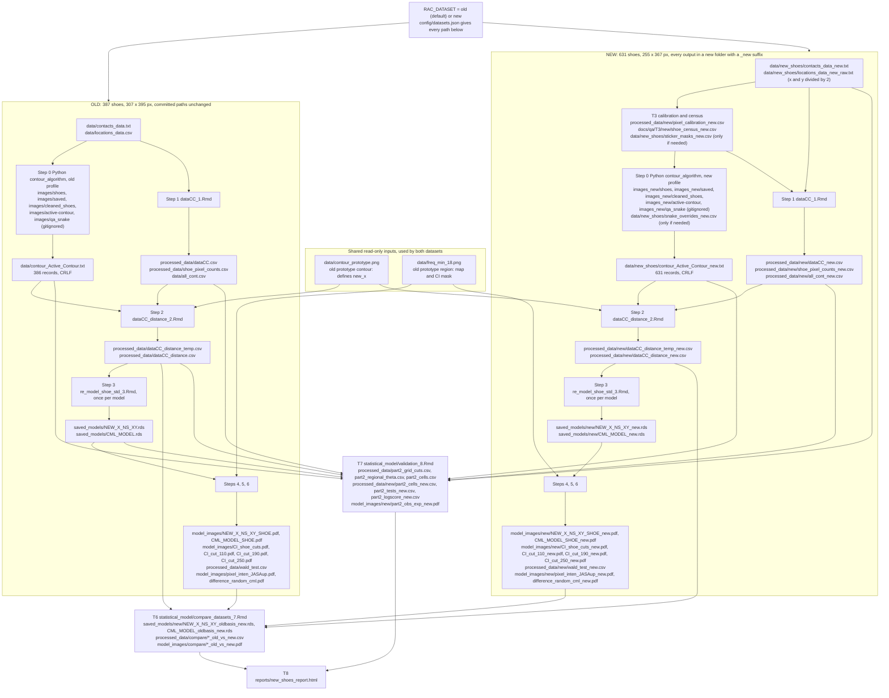

# Plan: Run the full RAC pipeline on the new 631-shoe dataset and validate it
**Date:** 2026-11-05

> **For agentic workers:** this plan is executed task by task (T1..T8) by the workflow, one implementer plus one independent reviewer per task (superpowers:subagent-driven-development; inside a task use superpowers:test-driven-development and superpowers:verification-before-completion). A task is done only when its tests and its **old-regression gate** pass, its results are pasted (real output only) into `docs/tests/<task>-results.md`, `docs/progress/LOG.md` and `docs/decisions.md` are updated, the images it produced were opened and described, and the work is committed. Steps use `- [ ]` checkboxes.

**Goal:** Part 1: run the complete pipeline (snake contour, steps 1-6, old-vs-new comparison) on the 631 new shoes with the same standardization as the 387 old shoes, without changing any old output by a single byte. Part 2: use the new shoes as out-of-sample data to test the old-fitted continuous model (and the 2022 regional model) with Micha's per-shoe area probabilities.

**Architecture:** one dataset profile file (`config/datasets.json`) selected by `RAC_DATASET=old|new` (default `old`) drives both the Python contour code (ported from the thesis repo into `contour_algorithm/`) and the R steps (`statistical_model/`). OLD paths are exactly the committed ones; every NEW artifact lives in a `new` folder and carries a `_new` suffix. Old regression is checked against two baselines: Tier A (files committed at `79247d8`) and Tier B (the unmodified code re-run on this machine in T1).

**Tech stack:** R 4.3.3 (lme4 1.1.38, survival 3.8.3, splines, imager, fields, ggplot2 4.0.0, jsonlite 2.0.0, rmarkdown 2.29); Python 3.12.3 from the thesis venv `/mnt/c/Users/mehes/Documents/repo/master_thesis_forensic_shoeprint/venv/bin/python` (scikit-image 0.25.2, numpy 2.2.6, opencv 4.12.0.88, pandas 2.3.3, pillow 12.0.0, scipy 1.16.3, matplotlib 3.10.7); tests with `python -m unittest` and plain `Rscript` + `stopifnot`; bash runners checked by shellcheck.

**Spec:** `docs/2026-11-05-meeting-micha-new-shoes.md` (requirements), `README.md`, `PIPELINE_DETAILS.md`, `data/new_shoes/README.md`. **Evidence for every number below:** `docs/qa/T0/probes/*.out` (scripts next to them), summarized in `docs/tests/T0-architecture-results.md`. **Decisions:** `docs/decisions.md` (IDs `D-` = people, `A-` = agent calls).

---

## 1. Goal and scope

| Part | What | Done when |
|---|---|---|
| 1 | Snake contours for all 631 new shoes (visually checked one by one), steps 1-6 on the new data (both models), every output under the NEW names of section 5 | NEW outputs committed; QA described; old regression green |
| 1+ | Old vs new comparison: data, contours, `new_x`, coefficients, sigma^2, maps, CIs, Wald tests | `model_images/compare/*_old_vs_new.pdf` + tables; statistics expert review |
| 2 | Micha's validation: OLD-fitted model, random effect 0, on each NEW shoe's own standardized pixels; Naomi's 14 areas on `new_x` and a 10-20 cell grid; pooled Pearson chi-square + shoe bootstrap; same for the 2022 regional model; log-score comparison | Tables and figures of section 9; method review by the statistics expert |
| Report | HTML report for Micha (T8) | `reports/new_shoes_report.html` committed |

Out of scope (open, see `docs/decisions.md`): refitting the old GLMM with the per-shoe offset (D-008), the sign of the sigma^2 correction (D-009), sole-type classification (meeting open question 6).

## 2. Facts established in T0 (all from real probe output)

| # | Fact | Evidence |
|---|---|---|
| F1 | OLD: 387 shoes, **13,287 RACs** (the CSV has 13,288 lines including the header; the meeting note's "13,288" counts the header), 386 shoes with RACs (127 has none), 38 duplicate RAC pixels, so 13,249 case pixels; committed `dataCC.csv` = 51,849 rows = 13,249 + 386 x 100 | `t0_probe.out` B, `t0_facts.out` K, `t0_probe_R.out` |
| F2 | NEW: 631 shoes, 20,013 RACs, **every shoe has at least one RAC** (min 1, median 24, mean 31.72, max 281); file sorted by shoe, `rac_num` consecutive from 1; `type` values 1-7; 23 duplicate RAC pixels, so **19,990 case pixels** expected | B, K |
| F3 | All three fixed-stride files (`contacts_data.txt` 387 x (307*395+2), `contour_Active_Contour.txt` 386 records, `contacts_data_new.txt` 631 x (255*367+2)) have `\r\n` at every stride and only `0`/`1` | A |
| F4 | `raw / 2` equals the 2023 file's x and y exactly (max abs diff 0) | B |
| F5 | The 2023 `COL/ROW` equal the **generalized legacy mapping** (R `aspix_x/aspix_y` with W=255, H=367, `rel_col_shoe`=150, `rel_row_shoe`=300) for all 20,013 RACs; all in bounds | K |
| F6 | RACs on contact: OLD legacy mapping 0.8479; OLD grid optimum 0.8816 at scale 300 px/unit, x mirrored, y not flipped, offset -0.5 px from legacy. NEW generalized legacy 0.8078; NEW optimum 0.8352 at (sx, sy) = (298, 300) with the same -0.5 px offset; (300, 300) gives 0.8343. Same scale, same mirroring, same half-pixel convention in both datasets | D, K |
| F7 | The R `dataCC` frame mirrors x: corr(x in `locations_data.csv`, x of the RAC's pixel) = -0.999941. Naomi's 14 areas are defined in the unmirrored frame | K |
| F8 | The committed OLD contour **is** the thesis run of 2025-11-13: 386/386 records equal `images/saved/active-contour_all.npy`; the txt was written on Windows (CRLF) at 11:54 | J, `t0_probe_sh.out` |
| F9 | In that run shoe 9 was **not** flipped (`list_matrices[8]` == raw shoe 9; the flip at `create_files_shoes.py:26-30` is dead code), while R flips shoe 9's contact (`dataCC_1.Rmd:83-85`). Known issue K1. Shoe 9 has 2 RACs, both off-contact in either orientation | J, K, F |
| F10 | `data/freq_min_18.png` == thesis `images/saved/freq_min_18.npy` (snake-filled prototype of the superposition >= 18, 32,975 px); `data/contour_prototype.png` == its 4-connected inner boundary (xor 0, 748 px) | J, G |
| F11 | R mask `all_cont.csv` (28,609 px) lies inside `freq_min_18.png`; the stamp sweep removed 1,110 px, the two blobs beside the toe | H, `docs/qa/T0/old_rmask_stamps.png` |
| F12 | NEW superposition: union 36,894 px; >= 8: 6 components (7 px outside the main one); >= 13: 2 (1 px); >= 18 and >= 29: 1 component | H |
| F13 | The legacy stamp sweep with its bound `j < rel_row_shoe` (300) **crashes on NEW dims** ("subscript out of bounds", t = 8 and 13); with bound `col_shoe` = 255 it removes 4 px (t = 8) or 1 px (t = 13) | `t0_probe_R.out` |
| F14 | `abs(dy) < 0.01` in step 2 (data y after a CSV round trip, contour y in memory) includes all 2-row pairs, **160 of 392 three-row pairs**, no 4-row pair. A vectorized version must reproduce the float comparison, not an integer row window | `t0_probe_R.out` |
| F15 | `get_snake_image()` (`np.zeros((W, H))` + `cv2.transpose`) is orientation-correct for both 307x395 and 255x367: a double swap, not a bug | M |
| F16 | Geometry (0-indexed px): OLD >= 18 rows 44-347, cols 102-219, centroid (194.4, 157.9); NEW >= 18 rows 27-335, cols 74-196, centroid (180.5, 132.2). Init ellipses: OLD rows 38-362, cols 65-245; NEW (2023 values) rows 23-347, cols 33-223: similar margins | L |
| F17 | Left/right score (flipped vs original correlation with the mean shoe): OLD shoe 9 = 1.164 (a left shoe); NEW: no shoe above 1 (max 0.989) | E |
| F18 | Committed GLMM (writer R 4.4.3): nobs 51,849, 386 groups, **25 fixed effects** (24 spatial), conv 0, sigma^2 = 0.9597791; manual Wald W = 428.6933, df 24, p = 9.43e-76. Committed CML (writer R 4.3.3): 24 coefficients | `t0_probe_R.out` |
| F19 | Committed EOLs: `dataCC.csv`, `shoe_pixel_counts.csv`, `all_cont.csv` CRLF; `dataCC_distance.csv`, `dataCC_distance_temp.csv` LF. The 2026-03-16 "regeneration" of `dataCC.csv` and `all_cont.csv` changed only the EOL | `t0_probe_sh.out` |
| F20 | All committed PDFs: Producer R 4.4.3, embedded CreationDate, so they cannot be byte-compared on this machine | `t0_probe_sh.out` |
| F21 | Missing here: `car`, `hglm`, `testthat`, `sandwich`, `pdftools`, `magick` (R); `pdftoppm`, `gs`, `magick` (system). Present: `png`, `jsonlite`, `digest`, `boot` (R); flake8 7.3.0, shellcheck 0.10.0. The Windows `venv-wind` has the same package versions on Python 3.13.9 | `t0_probe_R.out`, `t0_probe_sh.out` |
| F22 | Thesis contour code at HEAD `109f30a`; the working tree differs from it only by CRLF | `t0_probe_sh.out` |
| F23 | OLD: `MEAN_OFFSET` = -4.614310784; knots `new_x` (-0.0663992, 0.0219597, 0.1047822), y (-0.325, -0.178333, 0.095, 0.208333, 0.321667); range `new_x` [-0.191667, 0.241667], y [-0.501667, 0.511667] | `t0_probe_R.out` |
| F24 | Contact px per shoe p5/p50/p95: OLD 6,245/10,266/16,146; NEW 4,876/8,924/14,286; smallest NEW: shoe 428 (1,343 px), 163 (1,376), 8 (2,016) | C, L |

**Known issues of the OLD analysis (kept as they are for the regression, reported, not fixed):** K1 shoe 9 contour unflipped vs flipped contact (F9). K2 GLMM fitted without the per-shoe offset (meeting 8.1). K3 `exp(-sigma^2/2)` (meeting 8.2, ask Naomi). K4 `MEAN_OFFSET` is a mean of logs (meeting 8.3). K5 legacy `aspix` sits about half a pixel from the on-contact optimum (F6). K6 `PIPELINE_DETAILS.md` errors: 25 fixed effects, not 36; `dataCC.csv` has 51,849 rows, not ~8,000; `freq_min_18.png` is the snake-filled >= 18 superposition, not ">= 8 shoes". K7 `processed_data/dataCC_distance_part4.csv` has another schema and no current code writes it (stale; never regenerate, never delete).

## 3. Big picture

## 4. Dataset-profile architecture

### 4.1 Selection and the profile file
- `RAC_DATASET` (environment variable) = `old` (default when unset or empty) or `new`; any other value is an error in both languages. Read by `contour_algorithm/profiles.py` and `statistical_model/R/profile.R`.
- Both read the **same** file `config/datasets.json` (decision A-003): one source of truth for dimensions, skip lists, thresholds and paths. R reads it with `jsonlite::fromJSON(simplifyVector = TRUE)` and coerces every number with `as.numeric()`, so the old values are doubles exactly like the legacy literals.
- Shoe ids are 1-based everywhere in the JSON and in CSV outputs. Image file names keep the legacy 0-based index (`im0.png` is shoe 1) for both datasets (A-018); QA tiles are labelled with the 1-based shoe id.
- `RAC_MODEL_FEATURE` = `NEW_X_NS_XY` (default, same as `config.R` today) or `CML_MODEL` selects the model for steps 3 and 4, so nobody edits `config.R` to switch models.
- `RAC_DISTANCE_IMPL` = `legacy` or `vectorized` (step 2; default `legacy` until T5 proves byte identity on OLD, then `vectorized`, A-016).

### 4.2 Frames
- **Data frame:** the dataset's own pixel grid (`col_shoe` x `row_shoe`). Pixel (c, r), 1-based, has coordinates x = (c - col_shoe/2) / 300, y = -(r - row_shoe/2) / 300, i.e. 1 px = 1/300 coordinate unit on both axes (legacy `rel_Y_cord / rel_col_shoe`). x is mirrored with respect to the location files (F7).
- **Prototype (map) frame:** the old 307 x 395 grid of `data/contour_prototype.png` and `data/freq_min_18.png`. Used by step 2 for `distance_shape` and by steps 4-6 for maps, CI cuts (rows 110, 190, 250), crops (`sub = 40`, `xlim = c(100, 220)`) for **both** datasets (A-006). In the legacy Rmds the same `col_shoe/row_shoe` serve both frames; the refactor separates them (`P$col_shoe` vs `P$prototype$col_shoe`). For OLD the values coincide, so the outputs cannot change.

### 4.3 Profile values

| Field (JSON path) | OLD | NEW | Who sets NEW |
|---|---|---|---|
| `dataset`, `suffix` | `old`, `""` | `new`, `"_new"` | T2 |
| `col_shoe`, `row_shoe` | 307, 395 | 255, 367 | T2 (F3) |
| `num_shoe` | 387 | 631 | T2 |
| `shoes_without_racs` (1-based; contour has no record for them) | [127] | [] | T2, asserted against the locations at load (F2) |
| `coords.divisor` | 1 | 2 | T2 (F4) |
| `coords.rel_col_shoe`, `rel_row_shoe`, `rel_x_cord`, `rel_Y_cord` (pixel scale 300 px/unit) | 150, 300, 0.25, 0.5 | 150, 300, 0.25, 0.5 (provisional) | T3 decision rule (section 8, T3) |
| `inputs.contacts` | `data/contacts_data.txt` | `data/new_shoes/contacts_data_new.txt` | T2 |
| `inputs.locations`, `inputs.locations_format` | `data/locations_data.csv`, `csv` | `data/new_shoes/locations_data_new_raw.txt`, `space_no_header` | T3 |
| `inputs.cross_check` | none | `data/new_shoes/locations_new_snake_2023.csv` | T3 |
| `inputs.sticker_masks` | none | `data/new_shoes/sticker_masks_new.csv` (only if T3 finds stickers inside the mask) | T3 |
| `prototype.col_shoe`, `row_shoe`, `contour`, `mask` | 307, 395, `data/contour_prototype.png`, `data/freq_min_18.png` | same as OLD | T2 (A-001, A-006) |
| `r.contact_flip_shoes` | [9] | [] | T3 confirms visually (F17) |
| `r.stamp_threshold` (`allcont >= t`) | 8 | 13 (provisional: 8 x 631/387 = 13.04) | T3 |
| `r.stamp_sweep_bound` (legacy `j < rel_row_shoe`) | 300 | 255 (`col_shoe`; 300 crashes, F13) | T2 |
| `r.n_controls`, `r.seed` | 100, 313 | 100, 313 | T2 (A-020) |
| `r.eol` per CSV | `dataCC`, `pixel_counts`, `all_cont`: `\r\n`; `dataCC_distance`, `dataCC_distance_temp`: `\n` | all `\n` | T2 (A-005, F19) |
| `r.paths.*`, `r.knit_dir` | section 5, `statistical_model/` | section 5, `logs/knit/new/` | T2 |
| `python.images_dir` | `images/` | `images_new/` | T2 |
| `python.contact_flip_shoes` | [] (legacy dead code, F9) | [] | T3 |
| `python.superpose_threshold` | 18 | 29 (provisional: 18 x 631/387 = 29.3) | T4 |
| `python.snake.center_rc`, `radii_rc` | [200, 155], [162, 90] | [185, 128], [162, 95] (2023 values, provisional) | T4 |
| `python.snake.n_points`, `gaussian_sigma`, `alpha`, `beta_first`, `beta_second`, `gamma` | 400, 3, 0.015, 10, 0.10, 0.001 | same unless T4 shows a global change is needed | T4 |
| `python.write_html` | false (no effect on any output, saves 3.6 GB) | false | T2 (A-017) |
| `python.contour_out` | `data/contour_Active_Contour.txt` | `data/new_shoes/contour_Active_Contour_new.txt` | T2 |

### 4.4 Access API (implemented in T2)
- R, `statistical_model/R/profile.R`: `rac_profile(dataset = Sys.getenv("RAC_DATASET", "old"), root = ROOT_PATH) -> list`; `rac_path(P, key) -> character` (for OLD the exact string the legacy `paste(ROOT_PATH, "...", sep = "")` built); `rac_model_path(P, feature) -> character`; `rac_image_path(P, stem) -> character` (`model_images/<stem>.pdf` or `model_images/new/<stem>_new.pdf`); `rac_write_csv(x, P, key)` = `write.csv(x, rac_path(P, key), row.names = FALSE, eol = P$r$eol[[key]])`.
- `config.R` sources `R/profile.R`, sets `P <- rac_profile()`, reads `MEAN_OFFSET` from `rac_path(P, "pixel_counts")`. OLD keeps the legacy fallback `log(N_CONTROLS / 10615)`; NEW gets `NA_real_` plus a warning, never the old average (A-021).
- Python, `contour_algorithm/profiles.py`: `load_profile(dataset: str | None = None) -> Profile` (frozen dataclass with the fields of 4.3 as attributes and `root: Path`); `Profile.image_path(kind: str, idx0: int, ext: str = "png") -> Path` (legacy names: `shoes/im{i}`, `shoe_on_prototype/im_{i}`, `cleaned_shoes/im_{i}`, `active-contour/im_{i}`, `qa_snake/im_{i}`, plus `_new` before the extension for NEW); `Profile.saved_path(stem: str, ext: str) -> Path` (`images/saved/<stem>.<ext>` or `images_new/saved/<stem>_new.<ext>`).
- Runners: `RAC_DATASET=old|new <venv>/bin/python -m contour_algorithm.main [--steps create,contour,snake,distance] [--html] [--qa]` from the repo root; `RAC_DATASET=old|new tools/run_pipeline.sh --steps 0-6` renders each Rmd with `rmarkdown::render(input, knit_root_dir = "<repo>/statistical_model", output_file = "<stem><suffix>.html", output_dir = P$r$knit_dir, intermediates_dir = <fresh temp dir>, envir = new.env())`, runs steps 3 and 4 once per model, logs to `logs/<dataset>/` (gitignored), sets `RGL_USE_NULL=TRUE` (headless). Old and new knits never run at the same time.

### 4.5 Regression harness (A-004)
- **Tier A** = files committed at `79247d8` (`tests/baseline/committed_79247d8.sha256`, EOL table, model dumps). **Tier B** = outputs of the unmodified code (thesis `109f30a` Python; R Rmds at `79247d8`) re-run on this machine in T1 (`tests/baseline/local/`).
- `tests/regress_old.sh --steps <list> [--keep]` copies the working tree to `$SCRATCH/regress_old_<timestamp>/` (rsync, excluding `.git`, `images/`, `images_new/`, `logs/`), runs the steps there with `RAC_DATASET=old`, and compares. Nothing in the real repo is overwritten. Exit 0 only if every comparison passes; the summary table goes into the task's results doc.
- Comparisons: contour txt and R CSVs **raw sha256 = Tier A** (that is why the old profile carries the committed EOLs); Python intermediates (npy, png) sha256 = Tier B; `.rds` models: `identical()` on `fixef`, `vcov`, `VarCorr`, `getME(, "theta")`, `logLik`, CML `coef`/`vcov` vs Tier B, and the Tier A status reported as in T1; PDFs: sha256 after removing the `/CreationDate (...)` and `/ModDate (...)` values = Tier B, plus a visual check against Tier A.
- `tests/run_all.sh` = the fast suite (< 5 min): all unit tests + `sha256sum -c tests/baseline/committed_79247d8.sha256`. Slow gates (`regress_old.sh`, e2e) run in the background (`run_in_background` or `nohup ... &`), polled until done.

## 5. File naming, every artifact (OLD vs NEW)

Rule: OLD keeps the committed name and path; NEW = a `new` folder (`processed_data/new/`, `saved_models/new/`, `model_images/new/`, `images_new/`, `data/new_shoes/`, `logs/knit/new/`, `docs/qa/<task>/new/`) **and** `_new` before the extension. Raw inputs keep their committed names. Artifacts built from both datasets go to a `compare/` folder with `_old_vs_new`. New artifacts derived only from OLD data have no suffix.

| Step / task | Artifact | OLD | NEW | Tracked in git |
|---|---|---|---|---|
| input | contact surfaces | `data/contacts_data.txt` | `data/new_shoes/contacts_data_new.txt` | yes (raw, byte-identical forever) |
| input | RAC locations | `data/locations_data.csv` | `data/new_shoes/locations_data_new_raw.txt` | yes (raw) |
| input | 2023 cross-check | none | `data/new_shoes/locations_new_snake_2023.csv` | yes (raw) |
| input (shared) | prototype contour / region | `data/contour_prototype.png`, `data/freq_min_18.png` | same files | yes |
| T3 | pixel calibration | `docs/qa/T3/calibration_grid.csv` | `processed_data/new/pixel_calibration_new.csv`, `docs/qa/T3/new/calibration_grid_new.csv` | yes |
| T3 | shoe census (all shoes, reviewed) | none | `docs/qa/T3/new/shoe_census_new.csv` | yes |
| T3 | raw contact sheets with RACs | none | `docs/qa/T3/new/raw_sheet_<kk>_new.png` | yes |
| T3 | sticker erase list (only if needed) | none | `data/new_shoes/sticker_masks_new.csv` | yes |
| step 0 | shoe images | `images/shoes/im{i}.png` | `images_new/shoes/im{i}_new.png` | no |
| step 0 | shoe matrices | `images/saved/list_matrices.npy` | `images_new/saved/list_matrices_new.npy` | no |
| step 0 | union image | `images/saved/all_shoes_superposed.png` | `images_new/saved/all_shoes_superposed_new.png` | no |
| step 0 | superposition >= t | `images/saved/old_freq_min_18.npy`, `images/saved/old_freq_min_18.png` | `images_new/saved/superposed_min_<t>_new.npy`, `images_new/saved/superposed_min_<t>_new.png` | no |
| step 0 | prototype cleaning mask (snake-filled) | `images/saved/freq_min_18.npy`, `images/saved/freq_min_18.png` (== `data/freq_min_18.png`) | `images_new/saved/freq_min_<t>_new.npy`, `images_new/saved/freq_min_<t>_new.png` | no |
| step 0 | shoe over prototype | `images/shoe_on_prototype/im_{i}.png` | `images_new/shoe_on_prototype/im_{i}_new.png` | no |
| step 0 | cleaned shoes | `images/cleaned_shoes/im_{i}.png` | `images_new/cleaned_shoes/im_{i}_new.png` | no |
| step 0 | extreme-value contours | `images/saved/list_contour.npy` | `images_new/saved/list_contour_new.npy` | no |
| step 0 | plotly HTML (opt-in `--html`) | `images/extreme_values/plot_cont_{i}.html`, `images/snake_rac_html/plot_cont_{i}.html` | `images_new/extreme_values/plot_cont_{i}_new.html`, `images_new/snake_rac_html/plot_cont_{i}_new.html` | no |
| step 0 | legacy overlay (second snake) | `images/active-contour/im_{i}.png` | `images_new/active-contour/im_{i}_new.png` | no |
| step 0 (T4) | QA overlay: init ellipse red dashed + first snake blue; init + second snake blue | `images/qa_snake/im_{i}.png` | `images_new/qa_snake/im_{i}_new.png` | no |
| T4 | QA contact sheets, metrics, flagged shoes | `docs/qa/T4/old/snake_metrics.csv` | `docs/qa/T4/new/snake_sheet_<kk>_new.png`, `docs/qa/T4/new/snake_metrics_new.csv`, `docs/qa/T4/new/flagged/im_{i}_new.png` | yes |
| T4 | per-shoe snake overrides (only if needed) | none | `data/new_shoes/snake_overrides_new.csv` | yes |
| step 0 | all snakes | `images/saved/active-contour_all.npy` | `images_new/saved/active-contour_all_new.npy` | no |
| step 0 | **contour file** | `data/contour_Active_Contour.txt` | `data/new_shoes/contour_Active_Contour_new.txt` | yes |
| step 0 | pixel locations (`distance_extremities`) | `images/saved/locations_new.csv` (legacy name) | `images_new/saved/locations_pixels_new.csv` | no |
| step 1 | case-control sample | `processed_data/dataCC.csv` | `processed_data/new/dataCC_new.csv` | yes |
| step 1 | contact px per shoe | `processed_data/shoe_pixel_counts.csv` | `processed_data/new/shoe_pixel_counts_new.csv` | yes |
| step 1 | stamp-cleaned mask | `data/all_cont.csv` | `processed_data/new/all_cont_new.csv` | yes |
| step 2 | distances, checkpoint | `processed_data/dataCC_distance_temp.csv` | `processed_data/new/dataCC_distance_temp_new.csv` | yes |
| step 2 | distances + `new_x` | `processed_data/dataCC_distance.csv` | `processed_data/new/dataCC_distance_new.csv` | yes |
| none | stale checkpoint (K7) | `processed_data/dataCC_distance_part4.csv` | none | yes (never touched) |
| step 3 | GLMM | `saved_models/NEW_X_NS_XY.rds` | `saved_models/new/NEW_X_NS_XY_new.rds` | yes |
| step 3 | CML | `saved_models/CML_MODEL.rds` | `saved_models/new/CML_MODEL_new.rds` | yes |
| step 4 | heat maps | `model_images/NEW_X_NS_XY_SHOE.pdf`, `model_images/CML_MODEL_SHOE.pdf` | `model_images/new/NEW_X_NS_XY_SHOE_new.pdf`, `model_images/new/CML_MODEL_SHOE_new.pdf` | yes |
| step 5 | CI figures | `model_images/CI_shoe_cuts.pdf`, `model_images/CI_cut_110.pdf`, `model_images/CI_cut_190.pdf`, `model_images/CI_cut_250.pdf` | `model_images/new/CI_shoe_cuts_new.pdf`, `model_images/new/CI_cut_110_new.pdf`, `model_images/new/CI_cut_190_new.pdf`, `model_images/new/CI_cut_250_new.pdf` | yes |
| step 5 | Wald test (W, df, p, method) | `processed_data/wald_test.csv` (added in T2) | `processed_data/new/wald_test_new.csv` | yes |
| step 6 | comparison figures | `model_images/pixel_inten_JASAup.pdf`, `model_images/difference_random_cml.pdf` | `model_images/new/pixel_inten_JASAup_new.pdf`, `model_images/new/difference_random_cml_new.pdf` | yes |
| knit | HTML of each Rmd | `statistical_model/<stem>.html` | `logs/knit/new/<stem>_new.html` | no |
| QA | map PNGs for viewing | `docs/qa/T5/old/<stem>.png` | `docs/qa/T5/new/<stem>_new.png` | yes |
| T6 | common-basis refits | none | `saved_models/new/NEW_X_NS_XY_oldbasis_new.rds`, `saved_models/new/CML_MODEL_oldbasis_new.rds` | yes |
| T6 | comparison tables / figures | `processed_data/compare/<what>_old_vs_new.csv`, `model_images/compare/<what>_old_vs_new.pdf`, `docs/qa/T6/<what>_old_vs_new.png` | (same files) | yes |
| T7 | grid cut points (from OLD only) | `processed_data/part2_grid_cuts.csv` | (read by NEW) | yes |
| T7 | regional theta (fit on OLD) | `processed_data/part2_regional_theta.csv` | (read by NEW) | yes |
| T7 | shoe x cell tables | `processed_data/part2_cells.csv` (in-sample) | `processed_data/new/part2_cells_new.csv` | yes |
| T7 | tests and log scores | `processed_data/part2_tests.csv` (in-sample, descriptive) | `processed_data/new/part2_tests_new.csv`, `processed_data/new/part2_logscore_new.csv` | yes |
| T7 | figures | `model_images/part2_obs_exp.pdf` | `model_images/new/part2_obs_exp_new.pdf` | yes |
| T7 | full pixel tables | `processed_data/pixels_full.rds` | `processed_data/new/pixels_full_new.rds` | no (large, reproducible) |
| T8 | report | `reports/new_shoes_report.html` (covers both) | (same) | yes (`!reports/*.html` in `.gitignore`) |
| logs | run logs | `logs/old/<step>.log` | `logs/new/<step>_new.log` | no |

## 6. Global constraints (every task)
- No collisions: every file created for the NEW dataset is in a `new` folder **and** has a `_new` suffix; OLD files keep their names and paths exactly.
- Exact old regression after every change: contour txt and CSVs byte-identical; `.rds` compared with `identical()` (or `all.equal(tolerance = 0)`) on fixef/coef/vcov/VarCorr, with the result reported; anything not reproduced is stated with evidence, never hidden.
- Tests for every part, no package installs (no pip install, no install.packages, no apt): `python -m unittest` under `tests/python/`, `Rscript` + `stopifnot` under `tests/r/`, `tests/run_all.sh` (shellcheck-clean, LF).
- `car` is not installed: the Wald test is computed manually (W = b' V^-1 b, df 24) and must give 428.69 on OLD; the `car::linearHypothesis` path runs only when `requireNamespace("car", quietly = TRUE)` is TRUE.
- Docs: `docs/progress/LOG.md` (dated entries with results and timings), `docs/decisions.md` (who decided and why), `docs/tests/<task>-results.md` (exact commands and real outputs).
- Raw data byte-identical, line endings never converted. Code files LF; Python flake8-clean (default 79 columns); shell shellcheck-clean.
- Foreground commands time out at 10 min: long jobs run in the background and are polled. The step-2 loop may be vectorized only with byte-identical proof on OLD.
- Thesis repo is read-only: run Python with `-B` (no bytecode), copy modules to a scratch dir before running legacy code, use `git --no-optional-locks` there. Never run filesystem-wide searches; wrap risky commands in `timeout 600`.
- Look at every produced image with the Read tool and describe what you saw; check every NEW shoe for stickers (police/evidence labels, stamps).
- Work only on `feature/new-shoes-pipeline`; never push; commit often; no Co-Authored-By or AI attribution lines in commit messages.

## 7. Review Focus

The five failure modes that the task tests could miss and that would silently corrupt results, most likely first. Each one is pinned by a named test in its owning task.
1. **Float semantics of step 2.** `abs(dy) < 0.01` admits 160 of 392 three-row pairs (F14) and every value goes through a 15-digit CSV round trip; an "equivalent" integer window or a missing round trip changes `new_x` in the last digits. Pinned by T5 `tests/r/test_distances_vectorized.R` (byte-identical OLD CSVs; legacy vs vectorized on 2,000 NEW rows).
2. **Fixed-stride CRLF files.** Python on Linux writes `\n`; the R reader assumes `+2` per record and would shift every record by one byte without an error. Pinned by T2 `test_io_shoes.WriteShoes.test_crlf_roundtrip`, `test_io_shoes.WriteShoes.test_old_contour_bytes_from_thesis_npy`, and T4 `test_contour_new.ContourNew.test_layout`.
3. **Coordinate frames.** `dataCC` x is mirrored (F7), the prototype frame stays 307 x 395 for NEW, Naomi's areas need `-new_x`. Pinned by T2 `tests/r/test_profile.R` (NEW prototype dims 307/395), T5 `tests/r/test_new_outputs.R` (step 2 used the prototype frame for `distance_shape`), T7 `tests/r/test_validation_areas.R` (mirror test).
4. **Shoe indexing.** Contour record k is the k-th shoe that has RACs, which is factor code k in `dataCC` (OLD shoes 128-387 become 127-386); OLD skips shoe 127, NEW skips none. Pinned by T2 `test_io_shoes.RecordMap.test_record_shoe_mapping` and T5 `tests/r/test_new_outputs.R` (631 shoes, 631 contour records).
5. **Stickers and left shoes in NEW.** A sticker inside the prototype region survives the AND-cleaning and inflates the contact surface and the snake. Pinned by T3 `test_stickers.Stickers.test_synthetic_recall`, T3 `test_census.Census.test_complete`, T4 `test_qa_snake.Flags.test_all_flags_resolved`.

## 8. Tasks

Roles available to the orchestrator: implementer, independent reviewer, statistics expert, analyst, visualization/QA, end-to-end tester. Each task lists who is needed.

### T1: Baseline and reproduction (OLD)
**Roles:** implementer (baseline engineer); reviewer re-runs `tests/run_all.sh` and spot-checks two comparisons by hand.
**Rule:** no pipeline code changes. Legacy code runs only in scratch copies.

**Files:**
- Create: `tests/baseline/README.md`, `tests/baseline/committed_79247d8.sha256` (every tracked file under `data/`, `processed_data/`, `saved_models/`, `model_images/`), `tests/baseline/committed_79247d8_eol.tsv` (path, lines, CR count), `tests/baseline/models_committed.rds` + `models_committed.txt` (`%.17g` dumps), `tests/baseline/local/` (Tier B: `python_contour.sha256`, `python_intermediates.sha256`, `r_outputs.sha256`, `pdf_normalized.sha256`, `models_local.rds`, `models_local.txt`, `environment.txt` with R `sessionInfo()`, `pip freeze` of the venv, `uname -a`), `tests/lib/dump_models.R`, `tests/lib/pdf_normalize.py`, `tests/legacy/run_legacy_python.sh`, `tests/legacy/run_legacy_r.sh`, `tests/python/test_baseline_raw_data.py`, `tests/r/test_baseline_committed.R`, `tests/run_all.sh`, `docs/tests/T1-baseline-results.md`.

**Interfaces (produces):** `dump_models(glmm_path, cml_path) -> list(fixef, vcov, theta, sigma2, loglik, nobs, ngrps, cml_coef, cml_vcov, cml_loglik)` (R); `normalized_sha256(path: str) -> str` (Python, removes the CreationDate/ModDate values before hashing); baseline files in `sha256sum` format.

- [ ] **Step 1: tests that must pass on HEAD.** `test_baseline_raw_data.Raw.test_committed_checksums` (every line verifies); `.test_fixed_stride_layout` for (old contacts, 307, 395, 387), (old contour, 307, 395, 386), (new contacts, 255, 367, 631): size == n*(W*H+2), every separator == `b'\r\n'`, bytes in {48, 49}; `.test_location_counts`: OLD 13,287 RACs / 386 shoes / missing [127]; NEW 20,013 / 631 / []; NEW raw/2 == 2023 x and y with `np.array_equal`. `tests/r/test_baseline_committed.R`: GLMM `nobs == 51849`, `ngrps == 386`, `length(fixef) == 25`, `optinfo$conv$opt == 0`, `round(sigma2, 7) == 0.9597791`, manual `round(W, 2) == 428.69` with df 24; CML `length(coef) == 24`; `dataCC.csv` 51,849 rows, 13,249 cases, 386 shoes, `all(table(shoe[n_Acc == 0]) == 100)`; `dataCC_distance` (n_Acc, x, y, shoe) `identical` to `dataCC`; `round(MEAN_OFFSET, 9) == -4.614310784`.
- [ ] **Step 2: Tier A.** Write the checksum, EOL and model-dump files from the committed tree.
- [ ] **Step 3: legacy Python in scratch (background, about 20-40 min).** `run_legacy_python.sh` copies the thesis `contour_algorithm/*.py` (HEAD `109f30a`) into `$SCRATCH/legacy_py/contour_algorithm/`, **copies** (never symlinks) `contacts_data.txt` and `locations_data.csv` into `$SCRATCH/legacy_py/data/`, links `Data -> data` (the code reads `../Data/` at `distance_extremities.py:36`), creates the `images/` subfolders, runs `PYTHONDONTWRITEBYTECODE=1 <venv>/bin/python main.py`. Compare `data/contour_Active_Contour.txt` (LF, written on Linux) with Tier A after removing CR: whole-file and per-record pixel differences; also `images/saved/freq_min_18.png` vs `data/freq_min_18.png`. If it differs: record which records/pixels; as a diagnostic only, try `venv-wind` through WSL interop if it starts without writing to the thesis repo.
- [ ] **Step 4: legacy R in scratch.** `run_legacy_r.sh` rsyncs the repo to `$SCRATCH/legacy_r/` and renders steps 1, 2 (background), 3 (twice: `MODEL_FEATURE` changed by `sed` in the scratch `config.R` only), 4 (twice), 5 (scratch variant without `library(car)` and with the `linearHypothesis` chunk set to `eval = FALSE`, documented), 6. Record each runtime.
- [ ] **Step 5: compare.** Per artifact: raw sha256, LF-normalized sha256, numeric `identical()` after `read.csv`, model fields `identical()` and `max(abs(diff))`. Expected (to be confirmed, not assumed): step-1 CSVs identical after EOL normalization; step-2 CSVs byte-identical; CML possibly identical; GLMM possibly not bit-identical (Windows R 4.4.3 vs WSL R 4.3.3); PDFs differ in bytes.
- [ ] **Step 6: look.** Open every committed PDF and its Tier B twin with Read; describe differences in the results doc.
- [ ] **Step 7: write Tier B**, the results table (artifact, raw, LF, numeric, max abs diff, note) and LOG/decisions entries.
- [ ] **Step 8: gate.** `bash tests/run_all.sh` passes. The results doc names every artifact that is not reproduced exactly, with evidence.
- [ ] **Step 9: commit** `test: capture old-dataset baseline (Tier A committed, Tier B local legacy rerun)`.

### T2: Profiles refactor (no behaviour change for OLD)
**Roles:** implementer R, implementer Python, reviewer (diff reading against the legacy code), end-to-end tester (runs the gates).
**Order (one commit each, each with its gate):** T2a profile file + accessors; T2b Rmd parametrization + runners; T2c Python port with style-only changes; T2d Python profile parametrization; T2e manual Wald.

**Files:**
- Create: `config/datasets.json`; `statistical_model/R/profile.R`; `statistical_model/R/wald.R`; `contour_algorithm/{__init__.py, profiles.py, io_shoes.py, create_files_shoes.py, remove_noise.py, extreme_values_x_y.py, contour.py, active_contour_snake.py, distance_extremities.py, main.py, requirements.txt}` (ported from thesis `109f30a`, LF, flake8-clean; `requirements.txt` = the T1 `pip freeze`); `tools/run_pipeline.sh`; `tests/regress_old.sh`; `tests/lib/compare_models.R`; `tests/python/{test_profiles.py, test_io_shoes.py, test_snake_geometry.py, test_no_hardcoding.py}`; `tests/r/{test_profile.R, test_wald.R, test_no_hardcoding.R}`; `docs/tests/T2-profiles-results.md`.
- Modify: `statistical_model/config.R:13-31`; `dataCC_1.Rmd:14-21, 40-64 (aspix defaults from P), 73, 83-85 (flip list), 98 (threshold), 110 and 131 (sweep bound), 147, 192, 199-205, 244-247 (rac_write_csv)`; `dataCC_distance_2.Rmd:23-33, 41-61 (1:386 -> seq_len(num_shoe - length(shoes_without_racs))), 114, 142, 152-153, 163-164, 176-178 (prototype frame), 212-213`; `re_model_shoe_std_3.Rmd:19-26, 43-47, 71`; `shoe_std_results_4.Rmd:21-28 (prototype frame), 44-59, 80, 123`; `statistical_tests_5.Rmd:20, 24-30, 35-43, 59, 111-131, 198, 208, 256-266`; `model_comparison_6.Rmd:21-28, 34-59, 136, 168`; `.gitignore` (`images/`, `images_new/`, `logs/`, `processed_data/**/pixels_full*.rds`); `.gitattributes` (`-text` for `data/*.txt`, `data/all_cont.csv`, `processed_data/**/*.csv`); `README.md` (how to select a dataset).

**Interfaces:** 4.4 above, plus `read_shoes(path: Path, width: int, height: int, n: int) -> np.ndarray` (bool, shape (n, H, W); raises `ValueError` if a separator is not `b'\r\n'` or a byte is not 0/1); `write_shoes(path: Path, arrays: Sequence[np.ndarray], skip_idx0: Iterable[int] = ()) -> None` (binary, `0`/`1` characters, `b'\r\n'` after every record); `init_snake(profile: Profile) -> np.ndarray` (shape (n_points, 2), (row, col)); `wald_all_spatial(model) -> list(W, df, p, method)` (manual; `method = "car"` result added as `W_car` when car is present).

- [ ] **Step 1: failing tests.**
  - `test_profiles.Old.test_matches_legacy_constants`: W 307, H 395, n 387, `shoes_without_racs == (127,)`, `contour_out == root/"data/contour_Active_Contour.txt"`, `images_dir == root/"images"`, snake (200, 155), (162, 90), 400 points, sigma 3, alpha 0.015, beta 10 and 0.10, gamma 0.001, threshold 18, python flips `()`.
  - `test_profiles.New.test_outputs_namespaced`: every NEW output path has a `new` folder component (`new`, `new_shoes`, `images_new`) and a stem ending in `_new`; `test_no_collision`: OLD outputs and NEW outputs are disjoint, and no NEW output equals a path in `git ls-files`.
  - `test_profiles.Env.test_selection`: unset or empty gives `old`; `new` gives new; `foo` raises `ValueError`.
  - `tests/r/test_profile.R`: `rac_profile("old")` values `identical()` to the legacy literals (doubles); `rac_path(P, "dataCC") == paste(ROOT_PATH, "processed_data/dataCC.csv", sep = "")`; NEW `prototype$col_shoe == 307`, `prototype$row_shoe == 395`; `rac_profile("foo")` errors; NEW `MEAN_OFFSET` is `NA` when its pixel-count file is absent.
  - `test_io_shoes.ReadShoes.test_matches_legacy_readlines` (OLD and NEW: identical arrays to the legacy text-mode `readlines()` parse); `WriteShoes.test_crlf_roundtrip` (separators, record count n - len(skip), read-back equality); `WriteShoes.test_old_contour_bytes_from_thesis_npy` (`write_shoes` of the thesis 2025-11-13 `active-contour_all.npy` with skip [126] has the committed sha256, read-only access to the thesis file); `RecordMap.test_record_shoe_mapping` (OLD record k -> shoe k for k <= 126, k + 1 after; NEW record k -> shoe k).
  - `test_snake_geometry.Orientation.test_get_snake_image` (both dims: polyline through (row 50, col 20) and (300, 200) sets exactly those cells, not (20, 50); shape (H, W)); `InitSnake.test_old_values` (rows 38-362, cols 65-245 after rounding).
  - `tests/r/test_wald.R`: `round(W, 2) == 428.69`, `df == 24`, `p < 1e-70` on the committed GLMM; if car is present `all.equal(W, W_car, tolerance = 1e-8)`, else print `SKIPPED car comparison: car not installed`.
  - `test_no_hardcoding` (Python) and `tests/r/test_no_hardcoding.R`: no `307`, `395`, `387`, `386`, `255`, `367`, `631`, `126`, `1:386`, `'../images/'`, `'../data/'` or literal output paths in code outside the profile files (comments excluded).
- [ ] **Step 2: implement** T2a-T2e in order. Python port: first a style-only commit (flake8 fixes, no logic change), then parametrization; the dead flip of image 8 becomes `python.contact_flip_shoes` (OLD `[]`), the `i == 126` skip becomes `shoes_without_racs`, `img.show()` is never called in batch runs, `'../Data/'` becomes the profile path, the contour is written by `write_shoes` (CRLF). R: `P$...` replaces every constant and path; `num_shoe` loops use profile values; the step-5 car chunk becomes `wald_all_spatial()` + optional car; `processed_data/wald_test.csv` is written.
- [ ] **Step 3: gate (background).** `bash tests/run_all.sh`; `tests/regress_old.sh --steps 0-6`: contour txt sha256 == Tier A (if T1 found the legacy run reproduces the committed content; otherwise == Tier B content written with CRLF, stated in the results); Python intermediates == Tier B; the five R CSVs raw sha256 == Tier A; models `identical()` to Tier B; normalized PDFs == Tier B; printed Wald W = 428.69.
- [ ] **Step 4: docs and commits** (`refactor:` for T2a-T2d, `feat: manual Wald test when car is absent` for T2e).

### T3: New data preparation and pixel calibration
**Roles:** analyst (calibration), visualization/QA (census of all 631 shoes), statistics expert (checks the decision rule before it is applied), implementer, reviewer.

**Files:**
- Create: `contour_algorithm/locations.py` (readers), `contour_algorithm/calibrate_pixels.py`, `contour_algorithm/stickers.py`, `contour_algorithm/qa_sheets.py`, `contour_algorithm/census.py`; `statistical_model/R/io.R` (`read_locations(P)`); outputs of section 5 (T3 rows); `tests/python/{test_locations_new.py, test_pixel_mapping.py, test_calibration.py, test_stickers.py, test_census.py}`; `tests/r/test_pixel_mapping.R`; `docs/tests/T3-new-data-results.md`.
- Modify: `config/datasets.json` (NEW coords, `r.stamp_threshold`, flip lists, `inputs.*`); `statistical_model/dataCC_1.Rmd:147-148` (read via `read_locations(P)`).

**Interfaces:** `read_locations(profile) -> pd.DataFrame` (columns `shoe` int 1-based, `x`, `y` already divided, plus `rac_num`, `type` when present); `legacy_pixel(x, y, width, height, rel_col=150, rel_row=300, rel_x=0.25, rel_y=0.5) -> tuple[np.ndarray, np.ndarray]` (1-based col, row; identical to R `aspix_x/aspix_y`); `on_contact_rate(contacts, shoe, col0, row0) -> float`; `calibration_grid(contacts, locs, scales_x, scales_y, offsets, mirror_x, flip_y) -> pd.DataFrame` (one row per setting, sorted by rate); `sticker_candidates(raw: np.ndarray, mask: np.ndarray) -> list[dict]` (component id, area, bbox, solidity, rectangularity, inside_mask fraction); `contact_sheet(tiles: list[np.ndarray], labels: list[str], ncols: int, out: Path) -> None`. R: `read_locations(P) -> data.frame(shoe, x, y)`.

**Pre-registered mapping rule (statistics expert signs it off before running):** keep the generalized legacy mapping (profile W, H; `rel_col_shoe` 150, `rel_row_shoe` 300; 1 px = 1/300) if all three hold: (i) on OLD the grid optimum has scale 300, x mirrored, y not flipped; (ii) on NEW the optimum scale is within [294, 306] on both axes with x mirrored and y not flipped; (iii) the NEW optimum's offset from the generalized legacy mapping equals the OLD optimum's offset from the legacy mapping within 1 px. Otherwise add explicit `coords.px_per_unit_x/_y` and `coords.center_col/_row` for NEW, a new code path in both languages, and record why. T0 numbers satisfy (i)-(iii) (F6), so the expected outcome is "keep", but it must be re-run on the full grid with a finer step and a shoe bootstrap of the optimum (B = 200).

- [ ] **Step 1: failing tests.** `test_locations_new.New.test_matches_2023` (20,013 rows, shoes 1..631, sorted, x and y equal the 2023 file exactly); `test_pixel_mapping.Mapping.test_new_equals_2023_colrow` (all 20,013); `.test_matches_r_aspix` (runs `Rscript` on all NEW RACs and 500 OLD RACs, `np.array_equal`); `tests/r/test_pixel_mapping.R` (R side of the same equality); `test_calibration.Old.test_recovers_legacy_scale` (top row: scale 300, mirror True, flip False); `.New.test_scale_band` (top scale in [294, 306]); `.test_deterministic` (two runs identical); `test_stickers.Stickers.test_synthetic_recall` (100 synthetic solid rectangles 15-40 px wide injected inside the mask of 50 random NEW shoes (seed 1): recall >= 0.95; false positives on the unmodified shoes reported); `test_census.Census.test_complete` (631 rows, every `reviewed == "yes"`, every `sticker_decision` in {`none`, `erased`, `outside_mask`}).
- [ ] **Step 2: implement**, run the calibration on both datasets, apply the rule, update the profile.
- [ ] **Step 3: census (visual).** Contact sheets of all 631 raw NEW shoes (32 per sheet) with RACs drawn by the chosen mapping and the candidate stickers outlined; open **every** sheet with Read; open every flagged shoe at full size; fill `shoe_census_new.csv` (shoe, px, n_rac, on_contact_rate, flip_score, n_sticker_candidates, sticker_decision, reviewed, note). Stickers inside the prototype region go to `data/new_shoes/sticker_masks_new.csv` (shoe, row0, row1, col0, col1, reason), applied at load time by Python and R. Possible left shoes (flip score near or above 1, or visual) are checked: RAC on-contact rate flipped vs not decides the RAC frame.
- [ ] **Step 4: R stamp threshold.** Compare `allcont >= 8` and `>= 13` (sweep bound 255) with an overlay image like `docs/qa/T0/old_rmask_stamps.png`; criteria: no sole pixel lost on the overlay, sticker components removed; default 13. Record in decisions.
- [ ] **Step 5: gate.** `bash tests/run_all.sh`; `tests/regress_old.sh --steps 1` (step-1 CSVs byte-identical to Tier A).
- [ ] **Step 6: docs and commit** `feat: new-shoes readers, pixel calibration and sticker census`.

### T4: Snake adaptation and QA (NEW)
**Roles:** implementer (snake), visualization/QA (looks at every new shoe), reviewer (independent look at a random 10% and all flagged shoes).

**Files:**
- Create: `contour_algorithm/qa_snake.py`; `tests/python/{test_qa_snake.py, test_contour_new.py}`; outputs of section 5 (T4 rows), `data/new_shoes/contour_Active_Contour_new.txt`; `docs/tests/T4-snake-results.md`.
- Modify: `contour_algorithm/active_contour_snake.py` (return the init and both snakes to the QA writer; optional `--jobs N` with ordered results), `config/datasets.json` (NEW `superpose_threshold`, `snake.*`).

**Interfaces:** `snake_qa_figure(original: np.ndarray, init: np.ndarray, first: np.ndarray, second: np.ndarray, out: Path) -> None` (two panels: original + init red dashed + first snake blue; original + init red dashed + second snake blue; the shoe id in the title); `snake_metrics(cleaned: np.ndarray, contour: np.ndarray, proto_mask: np.ndarray) -> dict` with keys `coverage` (share of cleaned contact pixels inside the row-span fill of the contour), `rac_coverage`, `outside_mask_frac`, `area_px`, `n_contour_px`, `touches_border`, `bbox`.

- [ ] **Step 1: OLD reference.** `snake_metrics` for all 386 OLD shoes from the committed contour (expected from F: coverage p5 0.947, median 1.000, min 0.700 for shoe 9 by K1; 614-742 contour px) written to `docs/qa/T4/old/snake_metrics.csv`.
- [ ] **Step 2: failing tests.** `test_contour_new.ContourNew.test_layout` (631 records, CRLF at every stride, bytes 0/1, each record between 400 and 1,000 contour px); `.test_rac_coverage` (share of each shoe's RAC pixels inside its contour fill >= the OLD p5 of the same metric minus 0.02, for every shoe not listed as an accepted exception in the results doc); `test_qa_snake.Files.test_complete` (631 QA PNGs, `ceil(631 / 20)` = 32 sheets); `test_qa_snake.Flags.test_all_flags_resolved` (every flagged shoe in `snake_metrics_new.csv` has `resolution` in {`ok_after_review`, `override`, `excluded`} and a note); `test_qa_snake.Parallel.test_jobs_identical` (if `--jobs` exists: 20 shoes, jobs 1 vs 4, identical arrays).
- [ ] **Step 3: prototype mask threshold.** Build the NEW snake-filled mask for t = 18 and t = 29. Pre-registered choice: the mask must contain >= 99.5% of NEW RAC pixels and >= 99% of the contact pixels of the median shoe and must exclude every sticker component marked `outside_mask` in T3; if both thresholds pass, take 29 (same relative frequency as 18/387). Look at both masks over the superposition.
- [ ] **Step 4: run the snakes** on all 631 with the 2023 init (F16), write QA images and metrics. Flag a shoe when coverage or rac_coverage is below the OLD p1, `outside_mask_frac` is above the OLD p99, `touches_border` is true, or `n_contour_px` is outside [553, 816] (OLD range +-10%).
- [ ] **Step 5: look.** Open **all 32 sheets** and **every flagged shoe** at full size; describe what you saw (init placement, first snake, second snake, stickers, cut-off heels or toes) in the results doc. Confirm explicitly that no sticker survives in any cleaned shoe or contour.
- [ ] **Step 6: iterate globally first** (init center and radii from the NEW superposition; a starting proposal from F16 is center (186, 129), radii (165, 94)); re-run all 631 after each change and compare metrics. Per-shoe overrides only with a written reason and the before/after images (`snake_overrides_new.csv`: shoe, center_r, center_c, radius_r, radius_c, reason). A shoe without an acceptable contour is excluded only by a recorded decision (and then removed from every NEW step, with a sensitivity note).
- [ ] **Step 7: cross-check** with the 2023 file (`INSIDE_SNAKE`, `HORIZ_DIST_SNAKE`, `DIST_SNAKE` are in pixels): agreement tables, after converting units.
- [ ] **Step 8: gate.** `bash tests/run_all.sh`; `tests/regress_old.sh --steps 0` (OLD contour byte-identical; intermediates == Tier B).
- [ ] **Step 9: docs and commits** (`feat: snake QA images and metrics`, `data: adapted-snake contours for the 631 new shoes`).

### T5: R steps 1-6 on NEW
**Roles:** implementer (R), statistics expert (reads the fitted models and outputs), visualization (map PNGs), reviewer.

**Files:**
- Create: `statistical_model/R/distances.R`; `tests/r/{test_distances_vectorized.R, test_new_outputs.R}`; NEW outputs of section 5 (steps 1-6); `docs/qa/T5/old/*.png`, `docs/qa/T5/new/*_new.png`; `docs/tests/T5-new-pipeline-results.md`.
- Modify: `statistical_model/dataCC_distance_2.Rmd:89-157, 182-211` (call `compute_distances()` when `RAC_DISTANCE_IMPL = vectorized`), `config/datasets.json` (NEW eol and paths confirmed).

**Interfaces:** `min_dist_vec(new_data, contour_df) -> numeric`; `horiz_dist_vec(new_data, contour_df) -> numeric` (Inf where no contour point has `abs(dy) < 0.01`; the caller applies the legacy fallback to `min_dist`); `distance_shape_vec(x, y, distance_per_y) -> numeric` (legacy `>= y - 0.01 & <= y + 0.01` window, first `which.min`, nearest-y fallback); `compute_distances(dataCC, contour_df, distance_per_y, P) -> data.frame` (keeps the legacy write/read of the temp CSV between passes so every rounding is the same).

- [ ] **Step 1: failing tests.** `test_distances_vectorized.R`: OLD, vectorized run in scratch gives `dataCC_distance_temp.csv` and `dataCC_distance.csv` with the Tier A sha256; NEW, 2,000 random rows (seed 1) through the legacy loop and through the vectorized code are `identical()` on `min_dist`, `horiz_dist`, `distance_shape`, `new_x`. `test_new_outputs.R`: `dataCC_new.csv` has 631 shoes, `all(table(shoe[n_Acc == 0]) == 100)`, `sum(n_Acc) == 19990` (if T3 kept the generalized legacy mapping; otherwise the number T3 recorded), so 83,090 rows; no NA or Inf in `min_dist`, `horiz_dist`, `new_x`; every `distance_shape` value occurs among the prototype's per-row half-widths computed in the 307 x 395 frame, after the same 15-digit round trip (proves the prototype frame was used); 631 contour records were read; GLMM `optinfo$conv$opt == 0`, 25 fixed effects; CML 24 coefficients; `wald_test_new.csv` has df 24.
- [ ] **Step 2: vectorize** and prove identity on OLD; commit (`perf: vectorized step-2 distances, byte-identical on old`).
- [ ] **Step 3: run NEW steps 1-6** with both models (background; record runtimes).
- [ ] **Step 4: look.** Open every NEW PDF and the PNG twins; describe the maps (where the intensity is high, toe/heel, symmetry, artefacts at the prototype edge) and the CI cuts. The statistics expert reviews sigma^2, convergence, the Wald test, the range of `new_x` and the share of NEW points outside the OLD boundary knots.
- [ ] **Step 5: gate.** `bash tests/run_all.sh`; `tests/regress_old.sh --steps 1-6` (CSVs Tier A raw, models and normalized PDFs Tier B).
- [ ] **Step 6: docs and commit** `feat: run steps 1-6 on the new dataset`.

### T6: Old vs new comparison
**Roles:** analyst, statistics expert, visualization, reviewer.

**Files:**
- Create: `statistical_model/R/compare.R`; `statistical_model/compare_datasets_7.Rmd`; outputs of section 5 (T6 rows); `tests/r/test_compare.R`; `docs/tests/T6-compare-results.md`.

**Interfaces:** `fit_common_basis(data, knots_x, knots_y, bknots_x, bknots_y, feature) -> model` (refit NEW with the OLD knots and boundary knots); `intensity_map(coef, basis_x, basis_y, offset, mask, feature) -> matrix` (395 x 307, prototype frame, NA outside the mask); `equality_wald(b1, V1, b2, V2, drop_intercept = TRUE) -> list(W, df, p)` with W = (b1 - b2)' (V1 + V2)^-1 (b1 - b2), df 24.

**Content:** (a) data: shoes, RACs, RACs/shoe, contact px/shoe, cases, controls; (b) contours: contour px/shoe, coverage, `min_dist`/`horiz_dist`/`new_x` distributions; (c) models: sigma^2, `MEAN_OFFSET`, fixed effects side by side on the common basis, equality Wald test for the GLMM and the CML; (d) maps on one colour scale: OLD, NEW, difference, ratio (Random and CML); (e) CI curves at rows 110, 190, 250, OLD and NEW on the same axes; (f) Wald tests (OLD 428.69 vs NEW); (g) the step-6 Random-CML difference for both.

- [ ] **Step 1: failing tests.** `test_compare.R`: `fit_common_basis` uses `identical()` OLD knots and boundary knots; `intensity_map` dims 395 x 307 and NA pattern == mask; `equality_wald(b, V, b, V)$W == 0`; on simulated `b2 = b1 + N(0, V1 + V2)` draws, the rejection rate at 5% is within [0.03, 0.07] over 2,000 draws (seed 7).
- [ ] **Step 2: implement and run;** open every figure; the statistics expert writes the interpretation paragraph (which differences matter, which are within the CIs).
- [ ] **Step 3: gate.** `bash tests/run_all.sh` (committed checksums unchanged).
- [ ] **Step 4: docs and commit** `feat: old vs new comparison`.

### T7: Part 2 validation (method in section 9)
**Roles:** statistics expert (owns the method and signs off the implementation), implementer, analyst (interpretation), visualization, reviewer.

**Files:**
- Create: `statistical_model/R/validation.R`; `statistical_model/validation_8.Rmd`; outputs of section 5 (T7 rows); `tests/r/{test_validation_areas.R, test_validation_pixels.R, test_validation_stats.R}`; `docs/tests/T7-validation-results.md`.

**Interfaces:** `naomi_area(x, y) -> integer` (1..14, rules of Naomi's lines 28-117 transcribed; x in Naomi's frame); `grid_cuts_from_old(pixels_old, n_y, n_x) -> data.frame(band, y_lo, y_hi, x_cuts)`; `grid_cell(new_x, y, cuts) -> integer`; `pixel_table(P, contour_df, all_cont, locations) -> data.frame(shoe, row, col, x, y, new_x, S, n_rac)` (every contact pixel of every shoe; `new_x` from `compute_distances()` semantics); `old_basis(dataCC_old) -> list(bx, by)`; `design_matrix(new_x, y, basis) -> matrix` (column order of the fitted model); `p_old(pixels, model_old, basis, offset) -> numeric`; `cell_table(pixels, cell, p) -> data.frame(shoe, cell, S, N, E)`; `normalize_expected(E, n) -> numeric`; `regional_fit(cells_old) -> numeric` (theta per area); `regional_expected(cells_new, theta) -> numeric`; `merge_cells(O, E, min_expected = 5) -> list(O, E, map)`; `pearson_pooled(O, E) -> list(X2, df, p)`; `shoe_bootstrap(cells, B = 2000, seed = 20261105) -> list(X2_star, p_boot, dispersion, ratio_ci)`; `log_score(pixels, prob, ...) -> data.frame(model, LS, diff, ci_lo, ci_hi)`.

- [ ] **Step 1: freeze the OLD-only definitions first** (before any NEW data enter T7): `part2_grid_cuts.csv` and `part2_regional_theta.csv`; commit them (`feat: pre-register Part 2 grid and regional fit`).
- [ ] **Step 2: failing tests.**
  - `test_validation_areas.R`: `naomi_area` equals a literal loop transcription of Naomi's lines 28-117 for all 13,287 OLD RACs (x, y from `locations_data.csv`); a 1,001 x 1,001 grid over [-0.3, 0.3] x [-0.6, 0.6] gets exactly one label in 1..14 everywhere; mirror: `naomi_area(-x_pixel, y_pixel)` (pixel coordinates in the `dataCC` frame) equals `naomi_area(x, y)` for >= 99% of OLD RACs (only boundary pixels may differ).
  - `test_validation_pixels.R`: per-shoe `sum(S)` == `shoe_pixel_counts(_new).csv` for every shoe (OLD and NEW); `sum(n_rac)` == RACs per shoe; for the case-control pixels, full-table `new_x` is `identical()` to `dataCC_distance(_new).csv`; `design_matrix` on OLD case-control rows equals `getME(model_old, "X")` (max abs diff < 1e-12) and `X %*% fixef` equals `predict(model_old, re.form = NA, type = "link")` (< 1e-10).
  - `test_validation_stats.R`: under H0 (multinomial draws with the real n_i and normalized expectations, 500 replicates, seed 11) the pooled p-values are uniform or conservative (KS p > 0.01 or mean p >= 0.5) and the bootstrap p-values are uniform (KS p > 0.01; B = 200 in the test); under clustered data (shoe-level Dirichlet perturbation of the cell probabilities) the pooled test rejects more than 5% and the bootstrap test stays within [0.02, 0.09]; `merge_cells` gives all E >= 5 and df = K' - 1; `regional_fit` recovers simulated theta (relative error < 5%) and equals the optimum of a port of Naomi's `funLogCMLlambda` on the same counts (relative difference < 1e-4); `normalize_expected` rows sum to n_i (tolerance 1e-9).
- [ ] **Step 3: implement, run on OLD (in-sample, descriptive) and NEW** (both partitions, both models, sensitivities).
- [ ] **Step 4: look** at every figure; the statistics expert writes the interpretation (effect sizes, relative fit, the dispersion ratio as evidence about dependence).
- [ ] **Step 5: gate.** `bash tests/run_all.sh` (committed OLD outputs unchanged).
- [ ] **Step 6: docs and commit** `feat: Part 2 out-of-sample validation`.

### T8: Report and final verification
**Roles:** writer + visualization (invoke the frontend-design skill; the report is HTML, not markdown), statistics expert (reviews every claim against the tables), end-to-end tester, reviewer.

**Files:**
- Create: `reports/new_shoes_report.html`; `tests/e2e/test_old_full.sh` (== `tests/regress_old.sh --steps 0-6`); `tests/e2e/test_new_rerun.sh` (re-runs NEW steps 1-6 in scratch: CSVs byte-identical to the committed NEW outputs, models `identical()`); `docs/tests/T8-report-results.md`.
- Modify: `.gitignore` (`!reports/*.html`); `README.md` (datasets, how to run, new outputs); `PIPELINE_DETAILS.md` (fix K6, document profiles, frames, regression tiers); a November changelog; `docs/README.md`.

**Content of the report:** what Micha asked and what was done; decisions and open questions (with who decided); Part 1 (contours with examples, maps, coefficients, sigma^2, CIs, Wald); old vs new; Part 2 (tables, observed/expected plots, p-values, bootstrap, log scores, interpretation, limitations: independence, sole design and material, "conclusions within what the data support"); reproducibility statement (old regression results, environment).

- [ ] **Step 1:** `bash tests/run_all.sh`; both e2e scripts (background). **Step 2:** write the report from committed outputs only; every number traced to a file. **Step 3:** open the rendered report and every embedded image; fix layout problems. **Step 4:** commit `docs: report for Micha on the new-shoes pipeline and validation`.

## 9. Part 2 statistical method (exact)

**Notation.** NEW shoes i = 1..m (m = 631; OLD m0 = 386). Pixels j of shoe i's own image. `S_ij` in {0, 1}: cleaned contact exactly as in step 1 (raw contact x the stamp mask of that dataset, then every RAC pixel set to 1; T3 sticker erasures applied). (x_ij, y_ij): the pixel's coordinates in the `dataCC` frame after the 15-digit CSV round trip. `new_x_ij`: from the shoe's own contour and the **OLD** prototype (`data/contour_prototype.png`), same functions as step 2. `N_ij`: number of RACs of shoe i in pixel j (duplicates counted, A-011); `n_i = sum_j N_ij`.

**Continuous model (OLD-fitted GLMM, random effect 0).** eta_ij = b(new_x_ij, y_ij)' beta_old + MEAN_OFFSET_old, where b is the OLD spline basis (knots and boundary knots rebuilt from `processed_data/dataCC_distance.csv`, columns in the model's order) and beta_old = `fixef(saved_models/NEW_X_NS_XY.rds)`; p_ij = 1 / (1 + exp(-eta_ij)). Micha's part sums: **E_ik = sum over j in k of p_ij S_ij**.

**Normalization (D-003).** E~_ik = n_i E_ik / sum_k' E_ik'. With a shoe effect a_i and small p_ij the conditional probability of part k given n_i is about E_ik / sum_k' E_ik', so a_i cancels (2022 Proposition 1 and Corollary 1). The offset and the sigma^2 scaling cancel too.

**Observed.** O_ik = sum over j in k of N_ij.

**Partitions (D-005: on the standardized shoe).** (A) Naomi's 14 areas, rules of `Code/Organizing data to include subsets (larger areas).R` lines 28-117 (x < 0 vs >= 0; y cuts -0.35, -0.15, 0, 0.15; parabolas 12(x+0.02)^2 - 0.07, -12(x+0.01)^2 + 0.4, -20(x+0.01)^2 + 0.4, 16(x+0.02)^2 - 0.07 for areas 11-14), evaluated at **(-new_x_ij, y_ij)** because the pipeline's x is the mirror of Naomi's x (F7, A-007). (B) Grid, pre-registered (A-008): K = 15 = 5 y-bands x 3 `new_x` bands; y cuts = quintiles of y over OLD contact pixels (S = 1, all 386 shoes pooled); inside each y band, `new_x` cuts = terciles of OLD contact pixels in that band; frozen in `processed_data/part2_grid_cuts.csv` before NEW data are used. Sensitivity: K = 10 (5 x 2) and K = 20 (5 x 4), same construction.

**Pooled Pearson test.** O_k = sum_i O_ik, E_k = sum_i E~_ik (so sum_k O_k = sum_k E_k = N; N = 20,013 if T4 excludes no shoe). Cells with E_k < 5 are merged with the neighbour of smallest E_k in the same y band (else the adjacent band) until every E_k >= 5, giving K'. X^2 = sum_k (O_k - E_k)^2 / E_k, df = K' - 1 (nothing is estimated on NEW data), p = P(chi^2_df >= X^2). Under independent multinomials with shoe-specific probabilities, E[X^2] <= K' - 1, so the chi-square reference is conservative; dependence of RACs within a shoe inflates X^2.

**Shoe bootstrap (D-004, A-009).** B = 2000, seed 20261105. Per-shoe residual vectors r_ik = O_ik - E~_ik, observed discrepancy D_k = sum_i r_ik. Resample m shoes with replacement; D*_k = sum over resampled shoes of r_ik; E*_k = sum over resampled shoes of E~_ik; centered statistic X^2*_b = sum_k (D*_k - D_k)^2 / E*_k (the merged cells of the observed data). p_boot = (1 + #{b: X^2*_b >= X^2}) / (B + 1). Report the dispersion ratio phi = mean_b X^2*_b / (K' - 1) (about 1 under independence; above 1 means RACs within a shoe are dependent) and per-cell 95% percentile intervals of O*_k / E*_k from the uncentered resamples. If the pooled and bootstrap tests disagree, that is evidence of dependence (meeting 4, proposal 3).

**2022 regional model on equal terms (D-006, A-010).** theta fitted on OLD with the same partition: Poisson GLM N_ik ~ factor(shoe) + factor(area) + offset(log S_ik) over OLD cells with S_ik > 0 (equal to the conditional multinomial MLE of the 2022 paper). NEW: p^R_ik = theta_k S_ik / sum_k' theta_k' S_ik', E~^R_ik = n_i p^R_ik. Same X^2, same bootstrap with the **same resampled shoes** for both models; Delta X^2 = X^2_continuous - X^2_regional with its bootstrap percentile interval. Sensitivity: Naomi's areas on raw x (-x_ij), the 2022 setting.

**Log score (works with small counts).** For RAC r of shoe i at pixel j: pi^C_i(j) = p_ij S_ij / sum_j' p_ij' S_ij'; pi^R_i(j) = theta_k(j) S_ij / sum_j' theta_k(j') S_ij'; pi^U_i(j) = S_ij / sum_j' S_ij' (uniform baseline). LS_M = (1/N) sum_r log pi^M. Report LS_C, LS_R (each partition), LS_U, and the paired differences with shoe-bootstrap 95% intervals (positive LS_C - LS_R favours the continuous model).

**Also reported.** In-sample OLD values of the same statistics with the same OLD-fitted models (descriptive only). Sensitivities: binarized N (pixel indicator); K = 10 and 20; offset 0 instead of `MEAN_OFFSET` (max |Delta E~| reported); NEW pixels outside the OLD boundary knots excluded (share reported).

**Interpretation guard.** With N = 20,013 the pooled test detects very small departures. The report leads with effect sizes (O/E per cell with intervals), the comparison between the two models, and the dispersion ratio; p-values are secondary.

## 10. Risks

| # | Risk | Likelihood / impact | Mitigation (task) |
|---|---|---|---|
| R1 | The snake fails on NEW shoes, as in 2023 | high / high | QA image and metrics for every shoe; global tuning first; documented overrides; exclusion only by decision (T4). Probable 2023 causes: OLD intermediates reused through the shared `../images/` (an OLD 395 x 307 mask cannot be ANDed with a 367 x 255 shoe), the `i == 126` skip, unadapted init |
| R2 | Pixel calibration wrong (scale, offset, mirror) | medium / high | Grid search on both datasets, pre-registered rule, 2023 cross-check, overlays on every shoe (T3) |
| R3 | Units: raw NEW coordinates 2x; distances in coordinate units (1/300 per px); 2023 distances in pixels | medium / medium | Exact /2 test; unit names in columns; explicit conversion in comparisons (T3, T4) |
| R4 | Cleaning thresholds: Python superposition 18 vs about 29; R stamp mask 8 vs about 13 | medium / medium | Pre-registered criteria with images (T3, T4) |
| R5 | `get_snake_image` transposed array | low (verified correct, F15) | Locked by `test_snake_geometry` (T2) |
| R6 | Hard-coded `i == 126` would drop real NEW shoe 127 | certain if not removed / high | `shoes_without_racs` from the profile; NEW writes 631 records (T2, T4) |
| R7 | Image-8 flip is dead code: the OLD contour of shoe 9 is unflipped while R flips its contact (K1) | certain / low (1 shoe, 2 RACs) | Keep for OLD (regression), report; NEW has no flips unless T3 finds left shoes, then Python and R flip the same shoes (T2, T3) |
| R8 | Fixed-stride CRLF format broken by a Linux writer | high if unguarded / high | Binary CRLF writer, strict reader (T2) |
| R9 | Legacy stamp sweep crashes on NEW dims (F13) | certain / high | `r.stamp_sweep_bound` (T2) |
| R10 | GLMM not bit-reproducible across platforms (R 4.4.3 Windows vs 4.3.3 WSL) | medium / medium | Tier B gate; Tier A differences reported with max abs diff (T1) |
| R11 | `car` missing | certain / low | Manual Wald, proven 428.69 (T2) |
| R12 | Float semantics lost in vectorized step 2 (F14) | high / medium | Byte-identity proof on OLD + legacy-vs-vectorized NEW sample (T5) |
| R13 | Knots differ per dataset, so coefficients are not comparable | certain / medium | Common-basis refit for coefficient comparisons; maps compared on the prototype frame (T6) |
| R14 | NEW points outside the OLD boundary knots (linear extrapolation of `ns`) | medium / medium | Report the share; sensitivity excluding them (T5, T7) |
| R15 | Huge N makes every model "reject" | certain / medium | Effect sizes first, relative fit, bootstrap (T7, T8) |
| R16 | Stickers inside the prototype region survive the AND-cleaning | medium / high | Detector + census of all 631 + erase list (T3); confirmation on cleaned shoes and contours (T4) |
| R17 | Rmarkdown outputs or intermediates of OLD and NEW collide | medium / medium | Suffixed `output_file`, separate `output_dir` and `intermediates_dir`, no concurrent knits (T2) |
| R18 | Side effects on the thesis repo (bytecode, git index) | happened once in T0 (a `.pyc`, gitignored, removed) | `python -B`, copies in scratch, `git --no-optional-locks` (all) |
| R19 | Runtimes above the 10-minute tool limit | certain / low | Background jobs, logs, polling (all) |
| R20 | PDFs not byte-comparable across machines (F20) | certain / low | Normalized hash within this machine, visual check against Tier A (T1, T2) |
| R21 | Naomi's areas applied in the wrong (mirrored) frame | medium / high for Part 2 | `-new_x` and the mirror test (T7) |
| R22 | Headless `rgl` in steps 3-4 | low / low | `RGL_USE_NULL=TRUE` in the runner (T2) |
| R23 | A stale artifact gets regenerated or deleted (K7) | low / low | Excluded from every writer and test (all) |

## 11. Conventions for all tasks
- **Logs:** `docs/progress/LOG.md`, newest entry at the bottom: `## YYYY-MM-DD HH:MM, T<n> <title> (<role>)` + what, results (numbers), timings, next step, blockers.
- **Decisions:** `docs/decisions.md`, one row per decision (ID, date, decision, who: Micha / Shlomo / Naomi / agent-call, why, evidence, status). Provisional agent calls are confirmed or reversed by the task named in them.
- **Results:** `docs/tests/<task>-results.md` with each command in a code block followed by its real output (trimmed only with an explicit `[... N lines omitted ...]`).
- **QA images:** `docs/qa/<task>/` (`old/`, `new/`); every image that is committed is described in the results doc by the agent who looked at it.
- **Commits:** conventional prefixes (`feat:`, `fix:`, `test:`, `docs:`, `refactor:`, `perf:`, `data:`), one logical change each, no attribution trailers; commit at least at the end of every step that changes files.
- **If blocked:** write the blocker in the LOG, return `blocked` or `partial` with evidence; never claim a test passed without running it.

## 12. Open questions carried by this plan
See `docs/decisions.md` (status `open`): D-008 refit the GLMM with the offset; D-009 sigma^2 sign (Naomi); D-010 reference for dependence and variance; final cleaning thresholds (T3/T4); Part 2 grid size (pre-registered K = 15, sensitivities 10 and 20, for Micha to confirm); whether to classify sole type from the images (meeting question 6).
